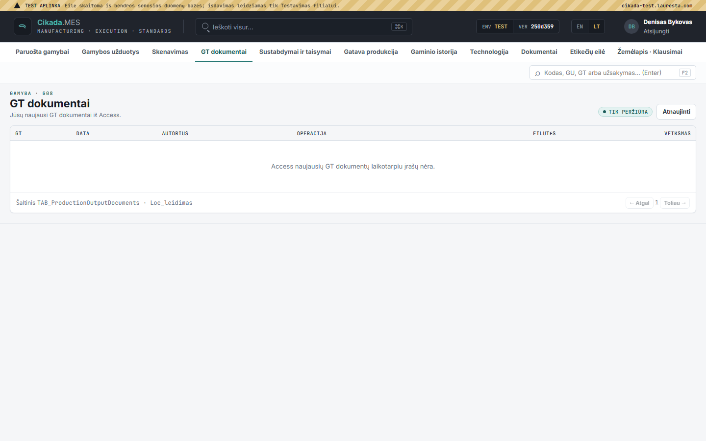

# Gamyba – Dokumentai ir Roletai šablonas

**Būsena:** dalinai (Roletai ir trapecijos dokumentai veikia; kitų ataskaitų rodomi tik duomenys)

## Kam skirta
Ekrano Gamyba skirtukas (UI: Dokumentai) leidžia pasirinktai gamybos užduočiai (GU) atidaryti gamybos dokumentus (ataskaitas). Pilnai veikia du: roletų dokumentas ir trapecijos dokumentas. Kitų ataskaitų duomenys rodomi lentele peržiūrai.

## Prieš pradedant
- Pirmiausia pasirinkite GU skirtuke (UI: Gamybos užduotys) ir spauskite (UI: Gamybos dokumentai). Be pasirinktos GU ekrane parašyta „Pirmiausia pasirinkite GU Gamybos užduotyse“ ir rodomas mygtukas (UI: Atidaryti užduotis).
- Roletai šablono redaktoriaus mygtukas matomas tik naudotojams su viena iš rolių: Admin, PortalAdmin, WarehouseAdmin, ShopfloorSupervisor, ShopfloorTechnologist.

## Žingsniai
### 1. Pasirinkti ataskaitą
1. Kairėje yra ataskaitų sąrašas (informacija iš `DIC_ProjectReports`); skaičius parodytas antraštėje.
2. Paspauskite ataskaitą. Kai ji ne Roletai ir ne Vertikalios · Trapecija, rodoma pirmųjų 50 eilučių lentelė ir užrašas, kad tai duomenų peržiūra, ne galutinis spausdinimo maketas. Dešinėje – žyma (UI: TIK PERŽIŪRA). Jei eilučių nėra, rodoma „NoData“ ir spausdinimas neprieinamas.

### 2. Roletai dokumentas
1. Pasirinkite Roletai ataskaitą (numeris 3). Rodomas lapas su cechais, užsakymais ir gaminiais.
2. Mygtukas (UI: Spausdinti) → atidaro naršyklės spausdinimo langą. Be eilučių mygtukas išjungtas („Šioje GU roletų nėra. Spausdinimas atšauktas kaip Access Report_NoData.“).

### 3. Roletai šablono redagavimas (tik su rolėmis)
1. Paspauskite (UI: Šablonų redaktorius). Grįžti galima mygtuku (UI: Ataskaita).
2. Redaktoriuje: (UI: Sekcijos) (matomumo varnelės), (UI: Dataset laukai) (pridėti lauką), stulpelių antraštės, plotis, šriftas, lygiavimas, eilutės.
3. (UI: Išsaugoti juodraštį) išsaugo pakeitimus. (UI: Atstatyti) atmeta neišsaugotus pakeitimus.
4. (UI: Publikuoti versiją) aktyvuoja išsaugotą juodraštį. Paskelbta versija nekintama, nauja versija keičia tik būsimą spausdinimą. Mygtukas aktyvus tik kai juodraštis išsaugotas ir šablonas teisingas.
5. Perjungikliu (UI: Juodraštis) / (UI: Publikuota) galima žiūrėti abi versijas.
6. Redaktoriuje galima naudoti tik duomenų laukus. SQL ir formulės neleidžiamos.

### 4. Trapecijos dokumentas
Žr. [Trapecijos dokumentas](trapecijos-dokumentas.md).

## Dažnos klaidos
- „Nepavyko įkelti ataskaitų sąrašo.“, „Nepavyko įkelti ataskaitos duomenų.“ – bandykite iš naujo.
- „Ataskaita neprieinama arba neturite teisių.“
- „Nepavyko įkelti šablono.“, „Juodraštis neišsaugotas.“, „Versija nepaskelbta. Atnaujinkite šabloną.“ – antroji reiškia, kad šabloną tuo metu pakeitė kitas naudotojas; atnaujinkite ir bandykite iš naujo.

## Dar neįgyvendinta
- Ataskaitų (išskyrus Roletai ir Trapeciją) puslapio maketas, PDF ir spausdinimas „dar tikrinami“ (taip parašyta ekrane): rodomi tik duomenys.
- Pavyzdinis režimas (kai eilės šaltinis išjungtas) imituoja 13 ataskaitų, originalių PDF atidarymą ir šablonų palyginimą – tai maketas.
