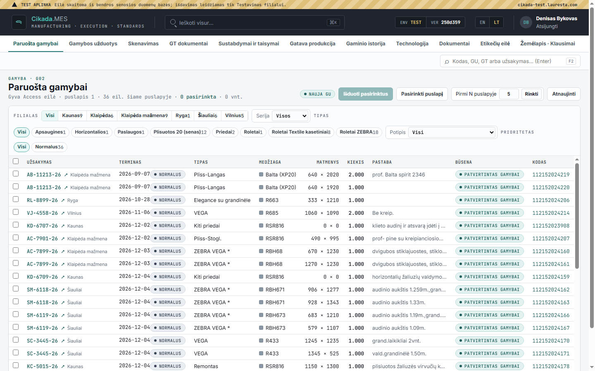

# Gamyba – Paruošta gamybai ir išdavimas į GU

**Būsena:** veikia (kai įjungtas nustatymas `Shopfloor:ProductionQueue:Enabled`; išdavimas leidžiamas tik filialui „Testavimas“)

## Kam skirta
Ekrano Gamyba skirtukas (UI: Paruošta gamybai) rodo gaminius, kurie jau patvirtinti ir laukia gamybos. Gamybos darbuotojas pasirenka eilutes ir išduoda jas į gamybos užduotį (GU). Eilė skaitoma tiesiogiai iš bendros senosios Access duomenų bazės.

## Prieš pradedant
- Prisijunkite prie Portalo ir atidarykite (UI: Gamyba) > (UI: Vykdymas) > (UI: Gamyba).
- Eilės peržiūrai specialios rolės nereikia, bet duomenų bazė gali neleisti skaityti, jei naudotojas neturi gamybos užduočių meniu teisės (tada rodoma pranešimas apie teisių trūkumą).
- Išdavimo mygtukai rodomi tik kai įjungtas `Shopfloor:ProductionTaskWrite:Enabled`. Priešingu atveju ekrane rodoma žyma (UI: TIK PERŽIŪRA).
- Šiuo metu į GU galima išduoti tik gaminius, kurių filialas yra „Testavimas“. Kitų filialų gaminių išduoti negalima, mygtukas lieka išjungtas. Ekrano apačioje paaiškinta: rašyti leidžiama tik „Testavimas“.
- Bandymų stende viršuje rodomas įspėjimas, kad eilė skaitoma iš bendros senosios duomenų bazės.

## Žingsniai
### 1. Atrinkti eilutes
1. Ekrane Gamyba atidarykite skirtuką (UI: Paruošta gamybai). Pirmas puslapis įkeliamas automatiškai.
2. Filtruokite: (UI: Filialas), (UI: Serija), (UI: Rūšis), (UI: Potipis), (UI: Prioritetas). Pasirinkimas (UI: Visi) panaikina filtrą.
3. Jei reikia konkretaus užsakymo, viršuje esančiame lauke (UI: Kodas, GU, GT arba užsakymas… (Enter)) įveskite užsakymo numerį ir paspauskite Enter: eilė bus atfiltruota pagal tą užsakymą ir viršuje parodyta (UI: Iš Sales užsakymo). Filtrą nuimsite mygtuku šalia.
4. Lentelės stulpeliai: (UI: Užsakymas), (UI: Terminas), (UI: Rūšis), (UI: Medžiaga), (UI: Matmenys), (UI: Kiekis), (UI: Pastaba), (UI: Būsena), (UI: Kodas).

### 2. Pasirinkti gaminius
1. Pažymėkite eilutes varnelėmis arba paspaudę eilutę.
2. Mygtukas (UI: Pasirinkti puslapį) pažymi visas dabartinio puslapio eilutes.
3. Laukas (UI: Pirmi N puslapyje) ir mygtukas (UI: Rinkti) pažymi pirmas N eilučių.
4. Mygtukai (UI: Atgal) ir (UI: Toliau) apačioje perjungia puslapius, (UI: Atnaujinti) iš naujo įkelia eilę.

### 3. Išduoti į GU
1. Paspauskite (UI: Išduoti pasirinktus). Mygtukas aktyvus tik kai pažymėta bent viena eilutė.
2. Lange (UI: Išduoti pasirinktas eilutes gamybai) patikrinkite: tikslinė GU (UI: Nauja GU) arba esama, eilučių kiekis, gaminių kiekis, filialai.
3. Paspauskite (UI: Išduoti porciją). Mygtukas išjungtas, jei yra ne „Testavimas“ filialo eilutė.
4. Sėkmingai išdavus sukuriama nauja GU (arba pridedama porcija prie esamos) ir atsiveria gamybos užduoties kortelė.
5. Jei GU jau pasirinkta (rodoma žyma (UI: GU #…)), nauja porcija bus pridėta prie jos. Mygtukas (UI: Nauja GU) grąžina prie naujos GU kūrimo.

## Dažnos klaidos
- „Nepavyko įkelti gamybos eilės.“ – nepavyko pasiekti API arba duomenų bazės. Paspauskite (UI: Kartoti).
- „Nepavyko įkelti eilės filtrų.“ – filtrai neįkelti, eilė vis tiek rodoma.
- „Eilėje nėra gaminių“ – pagal pasirinktus filtrus gaminių nėra.
- „Atsakymas prarastas. Prieš kartodami patikrinkite GU ir atnaujinkite eilę.“ – išdavimo atsakymas negautas. Neišduokite dar kartą, kol nepatikrinote skirtuke (UI: Gamybos užduotys), ar GU jau sukurta.
- Išdavimo klaida, kad gaminys „nebėra prieinamas“ – gaminį kitas naudotojas arba Access jau išdavė. Atnaujinkite eilę (UI: Atnaujinti) ir pasirinkite iš naujo.

## Dar neįgyvendinta
- Išdavimas kitų filialų gaminiams kol kas išjungtas sąmoningai.
- Kai nustatymas `Shopfloor:ProductionQueue:Enabled` išjungtas, skirtukas rodo pavyzdinius duomenis su sąlyginiais filialais ir tipais. Tuomet išdavimas neveikia (tik imitacija).
