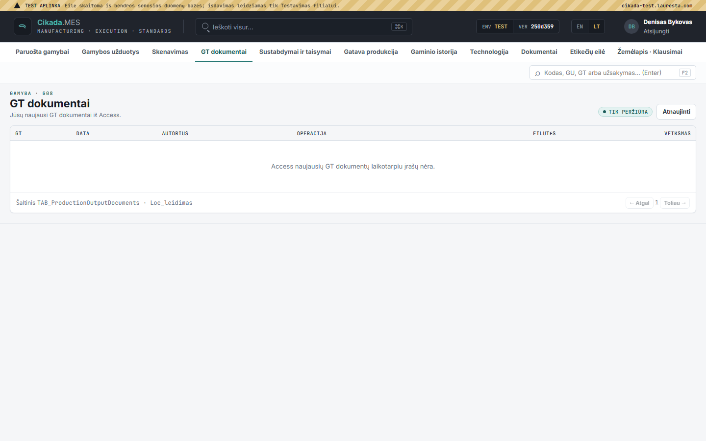

# Gamyba – GT dokumentai, gaminio istorija, remontai

**Būsena:** dalinai (veikia tik peržiūra; keisti negalima)

## Kam skirta
Ekrano Gamyba skirtukai (UI: GT dokumentai), (UI: Gaminio istorija) ir (UI: Sustabdymai ir taisymai) > (UI: Remontai) leidžia peržiūrėti gamybos išdavimo dokumentus, vieno gaminio perėjimų istoriją ir senosios sistemos remontus. Duomenys skaitomi iš Access duomenų bazės, jų keisti čia negalima.

## Prieš pradedant
- Turi būti įjungtas `Shopfloor:ProductionQueue:Enabled`. Kitaip šie ekranai rodo pavyzdinius duomenis.
- Rodomi tik tie įrašai, kuriuos leidžia matyti naudotojo teisės duomenų bazėje.

## Žingsniai
### 1. GT dokumentų sąrašas
1. Ekrane Gamyba atidarykite (UI: GT dokumentai).
2. Lentelėje: GT numeris, (UI: Data), (UI: Autorius), (UI: Operacija), eilučių kiekis. Rodomi naujausi dokumentai; jei jų nėra, parašyta „Access naujausių GT dokumentų laikotarpiu įrašų nėra.“
3. Puslapiuokite mygtukais (UI: Atgal) ir (UI: Toliau).

### 2. GT dokumento eilutės
1. Paspauskite dokumentą. Rodoma lentelė: (UI: Laikas), (UI: Kodas), (UI: Gaminys), (UI: Perėjimas).
2. Jei skenų nėra, rodoma „Skenų dar nėra“. Skenų šalinimo ar naujo GT kūrimo gyvame režime nėra.

### 3. Gaminio istorija
1. Atidarykite (UI: Gaminio istorija) arba viršuje laukelyje įveskite 12 skaitmenų kodą ir paspauskite Enter (laukelis atpažįsta būtent 12 skaitmenų).
2. Rodoma gaminio kortelė (tipas, matmenys, medžiaga, užsakymas, filialas, būsena, užsakovas) ir (UI: Dokumentų istorija): užsakymo įrašymas, GU/GT dokumentai su perėjimais, remontai.
3. Paspaudus GU numerį atsidaro ta gamybos užduotis.

### 4. Remontai
1. Atidarykite (UI: Sustabdymai ir taisymai) ir perjunkite į (UI: Remontai).
2. Filtrai: (UI: Visi), (UI: Nebaigti), (UI: Nenurodytas faktinis gedimas). Užrašas (UI: Legacy remontai · tik peržiūra) primena, kad keisti negalima.
3. Paspauskite eilutę, kad pamatytumėte priežastį, kliento nurodytą ir faktinį gedimą.

## Dažnos klaidos
- „Nepavyko įkelti GT dokumentų.“, „Nepavyko įkelti gaminio istorijos.“, „Nepavyko įkelti remontų.“ – ryšio ar teisių klaida; bandykite iš naujo.
- „Kodą turi sudaryti 12 skaitmenų.“ – neteisingas gaminio kodas.
- „Gaminys nerastas arba neturite teisių.“ – kodo nėra arba jo matyti negalima.
- „Dokumentas neprieinamas arba neturite teisių.“

## Dar neįgyvendinta
- Remontų keitimas išjungtas „kol nepatikrintos legacy įrašymo taisyklės“ (taip parašyta ekrane).
- GT dokumento sukūrimas, skeno pašalinimas ir tai, kas susiję su skenavimu, gyvame režime neveikia. Žr. [Pavyzdiniai ekranai](gamyba-pavyzdiniai-ekranai.md).
