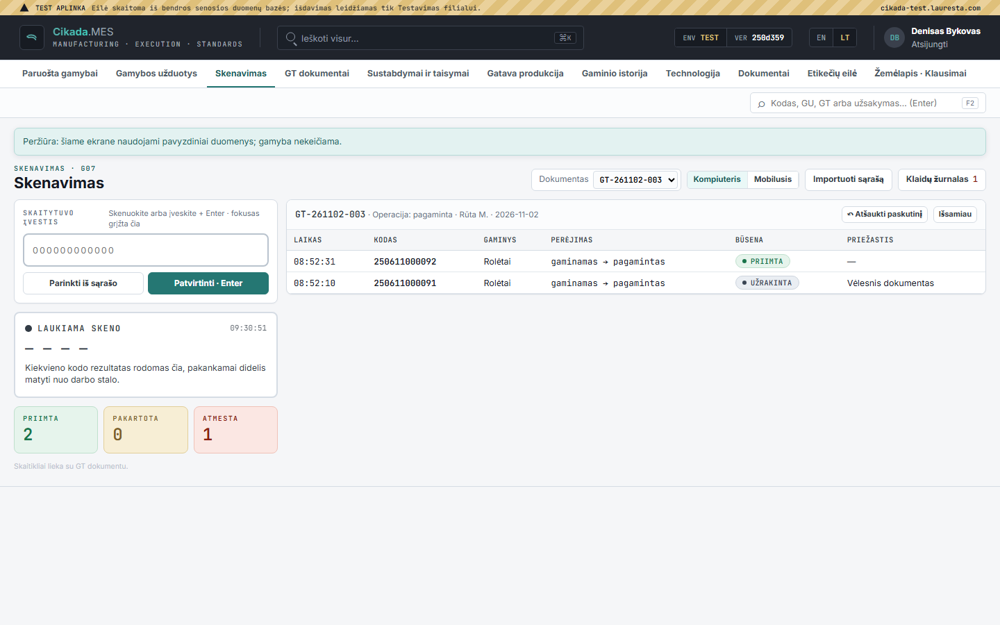

# Gamyba – ekranai su pavyzdiniais duomenimis

**Būsena:** laikina (zagluška)

## Kam skirta
Ekrane Gamyba yra skirtukai, kurie kol kas tik rodo būsimą sąsają su sugalvotais duomenimis. Operatorius ar vadovas jais gamybos dirbti negali: niekas nekeičiama senojoje duomenų bazėje. Šis puslapis išvardija, ką jie rodo.

## Kaip atpažinti
Kai serveryje įjungta gamybos eilė (`Shopfloor:ProductionQueue:Enabled`), tokio ekrano viršuje rodomas pranešimas: „Peržiūra: šiame ekrane naudojami pavyzdiniai duomenys; gamyba nekeičiama.“ Tikri ekranai yra tik (UI: Paruošta gamybai), (UI: Gamybos užduotys), (UI: GT dokumentai), (UI: Gaminio istorija), (UI: Dokumentai) ir (UI: Remontai).

## Ką rodo kiekvienas skirtukas
### Skenavimas (UI: Skenavimas)
Stalinio kompiuterio ir telefono režimo maketas: laukas (UI: Skaitytuvo įvestis), būsenos žyma (UI: Skenas priimtas)/(UI: Pakartota)/(UI: Atmesta), skaitikliai, pasirinkimas rankiniu būdu, kodų importas, klaidų žurnalas. Skenai ir dokumentai yra kode įrašyti pavyzdžiai; į duomenų bazę nieko nerašoma.

### Sustabdymai (UI: Sustabdymai ir taisymai) > (UI: Stabdymai)
Stabdymo dokumentų sąrašas ir formos laukai (serija KVT/KLP, grupė 2611/2610, priežastis iš fiksuoto sąrašo). Ekrane parašyta „Legacy stabdymo taisyklės dar tikrinamos“. Dokumentai yra pavyzdiniai. Atskira dalis (UI: Remontai) yra gyva (žr. [GT, istorija, remontai](gamyba-gt-istorija-remontai.md)).

### Gatava produkcija (UI: Gatava produkcija)
Perdavimo ir siuntimo dokumentų maketas. Sąskaita „lieka apribota“ (reikalinga finansų patikra), jos kūrimo čia nėra.

### Technologija (UI: Technologija)
Gaminių tipų, parametrų ir formulių maketas su bandymo skaičiuokle. Formulė skaičiuojama ant bandomųjų reikšmių; išsaugojimas neveikia kaip tikras.

### Etikečių eilė (UI: Etikečių eilė)
Etikečių spausdinimo užduočių (Zebra/EPL) maketas: pauzė, tęsimas, atšaukimas, pakartojimas. Kode nėra ryšio su spausdintuvu; darbo vietos COM prievadas „priklauso Access“.

### Žemėlapis (UI: Žemėlapis · Klausimai)
Projektavimo dokumentas pačioje sistemoje: ekranų žemėlapis, būsenų matrica ir atviri klausimai (P01–P12, D01–D03), pvz., kurią eilės užklausą laikyti pagrindu, ar reikia garsinio signalo. Tai ne darbo ekranas.

### Prototipo valdikliai
Papildomi jungikliai (rolė, filialas, klaidų imitacija) matomi tik atidarius puslapį su parametru `prototypeControls`. Tai kūrėjų priemonė, ne produkto dalis.

## Dar neįgyvendinta
Viskas šiame puslapyje. Kol tai neįgyvendinta, skenavimas, sustabdymai, gatavos produkcijos perdavimas, technologijos formulės ir etikečių spausdinimas atliekami senojoje Access sistemoje.
