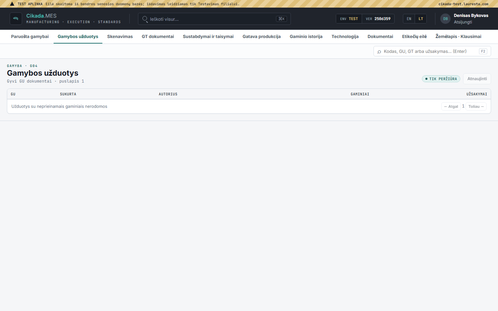

# Gamyba – Gamybos užduotys (GU)

**Būsena:** veikia (peržiūra; porcijos pridėjimas – tik filialui „Testavimas“)

## Kam skirta
Ekrano Gamyba skirtukas (UI: Gamybos užduotys) rodo gamybos užduočių (GU) dokumentus, kuriuos sukūrė ir naudoja Access sistema. Čia galima atsidaryti GU, pamatyti jos sudėtį, pridėti dar vieną porciją ir pereiti prie gamybos dokumentų.

## Prieš pradedant
- Eilės šaltinis turi būti įjungtas (`Shopfloor:ProductionQueue:Enabled`).
- Rodomos tik tos GU, kurių visos eilutės naudotojui prieinamos. GU, turinčios paslėptų eilučių, į sąrašą nepatenka (apačioje užrašyta apie tai).

## Žingsniai
### 1. Atidaryti sąrašą
1. Ekrane Gamyba spauskite skirtuką (UI: Gamybos užduotys).
2. Sąrašo stulpeliai: GU numeris, (UI: Sukurta), (UI: Autorius), gaminių ir užsakymų kiekis.
3. Puslapiuojama mygtukais (UI: Atgal) ir (UI: Toliau).

### 2. Atidaryti GU kortelę
1. Paspauskite eilutę. Atsidaro GU kortelė su numeriu, sukūrimo laiku, autoriumi, eilučių ir užsakymų skaičiumi.
2. Lentelė (UI: Sudėtis) rodo gaminių kodus, užsakymą, tipą, medžiagą, matmenis ir kiekį. Pavadinimas pažymėtas (UI: Gyvas Access dokumentas).
3. Jei įrašymas išjungtas, kortelėje rodoma žyma (UI: TIK PERŽIŪRA).

### 3. Pridėti porciją
1. Kortelėje paspauskite (UI: Pridėti porciją). Mygtukas rodomas tik kai įjungtas `Shopfloor:ProductionTaskWrite:Enabled`.
2. Sistema grąžina į skirtuką (UI: Paruošta gamybai) su pasirinkta tikslo GU. Toliau išduokite eilutes pagal [Paruošta gamybai](gamyba-eile-ir-isdavimas.md).

### 4. Atidaryti gamybos dokumentus
1. Kortelėje paspauskite (UI: Gamybos dokumentai). Atsidaro skirtukas (UI: Dokumentai) su pasirinkta GU. Žr. [Gamybos dokumentai](gamyba-dokumentai.md).

## Dažnos klaidos
- „Nepavyko įkelti gamybos užduočių.“ ir „Nepavyko įkelti užduoties.“ – laikinas ryšio arba teisių klaida; atidarykite iš naujo.
- „Nėra prieinamų užduočių“ – naudotojui neprieinama nė viena GU.

## Dar neįgyvendinta
- Kortelės šoniniai blokai (UI: Etiketės) ir (UI: Sandėlis), taip pat sudėties istorija rodomi tik pavyzdiniame režime (kai eilės šaltinis išjungtas). Gyvame režime jų nėra.
