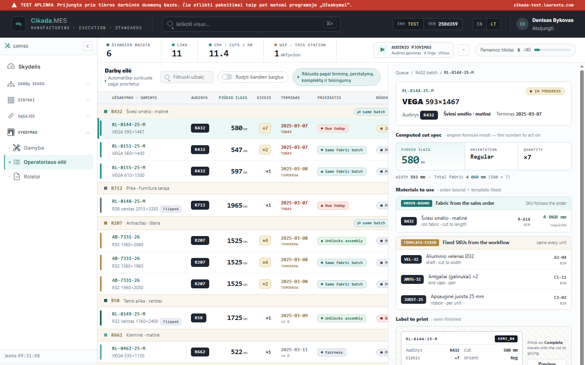

# Operatoriaus darbų eilė

**Būsena:** laikina (zagluška)

## Kam skirta
Puslapis (UI: Operatoriaus eilė) ateityje turi būti darbo vietos operatoriaus ekranas: eilė užduočių, pradėti, užbaigti ar sustabdyti darbą. Šiandien tai statinis HTML prototipas su sugalvotais duomenimis. Su gamybos duomenų baze ar API jis nesusijęs.

## Ką rodo ekranas
Puslapis `/shopfloor/operator-work-queue` yra tik rėmelis (iframe), kuriame atidaromas failas `prototypes/operator-work-queue.html`. Jame:

1. Darbo vieta „AUDINIO PJOVIMAS“ (Fabric cutting · Line A · Vilnius) ir meniu kitoms darbo vietoms su sugalvotomis eilių apimtimis.
2. Rodikliai (liko, pjūviai per valandą, nebaigta gamyba) su pastoviais skaičiais.
3. Apie dvylika eilučių su kodų pavyzdžiais (pvz., RL-8144-25-M, AB-7331-26), gaminio pavadinimais (VEGA, R32, R38) ir matmenimis.
4. Gaminio kortelė su pjovimo ilgiu, medžiagomis ir mygtukais (UI: Start job), (UI: Stop), (UI: Complete…). Langai užbaigimui ir sustabdymo priežasčiai (pvz., „Material missing“, „Fabric flaw — scrap“).
5. Puslapis neturi jokių užklausų į serverį, todėl visi paspaudimai keičia tik ekraną naršyklėje ir dingsta perkrovus puslapį.

## Dar neįgyvendinta
- Jokių tikrų užduočių, darbo vietų ar gaminių. Dalis užrašų išversta į lietuvių kalbą, dalis liko angliški.
- Užduočių pradėjimas, užbaigimas ir sustabdymas nieko neišsaugo.
- Tikras gamybos darbas atliekamas ekrane [Gamyba](gamyba-eile-ir-isdavimas.md) ir puslapyje [Roletai](roletai.md).
