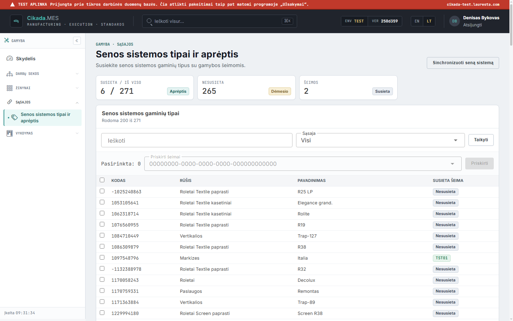

# Senos sistemos tipai ir aprėptis

**Būsena:** veikia

## Kam skirta
Puslapis (UI: Senos sistemos tipai ir aprėptis) skirtas technologui. Jis rodo, kurie senosios Access sistemos gaminių tipai jau priskirti gamybos šeimoms (darbų sekų šablonams), o kurie dar ne, ir leidžia tipus priskirti pasirinktai šeimai.

## Prieš pradedant
- Turi būti bent viena [gamybos šeima](workflows.md).
- Tipų sąrašas pasiimamas iš senosios duomenų bazės. Jei sąrašo nėra ar jis pasenęs, paspauskite (UI: Sinchronizuoti seną sistemą). Bandymų stende šaltinis yra SQL, o kai nustatyta `Stub`, sąrašas yra fiksuotas pavyzdys.

## Žingsniai
### 1. Peržiūrėti aprėptį
1. Atidarykite (UI: Sąsajos) > (UI: Senos sistemos tipai ir aprėptis).
2. Trys kortelės: (UI: Susieta / iš viso), (UI: Nesusieta) (žyma (UI: Dėmesio), kai yra nesusietų; (UI: Baigta), kai visi susieti) ir (UI: Šeimos).

### 2. Sinchronizuoti
1. Paspauskite (UI: Sinchronizuoti seną sistemą). Mygtukas rodo (UI: Sinchronizuojama…). Pavykus: „Senos sistemos gaminių tipai sinchronizuoti.“

### 3. Rasti ir pasirinkti tipus
1. Laukelyje (UI: Ieškoti) įveskite tekstą ir paspauskite Enter. Sąraše (UI: Sąsaja) pasirinkite (UI: Visi), (UI: Susieta) arba (UI: Nesusieta); paspauskite (UI: Taikyti). Rodoma iki 200 įrašų ("Rodoma X iš Y").
2. Pažymėkite tipus varnelėmis. Antraštės varnelė pažymi visus rodomus. Skaičius rodomas kaip „Pasirinkta: N“.

### 4. Priskirti šeimai
1. Sąraše (UI: Priskirti šeimai) pasirinkite šeimą.
2. Paspauskite (UI: Priskirti). Pavykus: „Priskirta gaminių tipų: N.“ Stulpelyje (UI: Susieta šeima) atsiranda šeimos kodas.
3. Mygtukas aktyvus tik kai pažymėtas bent vienas tipas ir pasirinkta šeima.

## Dažnos klaidos
- „Priskirti nepavyko.“, „Sinchronizuoti nepavyko.“ – serveris atmetė veiksmą; bandykite iš naujo.
- „Gamybos API nepasiekiama.“
- „Nė vienas tipas neatitinka filtrų.“

## Dar neįgyvendinta
- Ekrane nėra mygtuko sąsajai panaikinti (serveryje toks veiksmas yra, bet puslapis jo nenaudoja).
