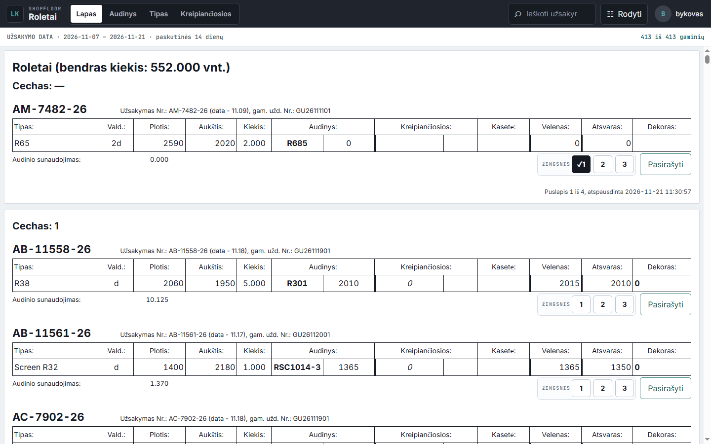
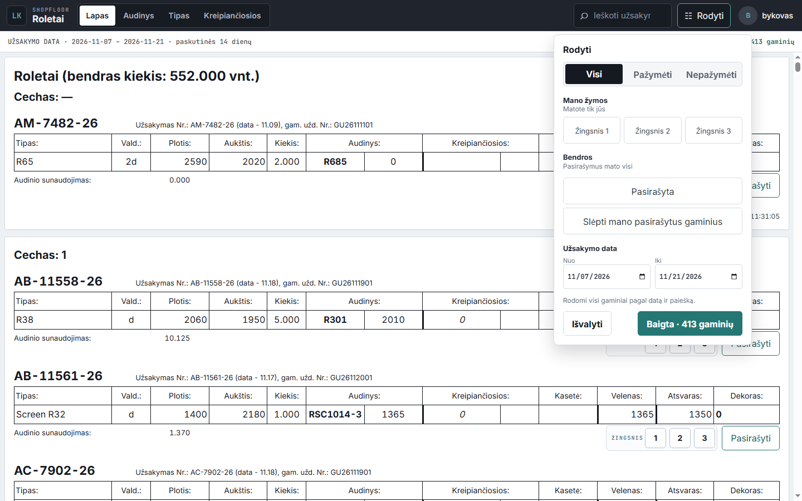

# Roletai (gamyba be popieriaus)

**Būsena:** veikia (kai įjungtas `Shopfloor:ProductionQueue:Enabled`; atskiras pilno ekrano puslapis be šoninio meniu)

## Kam skirta
Puslapis (UI: Roletai) skirtas roletų gamintojams. Jis pakeičia popierinį roletų gamybos lapą: rodo gaminius, kurie šiuo metu gaminami, leidžia kiekvienam darbuotojui pažymėti savo atliktus žingsnius ir pasirašyti, kad savo darbą baigė. Duomenys imami iš senosios Access duomenų bazės. Žymas ir parašus saugo Shopfloor modulis.

## Prieš pradedant
- Prisijunkite prie Portalo. Rolės nereikalingos, bet duomenų bazė rodo tik jūsų filialų užsakymus (pagal Access teises) ir reikia gamybos užduočių arba gatavos produkcijos meniu teisės.
- Rodomi tik roletų tipo gaminiai, kurie yra gamyboje; anuliuoti, sugadinti ir remonte esantys neįtraukiami.
- Žymėti ir pasirašyti galima tik gaminiams, kurie šiuo metu gaminami. Kitų gaminių mygtukai išjungti.

## Žingsniai
### 1. Atidaryti ir pasirinkti rodinį
1. Atidarykite (UI: Gamyba) > (UI: Vykdymas) > (UI: Roletai). Puslapis atsidaro pilname ekrane; (UI: LK) viršutiniame kairiajame kampe grąžina į Gamybą.
2. Pagal nutylėjimą rodomi paskutinių 14 dienų užsakymai (pagal užsakymo datą).
3. Viršuje pasirinkite rodinį: (UI: Lapas) (spausdinamas lapas pagal cechus), (UI: Audinys), (UI: Tipas), (UI: Kreipiančiosios) (grupavimas). Pasirinkimas įsimenamas jūsų naršyklėje.

### 2. Rasti užsakymą
1. Laukelyje (UI: Ieškoti užsakymo) įveskite užsakymo numerį ir paspauskite Enter. Paieška ieško per visas datas.
2. (UI: Išvalyti paiešką) grąžina datų rodinį.
3. Pranešimai: „Užsakymas … nerastas arba neturite teisės jo matyti.“, „Užsakymas … yra, tačiau jame nėra roletų.“, „Užsakymas … anuliuotas.“

### 3. Filtruoti
1. Paspauskite (UI: Rodyti). Skydelyje pasirinkite (UI: Visi), (UI: Pažymėti) arba (UI: Nepažymėti).
2. (UI: Mano žymos) (matote tik jūs): (UI: Žingsnis 1), (UI: Žingsnis 2), (UI: Žingsnis 3).
3. (UI: Bendros) (parašus mato visi): (UI: Pasirašyta), (UI: Slėpti mano pasirašytus gaminius).
4. Skiltyje (UI: Užsakymo data) nurodykite intervalą (UI: Nuo) – (UI: Iki). Paieškos metu data neveikia.
5. (UI: Baigta · N gaminių) uždaro skydelį, (UI: Išvalyti) nuima filtrus.

### 4. Pažymėti žingsnį
1. Prie gaminio paspauskite skaičių 1, 2 arba 3 prie užrašo (UI: ŽINGSNIS). Pažymėtas žingsnis gauna varnelę.
2. Paspauskite dar kartą, kad atžymėtumėte. Žymos yra asmeninės, kiti naudotojai jų nemato. Apačioje trumpam pasirodo (UI: Saugoma…) / (UI: Išsaugota). Nutrūkus ryšiui parašyta „Neišsaugota — nutrūko ryšys“, su mygtuku (UI: Bandyti dar kartą).

### 5. Pasirašyti darbą
1. Prie gaminio paspauskite (UI: Pasirašyti).
2. Lange (UI: Patvirtinti pasirašymą?) paspauskite (UI: Patvirtinti). Parašo vardas ir laikas matomi visiems.
3. Savo parašą atšaukite paspaudę (UI: ✓ Jūs · laikas), tada (UI: Atšaukti pasirašymą). Kiti darbuotojai parašo nebemato.
4. Kai kažkas pasirašo, kiti atidaryti langai atsinaujina patys.

## Dažnos klaidos
- „Nepavyko įkelti roletų. Bandykite dar kartą.“ – ryšio ar teisių klaida.
- „Pasirinkite teisingą datų intervalą.“
- „Pasirašymo išsaugoti nepavyko. Patikrinkite ryšį ir bandykite dar kartą.“
- „Nerasta atitinkančių gaminių.“ – nuimkite filtrus mygtuku (UI: Išvalyti filtrus).

## Ką reiškia žymos
- (UI: ŽINGSNIS) 1–3: asmeniniai žingsnių žymekliai. Kodas nenurodo, ką kuris žingsnis reiškia, tai nusprendžia gamykla.
- (UI: Pasirašyta): darbuotojas patvirtino, kad jo darbas su gaminiu baigtas.
