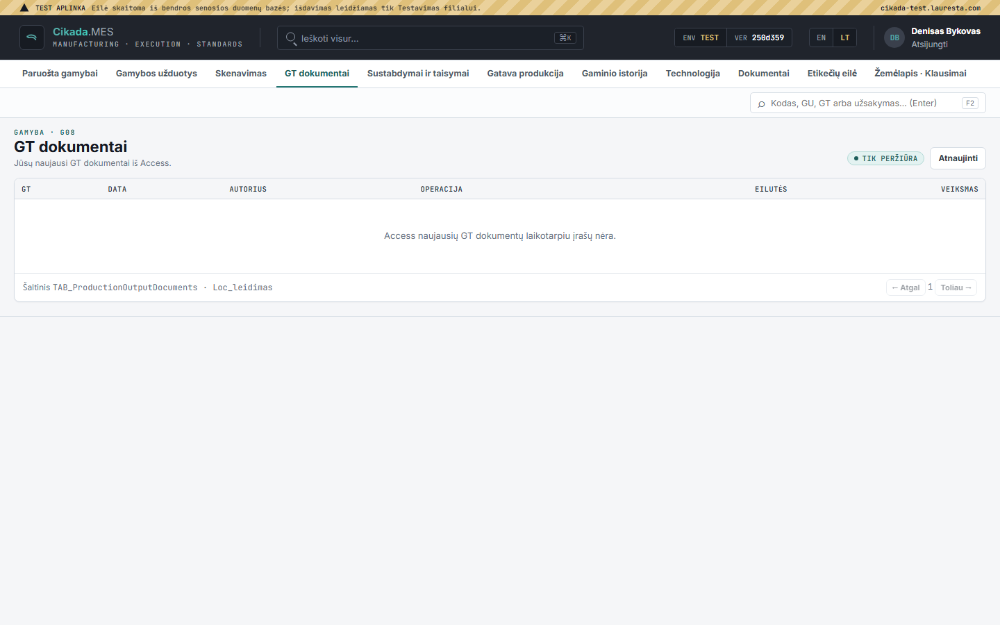

# Gamyba – Trapecijos dokumentas

**Būsena:** veikia (peržiūra ir spausdinimas visiems; skaičiavimo išsaugojimas tik su Access gamybos užduočių meniu teise)

## Kam skirta
Trapecijos dokumentas (ataskaita (UI: Vertikalios · Trapecija), pažymėta (UI: Nauja)) apskaičiuoja trapecinių vertikalių žaliuzių juostų ilgius ir pateikia gamybos lapą: vaizdą iš priekio, pjovimo vaizdą ir juostų pjovimo sąrašą. Tai atskiras komponentas, atidaromas ekrano Gamyba skirtuke (UI: Dokumentai). Jo atskiro adreso nėra.

## Prieš pradedant
- Reikia GU, kurioje yra trapecijų. Jei jų nėra, rodoma „Šioje GU trapecijų nėra“ ir dokumentas nekuriamas.
- Skaičiavimo įvedimui ir išsaugojimui reikia teisės: kodas tikrina, ar naudotojas turi gamybos užduočių meniu punktą Access duomenų bazėje (arba yra `sa`). Be jos ekrane rašoma „Redaguoti reikia teisės Gamyba · Dokumentai · Redaguoti“, o dokumentą galima tik peržiūrėti ir spausdinti išsaugotas versijas.
- Palaikomi tik kai kurie trapecijos tipai; kitiems rodoma „Šiai trapecijos rūšiai reikia atskiro technologinio profilio.“

## Žingsniai
### 1. Atidaryti dokumentą
1. Ekrane Gamyba atidarykite (UI: Dokumentai).
2. Galima pasirinkti vieną iš 20 paskutinių užsakymų: sąraše (UI: Paskutiniai trapecijos užsakymai) pasirinkite „Pasirinkite vieną iš 20 paskutinių užsakymų…“. Arba atidarykite GU per (UI: Gamybos užduotys) > (UI: Gamybos dokumentai) ir pasirinkite (UI: Vertikalios · Trapecija).
3. Viršuje pasirinkite gaminį iš sąrašo (gaminio kodas, užsakymas, pozicija, valdymo tipas).

### 2. Patikrinti ir pakoreguoti matmenis
1. Skiltyje (UI: Skaičiavimo matmenys) matomi užsakymo duomenys: (UI: Tipas) A arba B, (UI: Juostos plotis) 89 arba 127 mm, (UI: Aukštoji pusė · vaizdas iš patalpos) Kairėje/Dešinėje, AD (plotis), CD (didesnis aukštis), AB (mažesnis aukštis), (UI: Juostos išsikišimas).
2. Prie kiekvieno lauko rodomas šaltinis: iš užsakymo, iš medžiagos, iš gaminio, įvesta rankiniu būdu. Užpildytas reikšmes galima patikslinti; patikslinimai saugomi versijoje, užsakymas nekeičiamas. Rankiniu būdu pakeista reikšmė žymima žvaigždute.
3. Jei užsakymo ir medžiagos duomenys nesutampa, rodomas įspėjimas (UI: Šaltiniai nesutampa) ir reikia pasirinkti plotį.
4. Rezultatas perskaičiuojamas automatiškai. Apačioje: „Apskaičiuota · N juostų · X m komplektui“ arba „Užpildykite …, kad būtų apskaičiuota“.
5. Perjungikliu (UI: Vaizdas iš priekio) / (UI: Pjovimo vaizdas) keiskite brėžinį. Spustelėjus juostą brėžinyje matoma jos pjovimo ir galutinė ilgio reikšmė.

### 3. Išsaugoti ir spausdinti
1. Paspauskite (UI: Išsaugoti skaičiavimą). Mygtukas aktyvus, kai matmenys išsamūs, skaičiavimas pavyko, yra pakeitimų ir yra redagavimo teisė. Sukuriama nauja versija v1, v2 …
2. (UI: Sukurti PDF) sukuria ir archyvuoja išsaugotos versijos PDF ir atidaro jį naujame lange.
3. (UI: Spausdinti v…) siunčia išsaugotą versiją į naršyklės spausdinimo langą. Spausdinti galima tik išsaugotą versiją, be neišsaugotų pakeitimų.
4. Sąraše (UI: Versijos · archyvas) atidarykite senesnę versiją tik peržiūrai; (UI: Grįžti į dabartinę) grąžina.
5. Jei po išsaugojimo užsakymas pasikeitė, rodomas įspėjimas su mygtukais (UI: Taikyti užsakymo reikšmes) arba (UI: Palikti išsaugotą).

## Dažnos klaidos
- „Skaičiavimo paslauga nepasiekiama“ – rezultato nėra ir spausdinti negalima; (UI: Bandyti dar kartą).
- „AD už žinyno ribų“, „Daugiau nei 78 juostos“, „Su šiais matmenimis juostos išeina už angos ribų“, „CD turi būti ≥ AB“ – patikrinkite matmenis.
- „PDF nesukurtas.“ – serverio PDF generatorius grąžino klaidą; išsaugotas skaičiavimas nepaveiktas.
- „Pirmiausia išsaugokite“ – spausdinama tik iš išsaugotos versijos.
- „Šis užsakymas arba jo gamybos dokumentas nebepasiekiamas.“

## Dar neįgyvendinta
- Trapecijos šablonų redaktorius nepasiekiamas (ekrane: „Trapecijos šablonų redaktorius dar nepasiekiamas.“).
- Skaičiavimas atitinka senąjį Excel (`trapnew.xls`) dokumentą; kiti trapecijos tipai nepalaikomi.
