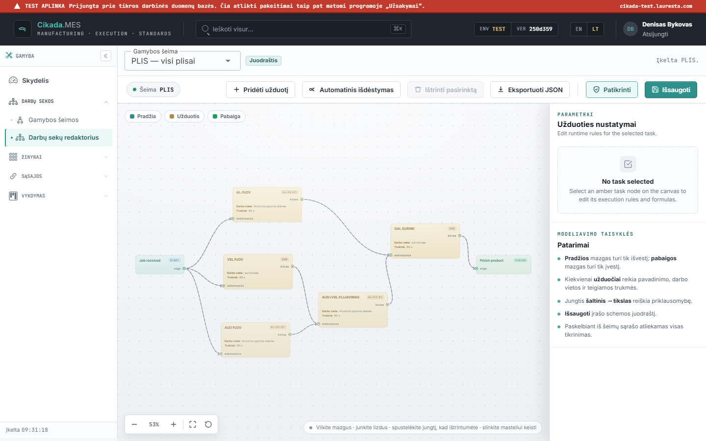

# Darbų sekų redaktorius

**Būsena:** veikia (schemos išsaugojimas ir patikra; paskelbiama iš šeimų sąrašo)

## Kam skirta
Puslapis (UI: Darbų sekų redaktorius) skirtas technologui braižyti gamybos šeimos schemą: užduotis (mazgus) ir jų tarpusavio priklausomybes. Schema saugoma serveryje prie pasirinktos gamybos šeimos.

## Prieš pradedant
- Turi būti sukurta [gamybos šeima](workflows.md).
- Turi būti sukurtos aktyvios [darbo vietos](zinynai.md): jos siūlomos užduoties laukelyje (UI: Darbo vieta).
- Redaktorius rodomas viename lange su Blazor puslapiu; tam naudojamas vidinis HTML rėmelis, kuris keičiasi žinutėmis su puslapiu.

## Žingsniai
### 1. Pasirinkti šeimą
1. Atidarykite (UI: Darbų sekos) > (UI: Darbų sekų redaktorius), arba sąraše paspauskite (UI: Redaktorius) prie šeimos.
2. Viršuje sąraše (UI: Gamybos šeima) pasirinkite šeimą. Šalia rodoma jos būsena, o dešinėje trumpas pranešimas („Pasirinkite gamybos šeimą.“, „Įkelta …“, „Išsaugota.“).

### 2. Sudėlioti schemą
1. Paspauskite (UI: Pridėti užduotį), kad pridėtumėte mazgą. Pradžios mazgas turi tik išvestį, pabaigos mazgas tik įvestį.
2. Pažymėkite užduotį drobėje ir dešinėje užpildykite: pavadinimas, aprašymas, (UI: Darbo vieta), trukmė sekundėmis. Tipas rodomas, bet nekeičiamas.
3. Sujunkite mazgus linijomis (šaltinis → tikslas): ši jungtis reiškia priklausomybę.
4. Mygtukai: (UI: Automatinis išdėstymas), (UI: Ištrinti pasirinktą) (aktyvus kai pažymėtas mazgas), (UI: Eksportuoti JSON) (parodo JSON ir leidžia kopijuoti ar atsisiųsti; serveryje nieko nekeičia). Mastelis valdomas mygtukais drobės kampe.

### 3. Patikrinti
1. Paspauskite (UI: Patikrinti). Atidaroma ataskaita su įvertinimu ir pastabomis. Patikra serveryje nieko neišsaugo.
2. Klaidos (būtina ištaisyti): E1 viena pradžia, E2 viena pabaiga, E3 nepasiekiama užduotis, E4 aklavietė, E5 ciklas, E6 sugedusi jungtis (nuoroda į neegzistuojantį mazgą, kilpa, dublikatas), E7 neužbaigta užduotis (nėra pavadinimo, darbo vietos ar teigiamos trukmės).
3. Įspėjimai ir užuominos (neblokuoja paskelbimo): pvz., W1 šakų disbalansas, W3 siauriausia vieta, W4 netikras lygiagretumas, W5 nebaigtos gamybos rizika, W8 linijų apkrovos disbalansas, W9 perteklinė priklausomybė, W11 ilga vienos linijos grandinė.

### 4. Išsaugoti
1. Paspauskite (UI: Išsaugoti). Serveris tikrina lanksčiau nei paskelbimo metu: nepriims tik sugedusios struktūros. Pavykus rodoma „Darbų sekos schema išsaugota.“
2. Išsaugojus schema nepaskelbiama automatiškai. Paskelbimas vyksta puslapyje [Gamybos šeimos](workflows.md) (UI: Paskelbti), kur atliekama pilna patikra.

## Dažnos klaidos
- „Nepavyko įkelti darbų sekos.“ – šeima nerasta arba API nepasiekiama.
- „Neteisingas darbų sekos ID.“ / „Neteisingi schemos duomenys.“ – gedimas perduodant duomenis iš redaktoriaus; perkraukite puslapį.
- Išsaugojimo klaida su schemos klaidų sąrašu – ištaisykite nurodytus mazgus.
- Jei redaktorius lieka tuščias, jis pats paprašo puslapio perduoti šeimą dar kartą; jei neišeina, pasirinkite šeimą sąraše iš naujo.

## Dar neįgyvendinta
- Paskelbtos šeimos neprijungtos prie gamybos vykdymo.
