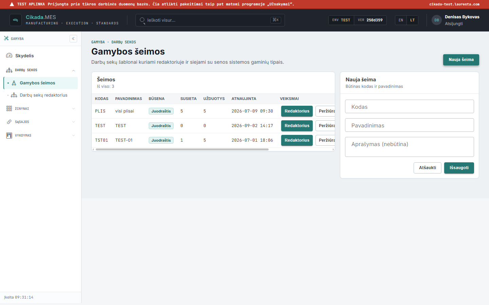

# Gamybos šeimos (darbų sekų šablonai)

**Būsena:** veikia (šablonų valdymas; gamybos vykdymas dar nesujungtas su šeimomis)

## Kam skirta
Puslapis (UI: Gamybos šeimos) skirtas gamybos technologui. Gamybos šeima yra darbų sekos šablonas: užduotys, jų eilės tvarka, darbo vietos ir trukmės. Čia šeimas galima sukurti, klonuoti, peržiūrėti, paskelbti ir ištrinti, o schemai brėžti atidaromas [redaktorius](workflow-editor.md).

## Prieš pradedant
- Prisijunkite prie Portalo. Atskirų rolių kodas netikrina.
- Prieš kuriant užduotis redaktoriuje turi būti sukurtos [darbo vietos](zinynai.md).

## Žingsniai
### 1. Sukurti šeimą
1. Atidarykite (UI: Darbų sekos) > (UI: Gamybos šeimos).
2. Paspauskite (UI: Nauja šeima).
3. Užpildykite (UI: Kodas), (UI: Pavadinimas) ir, jei reikia, (UI: Aprašymas (nebūtina)). Kodas ir pavadinimas privalomi. Kodas turi būti unikalus.
4. Paspauskite (UI: Išsaugoti). Pranešimas „Šeima sukurta.“ Naujos šeimos būsena (UI: Juodraštis).

### 2. Klonuoti
1. Eilutėje paspauskite (UI: Klonuoti). Kodas gauna priedą „-COPY“, o pavadinimas „(copy)“. Pakeiskite ir paspauskite (UI: Išsaugoti).

### 3. Peržiūrėti
1. Paspauskite (UI: Peržiūra). Dešinėje parodoma bandomoji užduočių tvarka: (UI: Žingsnis), (UI: Užduotis), (UI: Aprašymas), (UI: Darbo vieta), (UI: Trukmė).
2. Jei schema netinkama, vietoje lentelės rodomos klaidos, pvz., „Schemoje turi būti tik vienas pradžios mazgas.“, „Užduotis „X“ neturi darbo vietos.“, „Schemoje yra ciklas.“ Peržiūra nieko neišsaugo.

### 4. Paskelbti
1. Paspauskite (UI: Paskelbti). Prieš paskelbiant serveris atlieka pilną schemos patikrą. Jei yra klaidų, šeima nepaskelbiama ir parodomas klaidų sąrašas. Pavyzdžiai: viena pradžia ir viena pabaiga, nepasiekiamos užduotys, ciklai, neužbaigtos užduotys (be pavadinimo, darbo vietos ar trukmės).
2. Pavykus rodoma „{kodas} paskelbta.“, būsena (UI: Paskelbta).

### 5. Redaguoti schemą
1. Paspauskite (UI: Redaktorius). Atsidaro [Darbų sekų redaktorius](workflow-editor.md) su šia šeima.

### 6. Ištrinti
1. Paspauskite (UI: Ištrinti). Klausimo prieš trinant nėra, šeima trinama iš karto.
2. Šeimos, prie kurios priskirtas bent vienas senos sistemos gaminio tipas, ištrinti negalima: serveris grąžina klaidą, kad šeima negali būti ištrinta, nes prie jos priskirti tipai. Pirmiausia pašalinkite sąsajas (žr. [Tipų sąsajos](produktu-tipu-sasajos.md)).

## Ką reiškia būsenos
- (UI: Juodraštis): šeima redaguojama, dar nepaskelbta.
- (UI: Paskelbta): šeima praėjo patikrą.
- (UI: Archyvuota): būsena yra duomenų modelyje, bet šiuo metu jos nustatyti per ekraną negalima.
- Stulpelis (UI: Susieta) rodo, kiek senos sistemos tipų priskirta šeimai; (UI: Užduotys) – kiek joje užduočių.

## Dažnos klaidos
- „Gamybos API nepasiekiama.“ – paslauga neatsako; pabandykite vėliau.
- Kodo dubliavimas: serveris grąžina, kad šeima su tokiu kodu jau yra.
- „Veiksmas nepavyko.“ – bendras pranešimas, jei serveris nepateikė tikslesnio.

## Dar neįgyvendinta
- Paskelbta šeima kol kas nenaudojama operatoriaus darbų eilėje (ji dar zagluška, žr. [Operatoriaus eilė](operator-work-queue.md)).
