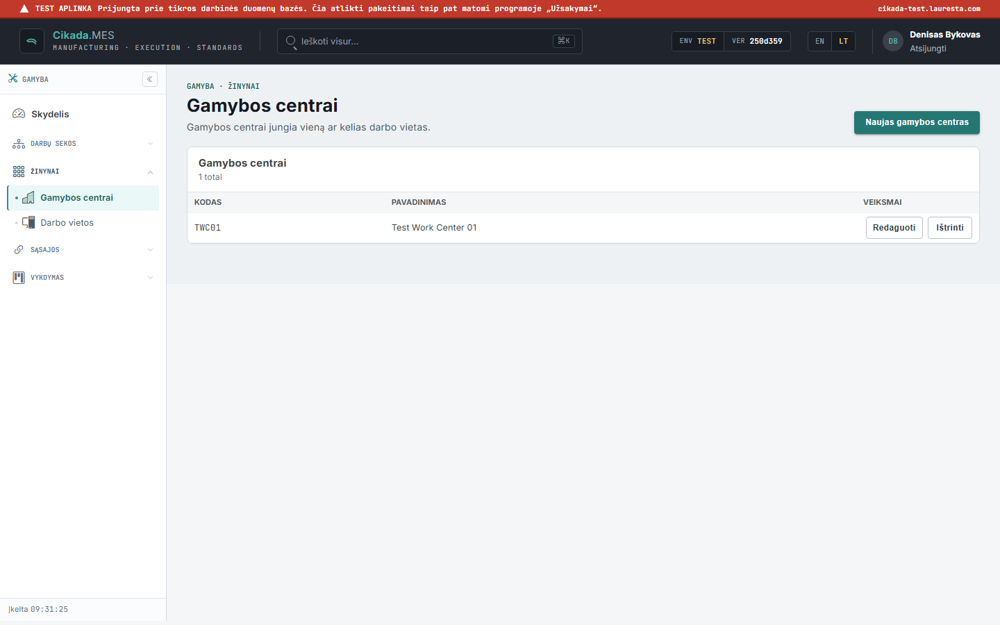
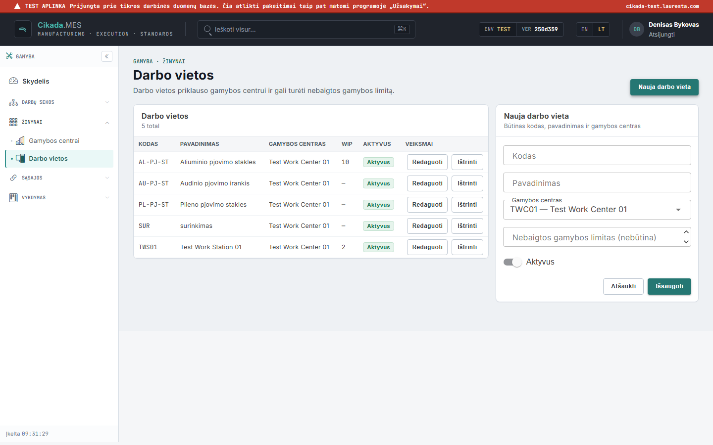

# Žinynai – gamybos centrai ir darbo vietos

**Būsena:** veikia

## Kam skirta
Du Gamybos modulio (Shopfloor) žinynų puslapiai: (UI: Gamybos centrai) ir (UI: Darbo vietos). Juos pildo gamybos vadovas ar technologas. Darbo vietos reikalingos darbų sekų užduotims. Gamybos centras sugrupuoja vieną ar kelias darbo vietas.

## Prieš pradedant
Reikia prisijungti prie Portalo. Rolės netikrinamos. Pirmiausia sukurkite gamybos centrą, tada darbo vietą (mygtukas (UI: Nauja darbo vieta) neaktyvus, kol nėra nė vieno centro).

## Žingsniai
### 1. Gamybos centrai
1. Atidarykite (UI: Žinynai) > (UI: Gamybos centrai).
2. Paspauskite (UI: Naujas gamybos centras), įveskite (UI: Kodas) ir (UI: Pavadinimas), paspauskite (UI: Išsaugoti).
3. Esamą centrą keiskite mygtuku (UI: Redaguoti), šalinkite mygtuku (UI: Ištrinti) (klausimo nėra).
4. Centro, kuriame dar yra darbo vietų, ištrinti negalima.

### 2. Darbo vietos
1. Atidarykite (UI: Žinynai) > (UI: Darbo vietos).
2. Paspauskite (UI: Nauja darbo vieta). Laukai: (UI: Kodas), (UI: Pavadinimas), (UI: Gamybos centras) (pasirenkama iš sąrašo), (UI: Nebaigtos gamybos limitas (nebūtina)), jungiklis (UI: Aktyvus).
3. Paspauskite (UI: Išsaugoti). Sąraše rodomi kodas, pavadinimas, centras, WIP limitas, (UI: Aktyvus)/(UI: Neaktyvus).
4. (UI: Redaguoti) ir (UI: Ištrinti) veikia kaip centruose.

## Dažnos klaidos
- „Gamybos API nepasiekiama.“ – sąrašas neįkeltas.
- Kodo dubliavimas: serveris grąžina, kad toks kodas jau naudojamas.
- „Gamybos centrų dar nėra.“, „Darbo vietų dar nėra.“ – tuščias žinynas.
- Centro trynimas nepavyksta, jei jis turi darbo vietų.
