# Warehouse item-flow extraction

**Analysed commit:** `24923ccebffc8b84858cba34467c6f913a5fa1c3` (`main`)
**Date:** 2026-11-11
**Scope:** `src/Modules/Warehouse/*`, with read-only checks of adjacent modules.

An item is defined in master data, enters through an inbound shipment or an explicit Agnum balance distribution, and is visible in per-warehouse/location/SKU projections. A normal receipt goes to `QC_HOLD` when QC is required, otherwise to `RECEIVING`; QC can send it to `RECEIVING` or `QUARANTINE`, and putaway sends it to a selected location. Transfers and picking move projected quantity, while sales orders, reservations, and packing add commercial and operational state. Several screens that resemble complete flows (wave, cross-dock, RMA and HU split/merge) currently only update an in-memory store; they are **not** reliable evidence of physical stock movement. Agnum imports product/balance snapshots and can receive an inventory-value export; the code does not implement per-movement Agnum accounting documents.

**Evidence notation.** Paths below are relative to `src/Modules/Warehouse/`; `D/`, `A/`, `App/`, `P/`, `I/`, `W/`, `S/` and `C/` abbreviate the projects `LKvitai.MES.Modules.Warehouse.Domain`, `.Api`, `.Application`, `.Projections`, `.Infrastructure`, `.WebUI`, `.Sagas` and `.Contracts` respectively. A `#` suffix names the type or method in the cited file. For shared contracts use `src/BuildingBlocks/...` only where explicitly named. Status means: `IMPLEMENTED` reachable working UI/API path; `PARTIAL` path exists but a material part is absent or inconsistent; `BACKEND-ONLY` no Warehouse UI; `UI-ONLY` no working persistent stock backend; `PLANNED` documentation/placeholder only. These are **code-reachability** classifications, not deployed-environment validation.

## A. Glossary and object model

The catalog, document state, quantity ledger and valuation are separate objects. A SKU is the stock key; a lot and HU are supplemental attributes rather than the primary balance key. Many lifecycle statuses are enums, but inbound shipment and pick task statuses are strings. Evidence: `D/Entities/MasterDataEntities.cs#Item,#Lot,#InboundShipment,#PickTask`, `D/Aggregates/StockLedger.cs#RecordMovement`, `C/ReadModels/AvailableStockView.cs#ComputeId`.

| Term | Identity, key fields and lifecycle | Evidence |
|---|---|---|
| Item / SKU | `Item.Id` integer, unique business `InternalSKU`, name, category, `BaseUoM`, `ItemType` Stock/Service, status, barcodes, QC/lot flags and nullable prices. Service lines are auto-received at document creation and do not become physical stock. | `D/Entities/MasterDataEntities.cs#Item,#ItemType`; `A/Api/Controllers/ReceivingController.cs#BuildShipmentLines` |
| UoM | `UnitOfMeasure.Code`; item base code plus per-item `ItemUoMConversion` with factor/rounding rule. Receipt/pick APIs use decimal quantities; no universal conversion is enforced in every movement handler. | `D/Entities/MasterDataEntities.cs#UnitOfMeasure,#ItemUoMConversion`; `A/Api/Controllers/ReceivingController.cs#ReceiveGoodsAsync` |
| Lot / batch | `Lot.Id`, `(ItemId,LotNumber)`, optional production/expiry dates. Receipt requires a lot number only when `Item.RequiresLotTracking`; it reuses/creates the lot and carries its number into the receipt event. | `D/Entities/MasterDataEntities.cs#Lot`; `A/Api/Controllers/ReceivingController.cs#ReceiveGoodsAsync` |
| Serial | Separate serial record and status/history in `AdvancedWarehouseStore`; advanced serial API is in-memory, not tied to a stock-ledger debit/credit. | `A/Services/AdvancedWarehouseStore.cs#RegisterSerial,#TransitionSerial`; `A/Api/Controllers/AdvancedWarehouseController.cs#SerialsController` |
| Handling unit (HU) | `HandlingUnit.HUId`, type PALLET/BOX/BAG/UNIT, lines SKU/quantity, OPEN/SEALED/PICKED/EMPTY. The domain aggregate says its business logic is a placeholder; receipt orchestration emits HU create/seal events, while advanced split/merge is in-memory. | `D/Aggregates/HandlingUnit.cs#HandlingUnit,#HandlingUnitStatus`; `I/Persistence/MartenReceiveGoodsOrchestration.cs#ExecuteAsync`; `A/Services/AdvancedWarehouseStore.cs#SplitHu,#MergeHu` |
| Warehouse | Warehouse master has `Id`, `Code`, `IsVirtual`, status; movement stream carries a warehouse string. Agnum maps `SndId` to a virtual MES warehouse code. | `D/Entities/MasterDataEntities.cs#Warehouse`; `D/StockLedgerStreamId.cs#For`; `D/Entities/AgnumImportEntities.cs#AgnumWarehouseMapping` |
| Location | `Location.Id`, code, barcode, free-text `Type`, optional parent and warehouse owner, `IsVirtual`, zone, capacity, coordinates, rack/slot fields and status. | `D/Entities/MasterDataEntities.cs#Location`; `A/Api/Controllers/LocationsController.cs#CreateAsync,#UpdateAsync` |
| Reservation / hard lock | Event-sourced reservation declares PENDING→ALLOCATED (SOFT)→PICKING (HARD)→CONSUMED, plus CANCELLED/BUMPED. `ReservationCreatedMasterDataEvent` would increment `ReservedQty`, and `PickingStartedEvent` would increment `HardLockedQty`; no producer of either reservation-creation event was found in Warehouse. A sales order's relational `ReservationId` alone does not create the event-sourced reservation. | `D/Aggregates/Reservation.cs#Apply`; `P/AvailableStockProjection.cs#Apply`; `A/Services/SalesOrderCommandHandlers.cs#AllocateSalesOrderCommandHandler.Handle` |
| Sales/order documents | Sales order has customer and priced lines; release creates an outbound order. Outbound order, pick task, shipment, transfer and cycle count hold their own status and line quantities. | `D/Entities/MasterDataEntities.cs#SalesOrder,#OutboundOrder,#PickTask,#Shipment,#Transfer,#CycleCount`; `A/Services/SalesOrderCommandHandlers.cs#Handle` |
| Price group / value | Customer's `PriceGroupId` selects `ItemPriceOverride` else `Item.BasePrice`. Purchase price and weighted average/current cost are separate; `OnHandValue` is a valuation read model, not the stock ledger. | `D/Entities/MasterDataEntities.cs#PriceGroup,#ItemPriceOverride,#OnHandValue`; `I/Pricing/ItemPriceSnapshotService.cs#GetAsync`; `D/Aggregates/ItemValuation.cs#Apply` |

## B. Warehouses and locations

Physical and virtual flags are master-data properties, not two different location classes. Seven virtual locations are seeded, while other endpoint names are code-only pseudo locations. The transfer executor also creates a per-transfer virtual in-transit location. Evidence: `D/Entities/MasterDataEntities.cs#Location`, `I/Persistence/Migrations/20260210050442_InitialMasterData.cs#Up`, `A/Services/TransferServices.cs#EnsureInTransitLocationAsync`.

| ID | Code/kind | Role and authority | Status |
|---|---|---|---|
| L-01 | `RECEIVING`, seeded virtual | Normal receipt destination and sole allowed putaway source. `ReceivingController#ReceiveGoodsAsync`, `PutawayController#PutawayAsync` | IMPLEMENTED |
| L-02 | `QC_HOLD`, seeded virtual | Receipt destination if item requires QC; QC source. `ReceivingController#ReceiveGoodsAsync`, `QCController#ProcessQcAsync` | IMPLEMENTED |
| L-03 | `QUARANTINE`, seeded virtual | QC-failure destination; no verified release-to-storage flow. `QCController#ProcessQcAsync` | PARTIAL |
| L-04 | `PRODUCTION`, seeded virtual | Destination of HU/reservation `PickStock`; no Warehouse finished-goods output path. `I/Persistence/MartenPickStockOrchestration.cs#ExecuteAsync` | PARTIAL |
| L-05 | `SHIPPING`, seeded virtual | Destination of task pick; dispatch changes shipment status without a verified `SHIPPING`→`CUSTOMER` ledger movement. `PickingController#CompleteTaskAsync`, `ShipmentCommandHandlers#Handle` | PARTIAL |
| L-06 | `SCRAP`, seeded virtual | Transfer approval special case uses `ToWarehouse == "SCRAP"`; RMA scrap is in-memory. `D/Entities/MasterDataEntities.cs#Transfer.RequiresApproval`, `A/Services/AdvancedWarehouseStore.cs#InspectRma` | PARTIAL |
| L-07 | `RETURN_TO_SUPPLIER`, seeded virtual | Seeded code; no verified supplier-return command/UI that moves stock into it. `I/Persistence/Migrations/20260210050442_InitialMasterData.cs#Up` | PARTIAL |
| L-08 | `IN_TRANSIT_{TransferNumber}`, dynamically virtual | Transfer executor emits source→transit→destination in one call. `A/Services/TransferServices.cs#ExecuteTransferCommandHandler.Handle,#EnsureInTransitLocationAsync` | IMPLEMENTED |
| L-09 | `SUPPLIER`, pseudo endpoint | Default `ReceiveGoodsCommand.FromLocation`; not seeded as a location row. `App/Commands/ReceiveGoodsCommand.cs#FromLocation` | BACKEND-ONLY |
| L-10 | `AGNUM`, pseudo endpoint | Source for Agnum balance distribution command. `A/Services/DistributeAgnumBalanceCommandHandler.cs#Handle` | IMPLEMENTED |
| L-11 | `CUSTOMER`, pseudo endpoint/report label | Traceability/report destination text; no confirmed dispatch ledger write to it. `A/Services/LotTraceabilityService.cs#BuildAsync`; `A/Services/ShipmentCommandHandlers.cs#Handle` | PARTIAL |
| L-12 | `SYSTEM`, pseudo endpoint | Treated as external by HU projection. `P/HandlingUnitProjection.cs#IsVirtualLocation` | BACKEND-ONLY |
| L-13 | `PICKING_STAGING`, code-only | Pack publisher claims this source although normal task pick already targets `SHIPPING`; no seeded row. `A/Services/OutboundOrderCommandHandlers.cs#PackAsync` | PARTIAL |
| L-14 | physical/ordinary location, configured | Admin-managed location; normal putaway destination, transfer endpoint and pick source. `A/Api/Controllers/LocationsController.cs#CreateAsync`; `A/Api/Controllers/PickingController.cs#CompleteTaskAsync` | IMPLEMENTED |

Location `Type` is free text, `ZoneType` is constrained to General/Refrigerated/Hazmat/Quarantine in the admin controller, parent is optional, and `WarehouseId` is optional. There is no single domain-wide matrix that enforces which `Type` may receive or send every movement. Explicit guards are local: putaway source must be `RECEIVING`; picking source cannot be virtual; cycle counts select active nonvirtual locations. Capacity on putaway yields a warning rather than a stop. Evidence: `A/Api/Controllers/LocationsController.cs#CreateAsync`, `A/Api/Controllers/PutawayController.cs#PutawayAsync,#BuildCapacityWarningAsync`, `A/Api/Controllers/PickingController.cs#CompleteTaskAsync`, `A/Services/CycleCountServices.cs#ScheduleCycleCountCommandHandler.Handle`.

## C. Movement catalogue

`MovementType` defines six values, but controllers also emit `StockMovedEvent` with literal `"Putaway"`, and other events move projected quantities without a `MovementType`. A stock move changes the from/to location projection; receipt and adjustment have their own event paths. None of these events itself carries a sale price or a confirmed per-movement Agnum document. Evidence: `D/MovementType.cs#MovementType`, `P/AvailableStockProjection.cs#AvailableStockGrouper.Group`, `A/Services/AgnumExportServices.cs#LoadExportRowsAsync`.

| ID | Event/type | From → to; quantity effect | Cost/value effect | Trigger; emitter; role | UI route/action | Status; evidence |
|---|---|---|---|---|---|---|
| M-01 | `StockMovedEvent/RECEIPT` | external → destination, +q there | no unit price in event | `ReceiveGoodsCommand`, `MartenReceiveGoodsOrchestration`; Agnum distribution role InventoryAccountantOrManager | `/agnum/balances` distribution | IMPLEMENTED; `I/Persistence/MartenReceiveGoodsOrchestration.cs#ExecuteAsync`, `A/Services/DistributeAgnumBalanceCommandHandler.cs#Handle` |
| M-02 | `StockMovedEvent/DISPATCH` | `PICKING_STAGING`→`SHIPPING`, -q/+q if persisted | none | `PackOrderCommandHandler`; PackingOperatorOrManager | `/outbound/pack/{OrderId}` Pack | PARTIAL: bus publish is not a ledger append, source conflicts with pick target; `A/Services/OutboundOrderCommandHandlers.cs#PackAsync` |
| M-03 | `StockMovedEvent/TRANSFER` | source→in-transit→target, two q moves | no explicit revaluation | `ExecuteTransferCommandHandler`; OperatorOrAbove, manager approval for SCRAP | `/transfers/{Id}/execute` Execute | PARTIAL for cross-warehouse accounting: second event uses destination stream, no long-lived in-transit phase; `A/Services/TransferServices.cs#Handle` |
| M-04 | `StockMovedEvent/ADJUSTMENT_IN` | external→location, +q | none in event | `RecordStockMovementCommandHandler`; API/backend use | no dedicated direct MovementType UI | BACKEND-ONLY; `D/MovementType.cs#AdjustmentIn`, `App/Commands/RecordStockMovementCommandHandler.cs#Handle` |
| M-05 | `StockMovedEvent/ADJUSTMENT_OUT` | location→external, -q | none in event | `RecordStockMovementCommandHandler`; API/backend use | no dedicated direct MovementType UI | BACKEND-ONLY; same evidence |
| M-06 | `StockMovedEvent/PICK` | location→`PRODUCTION`, -q/+q | none in event | `PickStockCommand`/`MartenPickStockOrchestration`; OperatorOrAbove reservation API | `/reservations` Start picking / Pick | PARTIAL: separate from outbound task picking; `I/Persistence/MartenPickStockOrchestration.cs#ExecuteAsync`, `A/Api/Controllers/ReservationsController.cs#PickAsync` |
| M-07 | `StockMovedEvent/Putaway` (literal) | `RECEIVING`→selected location, -q/+q | none in event | `PutawayController#PutawayAsync`; QcOrManager | `/putaway` Putaway | IMPLEMENTED; `A/Api/Controllers/PutawayController.cs#PutawayAsync` |
| M-08 | `GoodsReceivedEvent` | external→`QC_HOLD` or `RECEIVING`, +received qty | separate best-effort WAC update from actual unit price/landed cost | `ReceivingController#ReceiveGoodsAsync`; QcOrManager | `/inbound/shipments/{Id}` Receive | PARTIAL: EF and Marten writes separate; valuation failure does not roll back receipt; `A/Api/Controllers/ReceivingController.cs#ReceiveGoodsAsync`, `P/AvailableStockProjection.cs#Apply` |
| M-09 | `QCPassedEvent` | `QC_HOLD`→`RECEIVING`, -q/+q | none | `QCController#ProcessQcAsync`; QcOrManager | `/inbound/qc` Pass | IMPLEMENTED; `A/Api/Controllers/QCController.cs#ProcessQcAsync`, `P/AvailableStockProjection.cs#AvailableStockGrouper.Group` |
| M-10 | `QCFailedEvent` | `QC_HOLD`→`QUARANTINE`, -q/+q | none | same controller/role | `/inbound/qc` Fail + reason | IMPLEMENTED; same evidence |
| M-11 | `PickCompletedEvent` | physical→`SHIPPING`, -picked/+picked | none | `PickingController#CompleteTaskAsync`; OperatorOrAbove | `/picking/tasks` Complete | PARTIAL: any picked qty ≤ task qty marks task Completed; `A/Api/Controllers/PickingController.cs#CompleteTaskAsync`, `P/AvailableStockProjection.cs#AvailableStockGrouper.Group` |
| M-12 | `StockAdjustedEvent` | direct adjustment: location +signed `QtyDelta`; cycle-count bus event alone does not update Marten | no unit cost in event; valuation is separate | `AdjustmentsController#CreateAsync` ManagerOrAdmin; cycle-count handler bus-only | `/stock/adjustments`; `/cycle-counts/{Id}/execute` | PARTIAL; `A/Api/Controllers/AdjustmentsController.cs#CreateAsync`, `A/Services/CycleCountServices.cs#ApplyAdjustmentCommandHandler.Handle` |
| M-13 | `ReservationCreatedMasterDataEvent` / `ReservationReleasedMasterDataEvent` | no on-hand move; ±reserved if emitted | none | no event producer found; sales allocation publishes `SalesOrderAllocatedEvent` instead | `/sales/allocations`, `/sales/orders/{Id}` do not produce these events | PARTIAL: projection exists, emit path missing; `P/AvailableStockProjection.cs#Apply`, `P/ActiveReservationsProjection.cs#Apply`, `A/Services/SalesOrderCommandHandlers.cs#AllocateSalesOrderCommandHandler.Handle` |
| M-14 | `PickingStartedEvent` / `ReservationConsumedEvent` / `ReservationCancelledEvent` | no on-hand move; hard lock +/− if a reservation stream exists | none | reservation commands/aggregate | `/reservations` | PARTIAL: start-picking endpoint needs a reservation stream, but Warehouse has no producer of `ReservationCreatedEvent`; `D/Aggregates/Reservation.cs#Apply`, `A/Api/Controllers/ReservationsController.cs#StartPickingAsync`, `P/AvailableStockProjection.cs#Apply` |

**Critical scope distinction.** A status update in `AdvancedWarehouseStore` is not a stock-affecting event. `ShipmentDispatchedEvent`, `ShipmentPackedEvent`, `TransferCompletedEvent` and `AgnumExport*Event` record document/process state; they do not by themselves debit an item balance. Evidence: `A/Services/AdvancedWarehouseStore.cs#UpdateCrossDockStatus,#InspectRma,#CompleteWaveLines`, `A/Services/ShipmentCommandHandlers.cs#Handle`, `P/AvailableStockProjection.cs#AvailableStockGrouper.Group`.

## D. Lots and splitting

Lot creation is tied to a normal receipt; the lot number is compulsory only for a flagged item. Partial quantities are accepted in several places, but balances are aggregated by SKU/location, not by lot or HU. FEFO is a preference/suggestion, not a universal debit guard. Evidence: `A/Api/Controllers/ReceivingController.cs#ReceiveGoodsAsync`, `C/ReadModels/AvailableStockView.cs#ComputeId`, `A/Api/Controllers/PickingController.cs#GetLocationSuggestionsAsync`.

| Operation | Actual rule | Status; evidence |
|---|---|---|
| Receipt split | Each call receives `ReceivedQty > 0`; cumulative received may not exceed expected. Under-receipt leaves shipment `Partial`; no close-short endpoint. | IMPLEMENTED partial receipt, PARTIAL closure; `A/Api/Controllers/ReceivingController.cs#ReceiveGoodsAsync,#ComputeShipmentStatus` |
| Lot allocation | Reuse/create by `(ItemId,LotNumber)`; expiry may be set. `AvailableStockView` stores one `LotNumber` and `ExpiryDate` on a SKU/location row, so two lots there are not separate balance keys. | PARTIAL traceability granularity; `A/Api/Controllers/ReceivingController.cs#ReceiveGoodsAsync`; `C/ReadModels/AvailableStockView.cs#ComputeId` |
| Partial putaway/transfer | `Qty` can be less than available; transfer lines and movements carry quantity but not lot ID. | IMPLEMENTED quantity split, PARTIAL lot identity; `A/Api/Controllers/PutawayController.cs#PutawayAsync`; `A/Services/TransferServices.cs#Handle` |
| Partial pick | `PickedQty ≤ task.Qty`; task becomes Completed after one call, leaving no same-task remainder; optional `LotId` is checked for existence/number but balance check is SKU/location. | PARTIAL; `A/Api/Controllers/PickingController.cs#CompleteTaskAsync` |
| HU split/merge | Advanced endpoints mutate in-memory HU records, not the event-sourced aggregate/ledger. | UI-ONLY; `A/Services/AdvancedWarehouseStore.cs#SplitHu,#MergeHu`; `D/Aggregates/HandlingUnit.cs#HandlingUnit` |
| Serial | In-memory registration/status transition/history; no physical quantity reconciliation. | UI-ONLY; `A/Services/AdvancedWarehouseStore.cs#RegisterSerial,#TransitionSerial` |
| FIFO/FEFO | `WarehouseSettings` has default FEFO flag; picking location suggestions include expiry/lot and sort choices, but `CompleteTaskAsync` permits selected physical source and does not enforce oldest lot globally. | PARTIAL; `D/Entities/MasterDataEntities.cs#WarehouseSettings`; `A/Api/Controllers/PickingController.cs#GetLocationSuggestionsAsync,#CompleteTaskAsync` |
| Traceability | Two report paths exist: `LotTraceabilityService.BuildAsync` builds supplier/customer nodes using item-ID SQL joins (not proof that a specific lot moved); the general report filters lots and related item IDs. Neither is a lot-isolated movement history. | PARTIAL; `A/Services/LotTraceabilityService.cs#BuildAsync,#BuildBackwardAsync,#BuildForwardAsync`; `A/Api/Controllers/ReportsController.cs#GetTraceabilityAsync` |

## E. End-to-end flows, every supported variant

The following steps distinguish a document/status transition from an actual projected quantity change. A role shown here is the controller policy, not an inferred job title. `+q`/`-q` refer to the named location; value changes are stated only when an explicit valuation path exists. Each step carries its own status and evidence. Evidence for the common read side: `P/AvailableStockProjection.cs#AvailableStockGrouper.Group`, `P/LocationBalanceProjection.cs#Apply`, `C/ReadModels/AvailableStockView.cs#RecomputeAvailable`.

### F-01 Normal inbound and partial/over receipt — PARTIAL

A supplier shipment and at least one Stock line; unit price is required to receive. Partial cumulative receipt is allowed; over receipt is rejected. A failed event append can leave an EF shipment row, and valuation failure is logged after physical receipt. Result: received quantity in RECEIVING or QC_HOLD, shipment Draft/Partial/Complete.

1. **PARTIAL** — QcOrManager; screen `/inbound/shipments/create`; action InboundShipments.CreateInbound: EN “+ Create Inbound” / LT “+ Sukurti gaunamą siuntą”. API `POST /api/warehouse/v1/receiving/shipments` → `CreateShipmentAsync` → `InboundShipmentCreatedEvent`. Move: `none`; quantity: 0; value: landed-cost inputs only. Evidence: `A/Api/Controllers/ReceivingController.cs#CreateShipmentAsync`.

2. **PARTIAL** — QcOrManager; screen `/inbound/shipments/{Id:int}`; action Common.Receive: EN “Receive” / LT “Priimti”. API `POST /api/warehouse/v1/receiving/shipments/{id}/receive` → `ReceiveGoodsAsync` → `GoodsReceivedEvent`. Move: `SUPPLIER → QC_HOLD if RequiresQC, else RECEIVING`; quantity: +ReceivedQty; value: WAC attempt with unit price and apportioned costs. Evidence: `A/Api/Controllers/ReceivingController.cs#ReceiveGoodsAsync`.

3. **IMPLEMENTED** — QcOrManager; screen `/inbound/qc`; action ReceivingQc.Pass: EN “Pass” / LT “Praeiti”. API `POST /api/warehouse/v1/qc/pass` → `ProcessQcAsync` → `QCPassedEvent`. Move: `QC_HOLD → RECEIVING`; quantity: -q/+q; value: none. Evidence: `A/Api/Controllers/QCController.cs#ProcessQcAsync`.

4. **IMPLEMENTED** — QcOrManager; screen `/inbound/qc`; action ReceivingQc.Fail: EN “Fail” / LT “Nepavyko”. API `POST /api/warehouse/v1/qc/fail` → `ProcessQcAsync` → `QCFailedEvent`. Move: `QC_HOLD → QUARANTINE`; quantity: -q/+q; value: none. Evidence: `A/Api/Controllers/QCController.cs#ProcessQcAsync`.

5. **IMPLEMENTED** — QcOrManager; screen `/putaway`; action Putaway.Putaway: EN “Putaway” / LT “Padėjimas į vietas”. API `POST /api/warehouse/v1/putaway` → `PutawayAsync` → `StockMovedEvent/Putaway`. Move: `RECEIVING → selected location`; quantity: -q/+q; value: none. Evidence: `A/Api/Controllers/PutawayController.cs#PutawayAsync`.

### F-02 Receipt without a prior shipment — PARTIAL

The command exists, but a generic no-shipment receiving screen/endpoint was not found. Its reachable UI caller is Agnum distribution. It creates/seals an HU and records a stock move in one Marten session.

1. **PARTIAL** — InventoryAccountantOrManager; screen `/agnum/balances`; action Agnum.Balances.Distribute: EN “Distribute” / LT “Paskirstyti”. API `POST /api/warehouse/v1/agnum/balances/{id}/distribute` → `DistributeAgnumBalanceCommand → ReceiveGoodsCommand` → `HandlingUnitCreatedEvent, StockMovedEvent, HandlingUnitSealedEvent`. Move: `AGNUM → chosen location`; quantity: +q; value: no WAC update. Evidence: `A/Services/DistributeAgnumBalanceCommandHandler.cs#Handle; I/Persistence/MartenReceiveGoodsOrchestration.cs#ExecuteAsync`.

### F-03 Supplier return and quarantine release — PLANNED

The location exists and a QC failure can send goods to QUARANTINE. No verified dedicated return-to-supplier or release-from-quarantine command/UI was found.

1. **IMPLEMENTED** — QcOrManager; screen `/inbound/qc`; action ReceivingQc.Fail: EN “Fail” / LT “Nepavyko”. API `POST /api/warehouse/v1/qc/fail` → `ProcessQcAsync` → `QCFailedEvent`. Move: `QC_HOLD → QUARANTINE`; quantity: -q/+q; value: none. Evidence: `A/Api/Controllers/QCController.cs#ProcessQcAsync`.

2. **PLANNED** — actor unknown; screen `none`; action no UI action. API `none` → `none` → `none`. Move: `QUARANTINE → RETURN_TO_SUPPLIER`; quantity: none implemented; value: none. Evidence: `I/Persistence/Migrations/20260210050442_InitialMasterData.cs#Up`.

### F-04 Internal and cross-warehouse transfer — PARTIAL

Create lines with source/target warehouse and location, submit; manager approves only when ToWarehouse is SCRAP. Execute checks availability, then emits two moves via a generated virtual transit location and completes in one request. No separate arrival confirmation; cross-warehouse stream split is a material gap.

1. **IMPLEMENTED** — OperatorOrAbove; screen `/transfers/create`; action Transfers.Create.CreateTransfer: EN “Create Transfer” / LT “Sukurti perkėlimą”. API `POST /api/warehouse/v1/transfers` → `CreateTransferCommand` → `TransferCreatedEvent`. Move: `none`; quantity: 0; value: none. Evidence: `A/Services/TransferServices.cs#CreateTransferCommandHandler.Handle`.

2. **IMPLEMENTED** — OperatorOrAbove; screen `/transfers`; action Common.Submit: EN “Submit” / LT “Pateikti”. API `POST /api/warehouse/v1/transfers/{id}/submit` → `SubmitTransferCommand` → `EF transfer status only (no event)`. Move: `none`; quantity: 0; value: none. Evidence: `A/Services/TransferServices.cs#SubmitTransferCommandHandler.Handle`.

3. **IMPLEMENTED** — ManagerOrAdmin if SCRAP; screen `/transfers`; action Transfers.List.ApproveTransfer: EN “Approve Transfer” / LT “Patvirtinti perkėlimą”. API `POST /api/warehouse/v1/transfers/{id}/approve` → `ApproveTransferCommand` → `TransferApprovedEvent`. Move: `none`; quantity: 0; value: none. Evidence: `A/Services/TransferServices.cs#ApproveTransferCommandHandler.Handle`.

4. **PARTIAL** — OperatorOrAbove; screen `/transfers/{Id:guid}/execute`; action Transfers.Execute.ExecuteTransfer: EN “Execute Transfer” / LT “Vykdyti perkėlimą”. API `POST /api/warehouse/v1/transfers/{id}/execute` → `ExecuteTransferCommand` → `TransferExecutedEvent, 2×StockMovedEvent, TransferCompletedEvent`. Move: `source → IN_TRANSIT_* → target`; quantity: -q/+q twice; value: no revaluation. Evidence: `A/Services/TransferServices.cs#ExecuteTransferCommandHandler.Handle`.

### F-05 Cross-dock — UI-ONLY

The UI and API create/update cross-dock records in an in-memory singleton; no corresponding stock movement is emitted, so no physical cross-dock path can be asserted.

1. **UI-ONLY** — OperatorOrAbove; screen `/cross-dock`; action CrossDock.CreateCrossDockMatch: EN “Create Cross-Dock Match” / LT “Sukurkite Cross-Dock Match”. API `POST /api/warehouse/v1/cross-dock` → `CreateCrossDock` → `none`. Move: `none`; quantity: 0; value: none. Evidence: `A/Api/Controllers/AdvancedWarehouseController.cs#CrossDockController; A/Services/AdvancedWarehouseStore.cs#CreateCrossDock`.

2. **UI-ONLY** — OperatorOrAbove; screen `/cross-dock`; action Common.Complete: EN “Complete” / LT “Užbaigti”. API `POST /api/warehouse/v1/cross-dock/{id}/status` → `UpdateCrossDockStatus` → `none`. Move: `none`; quantity: 0; value: none. Evidence: `A/Services/AdvancedWarehouseStore.cs#UpdateCrossDockStatus`.

### F-06 Sales allocation and reservation — PARTIAL

Create priced order, submit/approve/allocate, then release to an outbound order. Sales allocation writes a relational reservation ID and publishes `SalesOrderAllocatedEvent`; it does not create a Marten reservation or update the `ReservedQty` projection. The separate reservation API needs a reservation stream whose creation path is absent. `ReservationExpiryJob` marks active projection rows Expired every minute but does not append a cancellation event or release projected stock locks. Evidence: `A/Services/SalesOrderCommandHandlers.cs#SubmitSalesOrderCommandHandler.Handle,#AllocateSalesOrderCommandHandler.Handle`, `I/BackgroundJobs/ReservationExpiryJob.cs#ExpireReservationsAsync`.

1. **IMPLEMENTED** — SalesAdminOrManager; screen `/sales/orders/create`; action SalesOrderCreate.CreateSalesOrder: EN “Create Sales Order” / LT “Sukurkite pardavimo užsakymą”. API `POST /api/warehouse/v1/sales-orders` → `CreateSalesOrderCommand` → `SalesOrderCreatedEvent`. Move: `none`; quantity: 0; value: commercial line UnitPrice. Evidence: `A/Services/SalesOrderCommandHandlers.cs#CreateSalesOrderCommandHandler.Handle`.

2. **PARTIAL** — SalesAdminOrManager; screen `/sales/orders/{Id:guid}`; action Common.Submit: EN “Submit” / LT “Pateikti”. API `POST /api/warehouse/v1/sales-orders/{id}/submit` → `SubmitSalesOrderCommand` → `SalesOrderAllocatedEvent when no approval; otherwise EF status only`. Move: `none`; quantity: 0; value: none. No Marten reservation is created. Evidence: `A/Services/SalesOrderCommandHandlers.cs#SubmitSalesOrderCommandHandler.Handle`.

3. **PARTIAL** — SalesAdminOrManager; screen `/sales/orders/{Id:guid}`; action SalesOrderDetail.Allocate: EN “Allocate” / LT “Paskirstyti”. API `POST /api/warehouse/v1/sales-orders/{id}/allocate` → `AllocateSalesOrderCommand` → `SalesOrderAllocatedEvent` (bus only). Move: `none`; quantity: 0; `ReservedQty` is not incremented here; value: none. Evidence: `A/Services/SalesOrderCommandHandlers.cs#AllocateSalesOrderCommandHandler.Handle; P/AvailableStockProjection.cs#Apply`.

4. **IMPLEMENTED** — ManagerOrAdmin; screen `/sales/orders/{Id:guid}`; action SalesOrderDetail.ReleaseToPicking: EN “Release to Picking” / LT “Išleisk į rinkimą”. API `POST /api/warehouse/v1/sales-orders/{id}/release` → `ReleaseSalesOrderCommand` → `OutboundOrderCreatedEvent`. Move: `none`; quantity: 0; value: none. Evidence: `A/Services/SalesOrderCommandHandlers.cs#ReleaseSalesOrderCommandHandler.Handle`.

5. **PARTIAL** — OperatorOrAbove; screen `/reservations`; action Reservations.StartPicking: EN “Start Picking” / LT “Pradėti komplektavimą”. API `POST /api/warehouse/v1/reservations/{id}/start-picking` → `StartPickingCommand` → `PickingStartedEvent` only for a pre-existing allocated reservation stream. Move: `none`; quantity: 0, conditional `HardLockedQty +q`; value: none. No Warehouse producer of `ReservationCreatedEvent` was found, so the sales-order flow cannot reach this step end to end. Evidence: `A/Api/Controllers/ReservationsController.cs#StartPickingAsync; I/Persistence/MartenAllocateReservationOrchestration.cs#AllocateAsync; P/AvailableStockProjection.cs#Apply`.

### F-07 Single-task pick, pack and dispatch — PARTIAL

Create and complete a pick task. It moves stock from a physical bin to SHIPPING. Pack requires all scanned quantities and creates shipment/HU, but publishes a conflicting PICKING_STAGING→SHIPPING bus event; dispatch obtains carrier tracking or manual fallback and changes statuses, with no verified CUSTOMER debit. Partial pick marks task complete.

**Branches and cancellation.** `CompleteTaskAsync` accepts a smaller positive picked quantity yet marks that task Completed; packing requires scans equal to every outbound line quantity, so the same task cannot complete a shortage. Dispatch sets each outbound line `ShippedQty = Qty` and each sales line `ShippedQty = OrderedQty`; there is no partial-shipment quantity in this command. Sales-order cancellation accepts a reason in any state except Invoiced/Cancelled; outbound-order cancellation rejects only Delivered/Cancelled. Neither cancellation path reverses an already executed pick or the published pack move. Evidence: `A/Api/Controllers/PickingController.cs#CompleteTaskAsync`, `A/Services/OutboundOrderCommandHandlers.cs#PackAsync`, `A/Services/ShipmentCommandHandlers.cs#Handle`, `D/Entities/MasterDataEntities.cs#SalesOrder.Cancel,#OutboundOrder.Cancel`.

1. **IMPLEMENTED** — OperatorOrAbove; screen `/picking/tasks`; action PickingTasks.CreateTask: EN “Create Task” / LT “Sukurti užduotį”. API `POST /api/warehouse/v1/picking/tasks` → `CreateTaskAsync` → `none`. Move: `none`; quantity: 0; value: none. Evidence: `A/Api/Controllers/PickingController.cs#CreateTaskAsync`.

2. **PARTIAL** — OperatorOrAbove; screen `/picking/tasks`; action PickingTasks.CompleteTask: EN “Complete Task” / LT “Atlikti užduotį”. API `POST /api/warehouse/v1/picking/tasks/{id}/complete` → `CompleteTaskAsync` → `PickCompletedEvent`. Move: `physical → SHIPPING`; quantity: -q/+q; value: none. Evidence: `A/Api/Controllers/PickingController.cs#CompleteTaskAsync`.

3. **PARTIAL** — PackingOperatorOrManager; screen `/outbound/pack/{OrderId:guid}`; action PackingStation.Pack: EN “Pack” / LT “Pakuotė”. API `POST /api/warehouse/v1/outbound/orders/{id}/pack` → `PackOrderCommand` → `ShipmentPackedEvent, StockMovedEvent published`. Move: `PICKING_STAGING → SHIPPING claimed`; quantity: unverified ledger effect; value: none. Evidence: `A/Services/OutboundOrderCommandHandlers.cs#PackAsync`.

4. **PARTIAL** — OperatorOrAbove; screen `/outbound/dispatch`; action OutboundDispatch.Dispatch: EN “Dispatch” / LT “Išsiuntimas”. API `POST /api/warehouse/v1/shipments/{id}/dispatch` → `DispatchShipmentCommand` → `ShipmentDispatchedEvent`. Move: `no ledger destination`; quantity: 0 in ledger; value: none. Evidence: `A/Services/ShipmentCommandHandlers.cs#Handle`.

### F-08 Wave pick and labels — UI-ONLY

Wave records/assignments/completion are in-memory and do not create pick-ledger events. Labels screen provides document/label operations, not a stock move.

1. **UI-ONLY** — OperatorOrAbove; screen `/waves`; action WavePicking.CreateWave: EN “Create Wave” / LT “Sukurti bangą”. API `POST /api/warehouse/v1/waves` → `CreateWave` → `none`. Move: `none`; quantity: 0; value: none. Evidence: `A/Api/Controllers/AdvancedWarehouseController.cs#WavesController; A/Services/AdvancedWarehouseStore.cs#CreateWave`.

2. **UI-ONLY** — OperatorOrAbove; screen `/waves`; action WavePicking.1Line: EN “+1 Line” / LT “+1 eilutė”. API `POST /api/warehouse/v1/waves/{id}/complete-lines` → `CompleteWaveLines` → `none`. Move: `none`; quantity: 0; value: none. Evidence: `A/Services/AdvancedWarehouseStore.cs#CompleteWaveLines`.

### F-09 RMA return, restock or scrap — UI-ONLY

RMA can be created, marked received and inspected. Restock/Scrap only updates an in-memory status; no receiving, adjustment or scrap ledger event is emitted.

1. **UI-ONLY** — SalesAdminOrManager; screen `/rmas`; action Rmas.CreateRMA: EN “Create RMA” / LT “Sukurkite RMA”. API `POST /api/warehouse/v1/rmas` → `CreateRma` → `none`. Move: `none`; quantity: 0; value: none. Evidence: `A/Services/AdvancedWarehouseStore.cs#CreateRma`.

2. **UI-ONLY** — OperatorOrAbove; screen `/rmas`; action Common.Receive: EN “Receive” / LT “Priimti”. API `POST /api/warehouse/v1/rmas/{id}/receive` → `ReceiveRma` → `none`. Move: `none`; quantity: 0; value: none. Evidence: `A/Services/AdvancedWarehouseStore.cs#ReceiveRma`.

3. **UI-ONLY** — QcOrManager; screen `/rmas`; action Rmas.Restock: EN “Restock” / LT “Atnaujinti atsargas”. API `POST /api/warehouse/v1/rmas/{id}/inspect` → `InspectRma` → `none`. Move: `none`; quantity: 0; value: none. Evidence: `A/Services/AdvancedWarehouseStore.cs#InspectRma`.

### F-10 Stock adjustment, write-off and cycle count — PARTIAL

A manager adjustment appends signed StockAdjustedEvent to Marten; negative stock yields a warning. Cycle count records discrepancies but publishes its CYCLE_COUNT StockAdjustedEvent only to the bus; it does not append that event to Marten, so the quantity projection is not changed by this path. Scrap can also be a transfer requiring manager approval.

1. **IMPLEMENTED** — ManagerOrAdmin; screen `/stock/adjustments`; action Common.Create: EN “Create” / LT “Sukurti” (under StockAdjustments.CreateAdjustment: EN “Create Adjustment” / LT “Sukurti koregavimą”). API `POST /api/warehouse/v1/adjustments` → `CreateAdjustmentAsync` → `StockAdjustedEvent`. Move: `selected location ±q`; quantity: signed QtyDelta; value: no unit cost. Evidence: `W/Pages/StockAdjustments.razor#CreateAsync`, `A/Api/Controllers/AdjustmentsController.cs#CreateAsync`.

2. **IMPLEMENTED** — OperatorOrAbove; screen `/cycle-counts/schedule`; action Common.Submit: EN “Submit” / LT “Pateikti”. API `POST /api/warehouse/v1/cycle-counts/schedule` → `ScheduleCycleCountCommand` → `CycleCountScheduledEvent`. Move: `none`; quantity: 0; value: none. Evidence: `A/Services/CycleCountServices.cs#ScheduleCycleCountCommandHandler.Handle`.

3. **IMPLEMENTED** — OperatorOrAbove; screen `/cycle-counts/{Id:guid}/execute`; action Common.Submit: EN “Submit” / LT “Pateikti”. API `POST /api/warehouse/v1/cycle-counts/{id}/record-count` → `RecordCountCommand` → `CountRecordedEvent`. Move: `none`; quantity: 0; value: none. Evidence: `A/Services/CycleCountServices.cs#RecordCountCommandHandler.Handle`.

4. **PARTIAL** — OperatorOrAbove; screen `/cycle-counts/{Id:guid}/discrepancies`; action CycleCounts.Discrepancies.Confirm: EN “Confirm” / LT “Patvirtinti”. API `POST /api/warehouse/v1/cycle-counts/{id}/apply-adjustment` → `ApplyAdjustmentCommand` → `StockAdjustedEvent, CycleCountCompletedEvent published to bus only`. Move: `no Marten projection move`; quantity: projected delta not applied; value: no unit cost. Evidence: `A/Services/CycleCountServices.cs#ApplyAdjustmentCommandHandler.Handle`.

### F-11 Valuation adjustment and write-down — IMPLEMENTED

Finance changes an item cost or applies landed cost/write-down through the valuation aggregate. This does not move stock or create an Agnum transaction document; later snapshot export may include new value.

1. **IMPLEMENTED** — InventoryAccountantOrManager; screen `/valuation/adjust-cost`; action Common.AdjustCost: EN “Adjust Cost” / LT “Koreguoti savikainą”. API `POST /api/warehouse/v1/valuation/adjust-cost` → `AdjustCostCommand` → `CostAdjusted`. Move: `none`; quantity: 0; value: CurrentCost changes. Evidence: `A/Api/Controllers/ValuationController.cs#AdjustCostV2Async`.

2. **IMPLEMENTED** — InventoryAccountantOrManager; screen `/valuation/apply-landed-cost`; action Common.ApplyLandedCost: EN “Apply Landed Cost” / LT “Paskirstyti papildomas įsigijimo išlaidas”. API `POST /api/warehouse/v1/valuation/apply-landed-cost` → `ApplyLandedCostCommand` → `LandedCostApplied`. Move: `none`; quantity: 0; value: CurrentCost changes. Evidence: `A/Api/Controllers/ValuationController.cs#ApplyLandedCostAsync`.

3. **IMPLEMENTED** — InventoryAccountantOrManager; screen `/valuation/write-down`; action Common.WriteDown: EN “Write Down” / LT “Nurašyti”. API `POST /api/warehouse/v1/valuation/write-down` → `WriteDownCommand` → `WrittenDown`. Move: `none`; quantity: 0; value: new valuation value. Evidence: `A/Api/Controllers/ValuationController.cs#WriteDownAsync`.

### F-12 Production consumption and output — PARTIAL

Reservation PickStock moves warehouse stock to PRODUCTION and has a durable retry saga for reservation consumption. No corresponding Warehouse output/finished-goods flow was verified; Shopfloor legacy write-off is separate SQL.

1. **PARTIAL** — OperatorOrAbove; screen `/reservations`; action Common.Pick: EN “Pick” / LT “Komplektuoti”. API `POST /api/warehouse/v1/reservations/{id}/pick` → `PickStockCommand` → `StockMovedEvent/PICK, ReservationConsumedEvent`. Move: `physical → PRODUCTION`; quantity: -q/+q; value: none. Evidence: `I/Persistence/MartenPickStockOrchestration.cs#ExecuteAsync; S/PickStockSaga.cs#PickStockSaga`.

2. **PLANNED** — actor unknown; screen `none`; action no UI action. API `none` → `none` → `none`. Move: `PRODUCTION → finished stock`; quantity: none implemented; value: none. Evidence: `src/Modules/Shopfloor/LKvitai.MES.Modules.Shopfloor.WebUI/Pages/Gamyba.razor.cs`.

### F-13 Admin item import — IMPLEMENTED

Admin import creates/updates relational master data, not physical stock. Any inferred initial stock load must go through explicit receiving/Agnum distribution/adjustment paths.

1. **IMPLEMENTED** — Admin; screen `/admin/import`; action AdminImport.RunImport: EN “Run Import” / LT “Vykdyti importą”. API `POST /api/warehouse/v1/admin/import/{entityType}?dryRun=…` → `ImportController.ImportAsync` → relational master-data writes, not an inventory event. Move: `none`; quantity: 0; value: catalog purchase/sale prices may change. Evidence: `W/Pages/AdminImport.razor#RunImportAsync; A/Api/Controllers/ImportController.cs#ImportAsync`.

### F-14 Agnum nomenclature/balance import and distribution — PARTIAL

Imports external product/client information and virtual balance snapshots. Scheduled price sync runs only when `Agnum:PriceSync:Enabled` is true. Only an explicit distribution of a linked balance creates physical stock via a receipt command. Failed runs keep a Failed status and error summary. Evidence: `A/BackgroundJobs/AgnumImportRecurringJob.cs#ExecuteAsync`, `I/Agnum/AgnumBalanceImportService.cs#StartImportAsync`.

1. **BACKEND-ONLY** — InventoryAccountantOrManager; screen `none`; action no UI action (API/job only). API `POST /api/warehouse/v1/agnum/import/products?sndId=…&apply=true` or recurring job → `ImportProductsAsync`/`AgnumNomenclatureImportService.ApplyAsync`; optional scheduled `AgnumPriceSyncService.SyncAsync`. Move: `none`; quantity: 0 physical; value: catalog price may change if price sync is enabled. Evidence: `A/Api/Controllers/AgnumImportController.cs#ImportProductsAsync`, `A/BackgroundJobs/AgnumImportRecurringJob.cs#ExecuteAsync`.

2. **BACKEND-ONLY** — InventoryAccountantOrManager; screen `none`; action no UI action (API/job only). API `POST /api/warehouse/v1/agnum/import/balances?sndId=…` → `StartImportAsync` → `none`. Move: `Agnum virtual balance snapshot`; quantity: 0 physical; value: external price data separate. Evidence: `A/Api/Controllers/AgnumImportController.cs#ImportBalancesAsync`, `I/Agnum/AgnumBalanceImportService.cs#StartImportAsync`.

3. **PARTIAL** — InventoryAccountantOrManager; screen `/agnum/balances`; action Agnum.Balances.Distribute: EN “Distribute” / LT “Paskirstyti”. API `POST /api/warehouse/v1/agnum/balances/{id}/distribute` → `DistributeAgnumBalanceCommand` → `StockMovedEvent/RECEIPT, HU events`. Move: `AGNUM → chosen location`; quantity: +q; value: no guaranteed WAC. Evidence: `A/Services/DistributeAgnumBalanceCommandHandler.cs#Handle`.

### F-15 Agnum value export and reconciliation — PARTIAL

Scheduled/API-triggered export creates inventory snapshot CSV and optional JSON API call. The `/agnum/reconcile` page reads imported virtual versus physical balances; a separate API-only CSV reconciliation compares a saved export with an uploaded Agnum CSV and stores its report in memory.

1. **BACKEND-ONLY** — InventoryAccountantOrManager; screen `none`; action no UI action (API/job only). API `POST /api/warehouse/v1/agnum/export` → `AgnumExportOrchestrator.ExecuteAsync` → `AgnumExportStarted/Completed/FailedEvent`. Move: `none`; quantity: 0; value: snapshot qty × cost. Evidence: `A/Services/AgnumExportServices.cs#ExecuteAsync,#LoadExportRowsAsync`.

2. **BACKEND-ONLY** — InventoryAccountantOrManager; screen `none`; action no UI action (API/job only). API `POST /api/warehouse/v1/agnum/reconcile` → `AgnumReconciliationService.GenerateAsync` → `none`. Move: `none`; quantity: 0; value: compare exported and Agnum balances. Evidence: `A/Services/AgnumReconciliationServices.cs#GenerateAsync`.


## F. Quantity and price: where each lives

Warehouse quantity is event-projected at `(warehouseId, location, SKU)` granularity, while commercial prices and inventory valuation are held separately in relational rows and valuation events. Available quantity is clamped at zero after reserved and hard-locked amounts are subtracted. A document may carry a price without changing stock, and a move may change quantity without carrying price. Evidence: `D/StockLedgerStreamId.cs#For`, `C/ReadModels/AvailableStockView.cs#RecomputeAvailable`, `I/Pricing/ItemPriceSnapshotService.cs#GetAsync`, `D/Aggregates/ItemValuation.cs#Apply`.

**Quantity.** `StockLedger` records `StockMovedEvent` by stream `stock-ledger:{warehouseId}:{location}:{sku}`, but normal receipt, QC, task pick and adjustment use separate event streams and are combined by Marten projection. `AvailableStockView.OnHandQty` is a projected balance; `ReservedQty` is master-data reservation, `HardLockedQty` is picking lock; `AvailableQty = max(0, OnHandQty − ReservedQty − HardLockedQty)`. `LocationBalanceView` and `/stock/location-balance`, `/available-stock`, `/reports/stock-level` expose related views. Lot number is denormalized, not part of balance identity. Evidence: `D/Aggregates/StockLedger.cs#RecordMovement`, `P/AvailableStockProjection.cs#AvailableStockGrouper.Group`, `P/LocationBalanceProjection.cs#Apply`, `W/Pages/AvailableStock.razor#OnInitializedAsync`.

**Price and value.** `Item.PurchasePrice` is a fallback cost; `Item.BasePrice` is list selling price; `ItemPriceOverride.Amount` is the group selling price and `ItemPriceHistory` audits changes. `ItemPriceSnapshotService.GetAsync` resolves latest on-hand valuation/unit cost then purchase fallback. Receiving requires a unit purchase price and tries to update WAC with apportioned service/additional landed cost; failure is logged after physical receipt. `ItemValuation` supports adjust cost, landed cost and write-down, rounded to four decimals. `OnHandValue` caches SKU quantity, unit cost and total value; screen totals may be nullable when some price is missing. Sales order lines store entered/resolved `UnitPrice` and round totals away from zero. Evidence: `D/Entities/MasterDataEntities.cs#Item,#ItemPriceOverride,#ItemPriceHistory,#OnHandValue,#SalesOrder`, `A/Api/Controllers/ReceivingController.cs#ReceiveGoodsAsync`, `I/Pricing/ItemPriceSnapshotService.cs#GetAsync`, `D/Aggregates/ItemValuation.cs#Apply`.

| Operation | Changes quantity? | Changes value/cost? | Carries price? | Evidence |
|---|---|---|---|---|
| Item/price-group maintenance | No | Changes catalog price, not stock value | Yes | `A/Api/Controllers/ItemsController.cs#UpdateAsync`; `D/Entities/MasterDataEntities.cs#ItemPriceOverride` |
| Shipment draft/service line | No physical quantity | Landed-cost input only | `UnitPrice` nullable in draft | `A/Api/Controllers/ReceivingController.cs#CreateShipmentAsync,#BuildShipmentLines` |
| Normal stock receipt | Yes, +received | WAC attempt, best effort | Yes, required unit purchase price | `A/Api/Controllers/ReceivingController.cs#ReceiveGoodsAsync` |
| Agnum balance import | No physical quantity | No | Agnum product DTO may carry price separately | `I/Agnum/AgnumBalanceImportService.cs#StartImportAsync` |
| Agnum distribution | Yes, +quantity | No guaranteed WAC change | No | `A/Services/DistributeAgnumBalanceCommandHandler.cs#Handle` |
| QC pass/fail, putaway, transfer, pick | Yes, relocate | No explicit cost recalculation | No | `A/Api/Controllers/QCController.cs#ProcessQcAsync`; `A/Api/Controllers/PutawayController.cs#PutawayAsync`; `A/Services/TransferServices.cs#Handle`; `A/Api/Controllers/PickingController.cs#CompleteTaskAsync` |
| Reservation/lock | No | No | No | `P/AvailableStockProjection.cs#Apply` |
| Sales order | No | Commercial order total only | Yes, `UnitPrice` | `D/Entities/MasterDataEntities.cs#SalesOrderLine,#SalesOrder`; `A/Services/SalesOrderCommandHandlers.cs#Handle` |
| Pack/dispatch | Pack publishes a disputed move; dispatch status only | No explicit cost change | Order lines retain sale price | `A/Services/OutboundOrderCommandHandlers.cs#PackAsync`; `A/Services/ShipmentCommandHandlers.cs#Handle` |
| Stock/cycle adjustment | Direct adjustment yes; cycle-count bus event not in Marten | No cost in quantity event | No | `A/Api/Controllers/AdjustmentsController.cs#CreateAsync`; `A/Services/CycleCountServices.cs#ApplyAdjustmentCommandHandler.Handle` |
| Cost adjustment/landed cost/write-down | No | Yes, valuation only | New cost/value | `A/Api/Controllers/ValuationController.cs#AdjustCostV2Async,#ApplyLandedCostAsync,#WriteDownAsync` |
| RMA, wave, cross-dock, HU split/merge | No ledger change in advanced store | No | Display may show prices | `A/Services/AdvancedWarehouseStore.cs#InspectRma,#CompleteWaveLines,#UpdateCrossDockStatus,#SplitHu` |

## G. Agnum integration

Agnum has two distinct paths: import of remote master/balance snapshots and export of MES inventory value. Importing a balance alone does not alter physical stock; an explicit distribution command does. The export is a snapshot grouped by SKU/account code, not a per-receipt, per-transfer or per-sale accounting document. Evidence: `I/Agnum/AgnumNomenclatureImportService.cs#PreviewAsync,#ApplyAsync`, `I/Agnum/AgnumBalanceImportService.cs#StartImportAsync`, `A/Services/AgnumExportServices.cs#LoadExportRowsAsync`.

| ID | Direction/type | Trigger, mapping, timing and failure | Screens; status; evidence |
|---|---|---|---|
| G-01 | Agnum→MES products, clients, prices | Preview/apply by `SndId`; product links map Agnum product IDs/codes to `Item`; separate price sync fetches prices. Background import recurring job exists. | No import control on `/agnum/balances`; BACKEND-ONLY import; `I/Agnum/AgnumNomenclatureImportService.cs#PreviewAsync,#ApplyAsync`, `I/Agnum/AgnumPriceSyncService.cs#SyncAsync`, `A/BackgroundJobs/AgnumImportRecurringJob.cs#ExecuteAsync` |
| G-02 | Agnum→MES balance snapshots | `StartImportAsync(sndId)` reads remote products, writes `AgnumBalanceImportRun` and `AgnumVirtualWarehouseBalance` rows, statuses Running/Completed/Failed. `/agnum/balances` reads the latest completed run but does not initiate the import. No physical ledger event at this step. | `/agnum/balances` read-only for import; BACKEND-ONLY import; `I/Agnum/AgnumBalanceImportService.cs#StartImportAsync`, `A/Api/Controllers/AgnumImportController.cs#GetBalancesAsync` |
| G-03 | Snapshot→physical stock distribution | Explicit quantity ≤ remaining, linked SKU and warehouse/location required. `DistributeAgnumBalanceCommandHandler` sends `ReceiveGoodsCommand` from `AGNUM`, then writes distribution row; event stream and relational write are not one transaction. | `/agnum/balances`; PARTIAL atomicity; `A/Services/DistributeAgnumBalanceCommandHandler.cs#Handle`, `I/Persistence/MartenReceiveGoodsOrchestration.cs#ExecuteAsync` |
| G-04 | MES→Agnum inventory value snapshot | Active export config; daily Hangfire job or controller manual trigger. `LoadExportRowsAsync` uses positive `AvailableStockView` by SKU plus `OnHandValue` cost, falls back to `OnHandValue`; account code mapping by category/warehouse/logical warehouse/total, `UNMAPPED` fallback. Writes CSV; JSON API mode posts batches to `api/v1/inventory/import`, compresses large payload. | `/agnum/config`; PARTIAL depending on active config/remote acceptance; `A/Services/AgnumExportServices.cs#ExecuteAsync,#LoadExportRowsAsync,#ResolveAccountCode,#SendToAgnumApiAsync`, `A/Api/Controllers/AgnumController.cs#ExportAsync` |
| G-05 | MES↔Agnum reconciliation | The page compares imported virtual balances with physical MES stock via GET. A separate API-only POST compares a saved successful export CSV with an uploaded Agnum balance CSV; that report store is in-memory. | `/agnum/reconcile` is the GET view; PARTIAL; `A/Api/Controllers/AgnumImportController.cs#GetReconciliationAsync`, `W/Pages/Agnum/Reconciliation.razor#LoadReconciliationAsync`, `A/Services/AgnumReconciliationServices.cs#GenerateAsync` |

**Per-flow Agnum fate.** F-01 through F-13 do **not** call an Agnum accounting-document endpoint. F-14 reads Agnum; F-15 can export an eventual aggregate inventory-value snapshot only. Thus no code-supported mapping to a receipt/transfer/write-off/sales document type, no transaction document number, and no guarantee that an individual movement reaches Agnum. The daily snapshot can include its resulting on-hand/value if projection/configuration permits. Retry is bounded to three attempts for export; histories record Success/Retrying/Failed and started/completed/failed events. `SndId` chooses a configured API client and mapped virtual warehouse; `AgnumProductLink` maps products; export `AgnumMapping` maps account codes. Evidence: `A/Services/AgnumExportServices.cs#ExecuteAsync,#LoadExportRowsAsync`, `A/Api/Controllers/AgnumImportController.cs#ImportBalancesAsync`, `I/Agnum/AgnumApiClientFactory.cs#GetForSndId`, `D/Entities/AgnumImportEntities.cs#AgnumProductLink,#AgnumWarehouseMapping`.

## H. Screen inventory

Each `@page` route in Warehouse WebUI is inventoried below, including detail and support pages absent from the sidebar. Route existence alone is not evidence of a working stock flow. Action labels are taken from button/link localizer calls and shown as resource key with English/Lithuanian values; a client method is shown where statically visible. `App.razor` uses `RouteView`, not `AuthorizeRouteView`, so the table identifies endpoint policies where verified and marks other effective page roles as undetermined. Evidence: `W/App.razor#RouteView`, `W/Shared/NavMenu.razor#_sections`, `W/Resources/WarehouseResources.resx`, `W/Resources/WarehouseResources.lt.resx` and the `@page` directive of each listed page.

| ID | Route / page evidence | Nav path / purpose | Read model or client data | Actions (resource key, EN/LT; client write) | Roles / flow | Status |
|---|---|---|---|---|---|---|
| S-01 | `/access-denied` · `W/Pages/AccessDenied.razor#@page` | Not linked in NavMenu<br>AccessDenied.AccessDenied: EN “Access denied” / LT “Prieiga uždrausta” | No page-local read client call | AccessDenied.BackToDashboard: EN “Back to dashboard” / LT “Grįžti į prietaisų skydelį” | `AllowAnonymous` informational route; no stock API | IMPLEMENTED |
| S-02 | `/admin/warehouses` · `W/Pages/Admin/AdminWarehouses.razor#@page` | Nav.Section.Admin: EN “Admin” / LT “Administravimas” → Nav.Warehouses: EN “Warehouses” / LT “Sandėliai”<br>AdminWarehouses | GetWarehousesAsync | Common.Close: EN “Close” / LT “Uždaryti”<br>Common.Filter: EN “Filter” / LT “Filtruoti”<br>Common.HideCreateForm: EN “Hide Create Form” / LT “Slėpti kūrimo formą”<br>Admin.AdminWarehouses.CreateWarehouse: EN “Create Warehouse” / LT “Sukurti sandėlį”<br>Common.Edit: EN “Edit” / LT “Redaguoti”<br>Common.Save: EN “Save” / LT “Išsaugoti”<br>Client: CreateWarehouseAsync, UpdateWarehouseAsync | Admin/manager API policy; reference/read only | IMPLEMENTED |
| S-03 | `/admin/api-keys` · `W/Pages/Admin/ApiKeys.razor#@page` | Nav.Section.Admin: EN “Admin” / LT “Administravimas” → Nav.APIKeys: EN “API Keys” / LT “API raktai”<br>Admin.ApiKeys.APIKeys: EN “API Keys” / LT “API raktai” | GetKeysAsync | Common.Delete: EN “Delete” / LT “Ištrinti”<br>Common.HideForm: EN “Hide Form” / LT “Slėpti formą”<br>Admin.ApiKeys.CreateNewKey: EN “Create New Key” / LT “Sukurti naują raktą”<br>Common.Refresh: EN “Refresh” / LT “Atnaujinti”<br>Common.Save: EN “Save” / LT “Išsaugoti”<br>Admin.ApiKeys.Rotate: EN “Rotate” / LT “Pasukti”<br>Client: CreateKeyAsync, RotateKeyAsync, DeleteKeyAsync | Admin/manager API policy; reference/read only | IMPLEMENTED |
| S-04 | `/admin/approval-rules` · `W/Pages/Admin/ApprovalRules.razor#@page` | Nav.Section.Admin: EN “Admin” / LT “Administravimas” → Nav.ApprovalRules: EN “Approval Rules” / LT “Patvirtinimo taisyklės”<br>Admin.ApprovalRules.ApprovalRules: EN “Approval Rules” / LT “Patvirtinimo taisyklės” | GetApprovalRulesAsync | Common.Delete: EN “Delete” / LT “Ištrinti”<br>Common.Close: EN “Close” / LT “Uždaryti”<br>Admin.ApprovalRules.TestRule: EN “Test Rule” / LT “Patikrinti taisyklę”<br>Common.HideForm: EN “Hide Form” / LT “Slėpti formą”<br>Admin.ApprovalRules.AddApprovalRule: EN “Add Approval Rule” / LT “Pridėti tvirtinimo taisyklę”<br>Common.Refresh: EN “Refresh” / LT “Atnaujinti”<br>Common.Save: EN “Save” / LT “Išsaugoti”<br>Common.Edit: EN “Edit” / LT “Redaguoti”<br>Client: CreateApprovalRuleAsync, UpdateApprovalRuleAsync, EvaluateApprovalRuleAsync, DeleteApprovalRuleAsync | Admin/manager API policy; reference/read only | IMPLEMENTED |
| S-05 | `/admin/audit-logs` · `W/Pages/Admin/AuditLogs.razor#@page` | Nav.Section.Admin: EN “Admin” / LT “Administravimas” → Nav.AuditLogs: EN “Audit Logs” / LT “Audito žurnalai”<br>Admin.AuditLogs.SecurityAuditLogs: EN “Security Audit Logs” / LT “Saugumo audito žurnalai” | GetLogsAsync | Common.Apply: EN “Apply” / LT “Taikyti”<br>Common.Refresh: EN “Refresh” / LT “Atnaujinti” | Admin/manager API policy; reference/read only | IMPLEMENTED |
| S-06 | `/admin/backups` · `W/Pages/Admin/Backups.razor#@page` | Nav.Section.Admin: EN “Admin” / LT “Administravimas” → Nav.Backups: EN “Backups” / LT “Atsarginės kopijos”<br>Admin.Backups.BackupManagement: EN “Backup Management” / LT “Atsarginių kopijų valdymas” | GetBackupsAsync | Admin.Backups.TriggerBackup: EN “Trigger Backup” / LT “Suaktyvinti atsarginę kopiją”<br>Common.Refresh: EN “Refresh” / LT “Atnaujinti”<br>Admin.Backups.Restore: EN “Restore” / LT “Atkurti”<br>Client: TriggerBackupAsync, RestoreAsync | Admin/manager API policy; reference/read only | IMPLEMENTED |
| S-07 | `/admin/dr-drills` · `W/Pages/Admin/DisasterRecoveryDrills.razor#@page` | Nav.Section.Admin: EN “Admin” / LT “Administravimas” → Nav.DRDrills: EN “DR Drills” / LT “Atkūrimo pratybos”<br>Admin.DisasterRecoveryDrills.DisasterRecoveryDrills: EN “Disaster Recovery Drills” / LT “Atkūrimo po nelaimių pratybos” | GetHistoryAsync | Admin.DisasterRecoveryDrills.TriggerDrill: EN “Trigger Drill” / LT “Pradėti atkūrimo pratybas”<br>Common.Refresh: EN “Refresh” / LT “Atnaujinti”<br>Client: TriggerDrillAsync | Admin/manager API policy; reference/read only | IMPLEMENTED |
| S-08 | `/admin/gdpr-erasure` · `W/Pages/Admin/GdprErasure.razor#@page` | Nav.Section.Admin: EN “Admin” / LT “Administravimas” → Nav.GDPRErasure: EN “GDPR Erasure” / LT “GDPR ištrynimas”<br>Admin.GdprErasure.GDPRErasureRequests: EN “GDPR Erasure Requests” / LT “GDPR ištrynimo užklausos” | GetRequestsAsync | Common.Create: EN “Create” / LT “Sukurti”<br>Common.Approve: EN “Approve” / LT “Patvirtinti”<br>Admin.GdprErasure.Reject: EN “Reject” / LT “Atmesti”<br>Common.Close: EN “Close” / LT “Uždaryti”<br>Admin.GdprErasure.ConfirmReject: EN “Confirm Reject” / LT “Patvirtinti atmetimą”<br>Client: CreateRequestAsync, ApproveRequestAsync, RejectRequestAsync | Admin/manager API policy; reference/read only | IMPLEMENTED |
| S-09 | `/admin/layout-editor` · `W/Pages/Admin/LayoutEditor.razor#@page` | Nav.Section.Admin: EN “Admin” / LT “Administravimas” → Nav.LayoutEditor: EN “Layout Editor” / LT “Maketo redaktorius”<br>Admin.LayoutEditor.WarehouseLayoutEditor: EN “Warehouse Layout Editor” / LT “Sandėlio išdėstymo redaktorius” | GetWarehousesAsync, GetLayoutAsync, GetRackConfigAsync | Admin.LayoutEditor.Reload: EN “Reload” / LT “Įkelti iš naujo”<br>Admin.LayoutEditor.SaveLayout: EN “Save Layout” / LT “Išsaugoti išdėstymą”<br>Client: UpdateLayoutAsync, UpdateRackConfigAsync | Admin/manager API policy; reference/read only | IMPLEMENTED |
| S-10 | `/admin/lots` · `W/Pages/Admin/Lots.razor#@page` | Nav.Section.Admin: EN “Admin” / LT “Administravimas” → Nav.Lots: EN “Lots” / LT “Partijos”<br>Lots | GetLotsAsync, GetMapAsync | Common.Filter: EN “Filter” / LT “Filtruoti”<br>Common.Refresh: EN “Refresh” / LT “Atnaujinti”<br>Common.ClearFilters: EN “Clear filters” / LT “Išvalyti filtrus” | Admin/manager API policy; reference/read only | IMPLEMENTED |
| S-11 | `/admin/reason-codes` · `W/Pages/Admin/ReasonCodes.razor#@page` | Nav.Section.Admin: EN “Admin” / LT “Administravimas” → Nav.ReasonCodes: EN “Reason Codes” / LT “Priežasties kodai”<br>Admin.ReasonCodes.ReasonCodes: EN “Reason Codes” / LT “Priežasties kodai” | GetReasonCodesAsync | Common.Delete: EN “Delete” / LT “Ištrinti”<br>Common.Close: EN “Close” / LT “Uždaryti”<br>Common.Filter: EN “Filter” / LT “Filtruoti”<br>Common.HideForm: EN “Hide Form” / LT “Slėpti formą”<br>Admin.ReasonCodes.AddReasonCode: EN “Add Reason Code” / LT “Pridėti priežasties kodą”<br>Common.Save: EN “Save” / LT “Išsaugoti”<br>Common.Edit: EN “Edit” / LT “Redaguoti”<br>Client: CreateReasonCodeAsync, UpdateReasonCodeAsync, DeleteReasonCodeAsync | Admin/manager API policy; reference/read only | IMPLEMENTED |
| S-12 | `/admin/retention-policies` · `W/Pages/Admin/RetentionPolicies.razor#@page` | Nav.Section.Admin: EN “Admin” / LT “Administravimas” → Nav.RetentionPolicies: EN “Retention Policies” / LT “Saugojimo taisyklės”<br>Admin.RetentionPolicies.RetentionPolicies: EN “Retention Policies” / LT “Saugojimo taisyklės” | GetPoliciesAsync | Common.Edit: EN “Edit” / LT “Redaguoti”<br>Common.Delete: EN “Delete” / LT “Ištrinti”<br>Common.Close: EN “Close” / LT “Uždaryti”<br>Admin.RetentionPolicies.ApplyLegalHold: EN “Apply Legal Hold” / LT “Taikyti teisinį saugojimo apribojimą”<br>Admin.RetentionPolicies.HideForm: EN “Hide Form” / LT “Slėpti formą”<br>Admin.RetentionPolicies.CreatePolicy: EN “Create Policy” / LT “Kurti taisyklę”<br>Common.Refresh: EN “Refresh” / LT “Atnaujinti”<br>Admin.RetentionPolicies.ExecuteNow: EN “Execute Now” / LT “Vykdyti dabar”<br>Common.Save: EN “Save” / LT “Išsaugoti”<br>Client: CreatePolicyAsync, UpdatePolicyAsync, DeletePolicyAsync, ExecuteAsync, SetLegalHoldAsync | Admin/manager API policy; reference/read only | IMPLEMENTED |
| S-13 | `/admin/roles` · `W/Pages/Admin/Roles.razor#@page` | Nav.Section.Admin: EN “Admin” / LT “Administravimas” → Nav.Roles: EN “Roles” / LT “Vaidmenys”<br>Common.Roles: EN “Roles” / LT “Vaidmenys” | GetRolesAsync, GetUsersAsync | Common.Delete: EN “Delete” / LT “Ištrinti”<br>Common.Close: EN “Close” / LT “Uždaryti”<br>Admin.Roles.AssignRole: EN “Assign Role” / LT “Paskirkite vaidmenį”<br>Common.HideForm: EN “Hide Form” / LT “Slėpti formą”<br>Admin.Roles.AddRole: EN “Add Role” / LT “Pridėti vaidmenį”<br>Common.Refresh: EN “Refresh” / LT “Atnaujinti”<br>Common.Save: EN “Save” / LT “Išsaugoti”<br>Common.Edit: EN “Edit” / LT “Redaguoti”<br>Client: CreateRoleAsync, UpdateRoleAsync, AssignRoleAsync, DeleteRoleAsync | Admin/manager API policy; reference/read only | IMPLEMENTED |
| S-14 | `/admin/serial-numbers` · `W/Pages/Admin/SerialNumbers.razor#@page` | Nav.Section.Admin: EN “Admin” / LT “Administravimas” → Nav.SerialNumbers: EN “Serial Numbers” / LT “Serijos numeriai”<br>Admin.SerialNumbers.SerialNumbers: EN “Serial Numbers” / LT “Serijos numeriai” | GetSerialsAsync | Common.Save: EN “Save” / LT “Išsaugoti”<br>Admin.SerialNumbers.Register: EN “Register” / LT “Registruoti”<br>Common.Search: EN “Search” / LT “Ieškoti”<br>Common.Reset: EN “Reset” / LT “Atkurti”<br>Admin.SerialNumbers.UpdateStatus: EN “Update Status” / LT “Atnaujinti būseną”<br>Common.Close: EN “Close” / LT “Uždaryti”<br>Client: CreateSerialAsync, UpdateStatusAsync | Admin/manager API policy; reference/read only | UI-ONLY |
| S-15 | `/admin/settings` · `W/Pages/Admin/Settings.razor#@page` | Nav.Section.Admin: EN “Admin” / LT “Administravimas” → Nav.AdminSettings: EN “Admin Settings” / LT “Administratoriaus nustatymai”<br>Admin.Settings.WarehouseSettings: EN “Warehouse Settings” / LT “Sandėlio nustatymai” | GetSettingsAsync | Common.Save: EN “Save” / LT “Išsaugoti”<br>Client: UpdateSettingsAsync | Admin/manager API policy; reference/read only | IMPLEMENTED |
| S-16 | `/admin/uom` · `W/Pages/Admin/UnitsOfMeasure.razor#@page` | Nav.Section.Admin: EN “Admin” / LT “Administravimas” → Nav.UnitsOfMeasure: EN “Units of Measure” / LT “Mato vienetai”<br>UnitsOfMeasure | GetUnitsAsync, GetHandlingUnitTypesAsync, GetConversionsAsync | Common.Filter: EN “Filter” / LT “Filtruoti” | Admin/manager API policy; reference/read only | IMPLEMENTED |
| S-17 | `/admin/categories` · `W/Pages/AdminCategories.razor#@page` | Nav.Section.Admin: EN “Admin” / LT “Administravimas” → Nav.Categories: EN “Categories” / LT “Kategorijos”<br>AdminCategories | GetCategoriesAsync | Common.Save: EN “Save” / LT “Išsaugoti”<br>Common.Edit: EN “Edit” / LT “Redaguoti”<br>Common.Delete: EN “Delete” / LT “Ištrinti”<br>Common.Close: EN “Close” / LT “Uždaryti”<br>AdminCategories.SaveChanges: EN “Save Changes” / LT “Išsaugoti pakeitimus”<br>Client: CreateCategoryAsync, UpdateCategoryAsync, DeleteCategoryAsync | Admin/manager API policy; reference/read only | IMPLEMENTED |
| S-18 | `/admin/customers` · `W/Pages/AdminCustomers.razor#@page` | Nav.Section.Admin: EN “Admin” / LT “Administravimas” → Nav.Customers: EN “Customers” / LT “Klientai”<br>AdminCustomers | GetCustomersAsync, GetCustomerByIdAsync | Common.Filter: EN “Filter” / LT “Filtruoti”<br>Common.Refresh: EN “Refresh” / LT “Atnaujinti”<br>AdminCustomers.CreateCustomer: EN “Create Customer” / LT “Sukurti klientą”<br>Common.Edit: EN “Edit” / LT “Redaguoti”<br>Client: CreateCustomerAsync, UpdateCustomerAsync | Admin/manager API policy; reference/read only | IMPLEMENTED |
| S-19 | `/admin/import` · `W/Pages/AdminImport.razor#@page` | Nav.Section.Admin: EN “Admin” / LT “Administravimas” → Nav.ImportWizard: EN “Import Wizard” / LT “Importavimo vedlys”<br>AdminImport | No page-local read client call | AdminImport.DownloadTemplate: EN “Download Template” / LT “Atsisiųsti šabloną”<br>AdminImport.Running: EN “Running...” / LT “Vykdoma...”<br>AdminImport.RunImport: EN “Run Import” / LT “Vykdyti importą”<br>AdminImport.DownloadErrorReport: EN “Download Error Report” / LT “Atsisiųskite klaidų ataskaitą”<br>AdminImport.CommitChanges: EN “Commit Changes” / LT “Įvykdykite pakeitimus”<br>Client: DownloadTemplateAsync, ImportAsync, DownloadErrorReportAsync | Admin/manager API policy; F-13 | IMPLEMENTED |
| S-20 | `/admin/items/{Id:int}` · `W/Pages/AdminItemDetail.razor#@page` | Nav.Section.Admin: EN “Admin” / LT “Administravimas” → Nav.Items: EN “Items” / LT “Prekės”<br>AdminItemDetail | GetItemByIdAsync, GetItemPriceOverridesAsync, GetItemPriceHistoryAsync, GetCostHistoryAsync, GetOnHandValueAsync | AdminItemDetail.BackToList: EN “Back to list” / LT “Atgal į sąrašą”<br>AdminItemDetail.Recompute: EN “Recompute” / LT “Perskaičiuoti”<br>AdminItemDetail.Open: EN “Open” / LT “Atidaryti”<br>Common.Primary: EN “Primary” / LT “Pagrindinis”<br>Common.Delete: EN “Delete” / LT “Ištrinti”<br>Common.Save: EN “Save” / LT “Išsaugoti”<br>Common.Cancel: EN “Cancel” / LT “Atšaukti”<br>Common.Edit: EN “Edit” / LT “Redaguoti”<br>Client: SetItemPriceOverrideAsync, UploadPhotoAsync, MakePrimaryPhotoAsync, DeletePhotoAsync, RecomputeEmbeddingsAsync | Admin/manager API policy; reference/read only | IMPLEMENTED |
| S-21 | `/admin/items` · `W/Pages/AdminItems.razor#@page` | Nav.Section.Admin: EN “Admin” / LT “Administravimas” → Nav.Items: EN “Items” / LT “Prekės”<br>AdminItems | GetCategoriesAsync, GetUnitsAsync, GetItemTagsAsync, GetItemsAsync, GetItemByIdAsync | Common.Filter: EN “Filter” / LT “Filtruoti”<br>Common.Refresh: EN “Refresh” / LT “Atnaujinti”<br>Common.Create: EN “Create” / LT “Sukurti”<br>Common.Actions: EN “Actions” / LT “Veiksmai”<br>AdminItems.OpenPhotos: EN “Open photos” / LT “Atidaryti nuotraukas”<br>AdminItems.NoImg: EN “No img” / LT “Nėra nuotraukos”<br>Common.ClearFilters: EN “Clear filters” / LT “Išvalyti filtrus”<br>Client: CreateItemAsync, UpdateItemAsync, DeactivateItemAsync | Admin/manager API policy; reference/read only | IMPLEMENTED |
| S-22 | `/admin/locations` · `W/Pages/AdminLocations.razor#@page` | Nav.Section.Admin: EN “Admin” / LT “Administravimas” → Nav.Locations: EN “Locations” / LT “Vietos”<br>AdminLocations | GetWarehousesAsync, GetLocationsAsync | AdminLocations.ViewDetails: EN “View Details” / LT “Peržiūrėti išsamią informaciją”<br>Common.Close: EN “Close” / LT “Uždaryti”<br>Common.Filter: EN “Filter” / LT “Filtruoti”<br>Common.HideCreateForm: EN “Hide Create Form” / LT “Slėpti kūrimo formą”<br>AdminLocations.CreateLocation: EN “Create Location” / LT “Sukurti vietą”<br>Common.Edit: EN “Edit” / LT “Redaguoti”<br>Common.Save: EN “Save” / LT “Išsaugoti”<br>Client: CreateLocationAsync, UpdateLocationAsync, ClearLocationRackPlacementAsync, UpdateLocationRackPlacementAsync | Admin/manager API policy; reference/read only | IMPLEMENTED |
| S-23 | `/admin/price-groups` · `W/Pages/AdminPriceGroups.razor#@page` | Nav.Section.Admin: EN “Admin” / LT “Administravimas” → Nav.PriceGroups: EN “Price Groups” / LT “Kainų grupės”<br>AdminPriceGroups | GetPriceGroupsAsync, GetPriceGroupCustomersAsync, SearchCustomersAsync | Common.Refresh: EN “Refresh” / LT “Atnaujinti”<br>AdminPriceGroups.CreateGroup: EN “Create Group” / LT “Sukurti grupę”<br>AdminPriceGroups.Customers: EN “Customers” / LT “Klientai”<br>Common.Edit: EN “Edit” / LT “Redaguoti”<br>Common.Delete: EN “Delete” / LT “Ištrinti”<br>Common.Remove: EN “Remove” / LT “Pašalinti”<br>Client: SetCustomerPriceGroupAsync, CreatePriceGroupAsync, UpdatePriceGroupAsync, DeletePriceGroupAsync | Admin/manager API policy; reference/read only | IMPLEMENTED |
| S-24 | `/admin/slots` · `W/Pages/AdminSlots.razor#@page` | Nav.Section.Admin: EN “Admin” / LT “Administravimas” → Nav.Slots: EN “Slots” / LT “Lizdai”<br>AdminSlots | GetWarehousesAsync, GetVisualization3dAsync, GetLocationsAsync | Common.Location: EN “Location” / LT “Vieta”<br>AdminSlots.Reload: EN “Reload” / LT “Įkelti iš naujo”<br>AdminSlots.Clear: EN “Clear” / LT “Išvalyti”<br>Common.Assign: EN “Assign” / LT “Priskirti”<br>Common.Cancel: EN “Cancel” / LT “Atšaukti”<br>Client: UpdateLocationRackPlacementAsync, ClearLocationRackPlacementAsync | Admin/manager API policy; reference/read only | IMPLEMENTED |
| S-25 | `/admin/supplier-mappings` · `W/Pages/AdminSupplierMappings.razor#@page` | Nav.Section.Admin: EN “Admin” / LT “Administravimas” → Nav.SupplierMappings: EN “Supplier Mappings” / LT “Tiekėjų atitikmenys”<br>AdminSupplierMappings | GetSuppliersAsync, GetItemsAsync, GetSupplierMappingsAsync | Common.Close: EN “Close” / LT “Uždaryti”<br>AdminSupplierMappings.SaveChanges: EN “Save Changes” / LT “Išsaugoti pakeitimus”<br>Common.Filter: EN “Filter” / LT “Filtruoti”<br>Common.HideCreateForm: EN “Hide Create Form” / LT “Slėpti kūrimo formą”<br>AdminSupplierMappings.CreateMapping: EN “Create Mapping” / LT “Sukurti atitikmenį”<br>Common.Edit: EN “Edit” / LT “Redaguoti”<br>AdminSupplierMappings.SaveMapping: EN “Save Mapping” / LT “Išsaugoti žemėlapius”<br>Client: CreateSupplierMappingAsync, UpdateSupplierMappingAsync | Admin/manager API policy; reference/read only | IMPLEMENTED |
| S-26 | `/admin/suppliers` · `W/Pages/AdminSuppliers.razor#@page` | Nav.Section.Admin: EN “Admin” / LT “Administravimas” → Nav.Suppliers: EN “Suppliers” / LT “Tiekėjai”<br>AdminSuppliers | GetSupplierCountriesAsync, GetSuppliersAsync | Common.Filter: EN “Filter” / LT “Filtruoti”<br>Common.Refresh: EN “Refresh” / LT “Atnaujinti”<br>Common.Create: EN “Create” / LT “Sukurti”<br>AdminSuppliers.Mappings: EN “Mappings” / LT “Sąsajos”<br>Common.ClearFilters: EN “Clear filters” / LT “Išvalyti filtrus”<br>Client: CreateSupplierAsync, UpdateSupplierAsync | Admin/manager API policy; reference/read only | IMPLEMENTED |
| S-27 | `/admin/users` · `W/Pages/AdminUsers.razor#@page` | Nav.Section.Admin: EN “Admin” / LT “Administravimas” → Nav.Users: EN “Users” / LT “Vartotojai”<br>AdminUsers.AdminUsers: EN “Admin Users” / LT “Administratoriai” | GetUsersAsync | AdminUsers.CreateUser: EN “Create User” / LT “Sukurti vartotoją”<br>Common.Refresh: EN “Refresh” / LT “Atnaujinti”<br>Common.Edit: EN “Edit” / LT “Redaguoti”<br>Common.Save: EN “Save” / LT “Išsaugoti”<br>Common.Cancel: EN “Cancel” / LT “Atšaukti”<br>Client: CreateUserAsync, UpdateUserAsync | Admin/manager API policy; reference/read only | IMPLEMENTED |
| S-28 | `/agnum/balances` · `W/Pages/Agnum/Balances.razor#@page` | Nav.Section.Finance: EN “Finance” / LT “Finansai” → Nav.AgnumBalances: EN “Agnum Balances” / LT “Agnum likučiai”<br>Agnum.Balances.AgnumBalances: EN “Agnum Balances” / LT “Agnum likučiai” | GetMapAsync, GetVirtualWarehousesAsync, GetWarehousesAsync, GetBalancesAsync, GetLocationsAsync | Common.Refresh: EN “Refresh” / LT “Atnaujinti”<br>Agnum.Balances.Distribute: EN “Distribute” / LT “Paskirstyti”<br>Common.Close: EN “Close” / LT “Uždaryti”<br>Common.Submit: EN “Submit” / LT “Pateikti”<br>Client: DistributeAsync | InventoryAccountantOrManager API; F-14/F-15 | IMPLEMENTED |
| S-29 | `/agnum/config` · `W/Pages/Agnum/Configuration.razor#@page` | Nav.Section.Finance: EN “Finance” / LT “Finansai” → Nav.AgnumConfig: EN “Agnum Config” / LT “Agnum nustatymai”<br>Agnum.Configuration.AgnumExportConfiguration: EN “Agnum Export Configuration” / LT “„Agnum Export“ konfigūracija” | GetCategoriesAsync, GetConfigAsync, GetHistoryAsync | Common.Remove: EN “Remove” / LT “Pašalinti”<br>Common.Save: EN “Save” / LT “Išsaugoti”<br>Agnum.Configuration.RefreshHistory: EN “Refresh History” / LT “Atnaujinti istoriją”<br>Agnum.Configuration.Daily2300: EN “Daily 23:00” / LT “Kasdien 23:00”<br>Agnum.Configuration.Hourly: EN “Hourly” / LT “Kas valandą”<br>Agnum.Configuration.Weekdays0800: EN “Weekdays 08:00” / LT “Darbo dienomis 08:00”<br>Agnum.Configuration.TestConnection: EN “Test Connection” / LT “Bandomasis ryšys”<br>Agnum.Configuration.AddMapping: EN “+ Add Mapping” / LT “+ Pridėti atvaizdavimą”<br>Client: SaveConfigAsync, TestConnectionAsync | InventoryAccountantOrManager API; F-14/F-15 | IMPLEMENTED |
| S-30 | `/agnum/reconcile` · `W/Pages/Agnum/Reconciliation.razor#@page` | Nav.Section.Finance: EN “Finance” / LT “Finansai” → Nav.AgnumReconcile: EN “Agnum Reconcile” / LT “Agnum sutikrinimas”<br>Agnum.Reconciliation.AgnumReconciliation: EN “Agnum Reconciliation” / LT “Agnum sutikrinimas” | GetVirtualWarehousesAsync, GetReconciliationDataAsync, GetMapAsync | Common.Refresh: EN “Refresh” / LT “Atnaujinti” | InventoryAccountantOrManager API; F-14/F-15 | IMPLEMENTED |
| S-31 | `/sales/allocations` · `W/Pages/AllocationDashboard.razor#@page` | Nav.Section.Outbound: EN “Outbound” / LT “Išsiuntimas” → Nav.Allocations: EN “Allocations” / LT “Paskirstymai”<br>AllocationDashboard.Title: EN “Allocation & Release Dashboard” / LT “Paskirstymo ir išleidimo skydelis” | GetSalesOrdersAsync | AllocationDashboard.ReleaseToPicking: EN “Release to Picking” / LT “Išleisk į rinkimą”<br>Common.Refresh: EN “Refresh” / LT “Atnaujinti”<br>Common.Approve: EN “Approve” / LT “Patvirtinti”<br>Common.View: EN “View” / LT “Peržiūrėti”<br>AllocationDashboard.ManualReallocateEndpointIsNotAvailableInCurrentAPISurface: EN “Manual reallocate endpoint is not available in current API surface.” / LT “Rankinio perskirstymo funkcija šiuo metu nepasiekiama.”<br>AllocationDashboard.Reallocate: EN “Reallocate” / LT “Perskirstyti”<br>Client: ApproveSalesOrderAsync, ReleaseSalesOrderAsync | SalesAdminOrManager API; F-06 | PARTIAL |
| S-32 | `/analytics/fulfillment` · `W/Pages/AnalyticsFulfillment.razor#@page` | Nav.Section.Analytics: EN “Analytics” / LT “Analitika” → Nav.FulfillmentKPIs: EN “Fulfillment KPIs” / LT “Įvykdymo KPI”<br>AnalyticsFulfillment | GetFulfillmentKpisAsync | Common.Refresh: EN “Refresh” / LT “Atnaujinti” | No page gate in `App.RouteView`; API policy varies; reference/read only | IMPLEMENTED |
| S-33 | `/analytics/quality` · `W/Pages/AnalyticsQuality.razor#@page` | Nav.Section.Analytics: EN “Analytics” / LT “Analitika” → Nav.QualityAnalytics: EN “Quality Analytics” / LT “Kokybės analizė”<br>AnalyticsQuality | GetQcLateShipmentAnalyticsAsync | Common.Refresh: EN “Refresh” / LT “Atnaujinti” | No page gate in `App.RouteView`; API policy varies; reference/read only | IMPLEMENTED |
| S-34 | `/available-stock` · `W/Pages/AvailableStock.razor#@page` | Nav.Section.Stock: EN “Stock” / LT “Atsargos” → Nav.AvailableStock: EN “Available Stock” / LT “Turimos atsargos”<br>AvailableStock.AvailableStock: EN “Available Stock” / LT “Turimos atsargos” | GetWarehousesAsync, SearchAvailableStockAsync | AvailableStock.Table: EN “Table” / LT “Lentelė”<br>AvailableStock.List: EN “List” / LT “Sąrašas”<br>AvailableStock.Gallery: EN “Gallery” / LT “Galerija”<br>Common.Refresh: EN “Refresh” / LT “Atnaujinti”<br>Common.ExportCSV: EN “Export CSV” / LT “Eksportuoti CSV”<br>Common.Previous: EN “Previous” / LT “Ankstesnis”<br>Common.Next: EN “Next” / LT “Toliau”<br>Client: ExportAvailableStockCsvAsync | No page gate in `App.RouteView`; API policy varies; reference/read only | IMPLEMENTED |
| S-35 | `/compliance/dashboard` · `W/Pages/ComplianceDashboard.razor#@page` | Nav.Section.Reports: EN “Reports” / LT “Ataskaitos” → Nav.ComplianceDashboard: EN “Compliance Dashboard” / LT “Atitikties skydelis”<br>ComplianceDashboard.ComplianceDashboard: EN “Compliance Dashboard” / LT “Atitikties prietaisų skydelis” | GetComplianceDashboardAsync, GetScheduledReportsAsync | ComplianceDashboard.Download: EN “Download” / LT “Atsisiųsti”<br>Common.Reset: EN “Reset” / LT “Atkurti”<br>Common.Save: EN “Save” / LT “Išsaugoti”<br>Common.Refresh: EN “Refresh” / LT “Atnaujinti”<br>ComplianceDashboard.Run: EN “Run” / LT “Bėk”<br>Common.Delete: EN “Delete” / LT “Ištrinti”<br>Client: CreateScheduledReportAsync, UpdateScheduledReportAsync, RunScheduledReportAsync, DeleteScheduledReportAsync | No page gate in `App.RouteView`; API policy varies; reference/read only | IMPLEMENTED |
| S-36 | `/compliance/lot-trace` · `W/Pages/ComplianceLotTrace.razor#@page` | Nav.Section.Reports: EN “Reports” / LT “Ataskaitos” → Nav.LotTraceability: EN “Lot Traceability” / LT “Partijos atsekamumas”<br>ComplianceLotTrace.LotTraceability: EN “Lot Traceability” / LT “Partijos atsekamumas” | No page-local read client call | ComplianceLotTrace.BuildTrace: EN “Build Trace” / LT “Sukurkite pėdsaką”<br>Common.ExportCSV: EN “Export CSV” / LT “Eksportuoti CSV”<br>Client: BuildLotTraceAsync, DownloadLotTraceCsvAsync | No page gate in `App.RouteView`; API policy varies; reference/read only | IMPLEMENTED |
| S-37 | `/cross-dock` · `W/Pages/CrossDock.razor#@page` | Nav.Section.Outbound: EN “Outbound” / LT “Išsiuntimas” → Nav.CrossDock: EN “Cross-Dock” / LT “Tiesioginis perkrovimas”<br>CrossDock | GetCrossDocksAsync, GetMapAsync | Common.Create: EN “Create” / LT “Sukurti”<br>Common.Refresh: EN “Refresh” / LT “Atnaujinti”<br>CrossDock.Match: EN “Match” / LT “Rungtynės”<br>Common.Complete: EN “Complete” / LT “Užbaigti”<br>Client: CreateCrossDockAsync, UpdateCrossDockStatusAsync | No page gate in `App.RouteView`; API policy varies; F-05 | UI-ONLY |
| S-38 | `/cycle-counts/{Id:guid}/discrepancies` · `W/Pages/CycleCounts/Discrepancies.razor#@page` | Nav.Section.Operations: EN “Operations” / LT “Operacijos” → Nav.CycleCounts: EN “Cycle Counts” / LT “Inventorizacijos”<br>CycleCounts.Discrepancies.CycleCountDiscrepancies: EN “Cycle Count Discrepancies” / LT “Ciklų skaičiavimo neatitikimai” | GetDiscrepanciesAsync, GetMapAsync | Common.Back: EN “Back” / LT “Grįžti”<br>Common.Approve: EN “Approve” / LT “Patvirtinti”<br>Common.Cancel: EN “Cancel” / LT “Atšaukti”<br>CycleCounts.Discrepancies.Confirm: EN “Confirm” / LT “Patvirtinti”<br>Client: ApproveAdjustmentAsync | No page gate in `App.RouteView`; API policy varies; F-10 | PARTIAL |
| S-39 | `/cycle-counts/{Id:guid}/execute` · `W/Pages/CycleCounts/Execute.razor#@page` | Nav.Section.Operations: EN “Operations” / LT “Operacijos” → Nav.CycleCounts: EN “Cycle Counts” / LT “Inventorizacijos”<br>CycleCounts.Execute.ExecuteCycleCount: EN “Execute Cycle Count” / LT “Vykdykite ciklų skaičiavimą” | GetCycleCountByIdAsync, GetMapAsync | Common.Back: EN “Back” / LT “Grįžti”<br>Common.Submit: EN “Submit” / LT “Pateikti”<br>Client: RecordCountAsync | No page gate in `App.RouteView`; API policy varies; F-10 | IMPLEMENTED |
| S-40 | `/cycle-counts` · `W/Pages/CycleCounts/List.razor#@page` | Nav.Section.Operations: EN “Operations” / LT “Operacijos” → Nav.CycleCounts: EN “Cycle Counts” / LT “Inventorizacijos”<br>CycleCounts.List.CycleCounts: EN “Cycle Counts” / LT “Inventorizacijos” | GetCycleCountsAsync | CycleCounts.List.ScheduleCycleCount: EN “Schedule Cycle Count” / LT “Suplanuokite ciklo skaičiavimą”<br>Common.View: EN “View” / LT “Peržiūrėti”<br>Common.Execute: EN “Execute” / LT “Vykdyti”<br>CycleCounts.List.ReviewDiscrepancies: EN “Review Discrepancies” / LT “Peržiūrėkite neatitikimus” | No page gate in `App.RouteView`; API policy varies; F-10 | IMPLEMENTED |
| S-41 | `/cycle-counts/schedule` · `W/Pages/CycleCounts/Schedule.razor#@page` | Nav.Section.Operations: EN “Operations” / LT “Operacijos” → Nav.CycleCounts: EN “Cycle Counts” / LT “Inventorizacijos”<br>CycleCounts.Schedule.ScheduleCycleCount: EN “Schedule Cycle Count” / LT “Suplanuokite ciklo skaičiavimą” | GetLocationsAsync, GetCycleCountsAsync | Common.Back: EN “Back” / LT “Grįžti”<br>Common.Submit: EN “Submit” / LT “Pateikti”<br>Client: ScheduleAsync | No page gate in `App.RouteView`; API policy varies; F-10 | IMPLEMENTED |
| S-42 | `/dashboard` · `W/Pages/Dashboard.razor#@page` | Not linked in NavMenu<br>Dashboard.WarehouseDashboard: EN “Warehouse Dashboard” / LT “Sandėlio skydelis” | GetWarehousesAsync, GetStockByCategoryAsync, GetStockByWarehouseAsync, GetLowStockAsync, GetExpiringAsync | Dashboard.LowStockItems: EN “Low stock items” / LT “Prekės, kurių atsargų mažai”<br>Common.ExpiringSoon: EN “Expiring soon” / LT “Greitai baigs galioti”<br>Dashboard.Within30Days: EN “≤ 30 d” / LT “≤ 30 d.”<br>Dashboard.AgnumSync: EN “Agnum sync” / LT “Agnum sinchronizavimas”<br>Common.AllWarehouses: EN “All warehouses” / LT “Visi sandėliai” | No page gate in `App.RouteView`; API policy varies; reference/read only | IMPLEMENTED |
| S-43 | `/inbound/shipments/create` · `W/Pages/InboundShipmentCreate.razor#@page` | Nav.Section.Inbound: EN “Inbound” / LT “Priėmimas” → Nav.InboundShipments: EN “Inbound Shipments” / LT “Gaunamos siuntos”<br>InboundShipmentCreate | GetSuppliersAsync, GetShipmentByIdAsync, GetItemsAsync | Common.Back: EN “Back” / LT “Grįžti”<br>InboundShipmentCreate.AddLine: EN “Add Line” / LT “Pridėti eilutę”<br>InboundShipmentCreate.AddCost: EN “Add Cost” / LT “Pridėti kainą”<br>Common.SaveChanges: EN “Save Changes” / LT “Išsaugoti pakeitimus”<br>InboundShipmentCreate.CreateShipment: EN “Create Shipment” / LT “Sukurti siuntą”<br>Client: UpdateShipmentAsync, CreateShipmentAsync | No page gate in `App.RouteView`; API policy varies; F-01/F-02/F-03 | IMPLEMENTED |
| S-44 | `/inbound/shipments/{Id:int}/edit` · `W/Pages/InboundShipmentCreate.razor#@page` | Nav.Section.Inbound: EN “Inbound” / LT “Priėmimas” → Nav.InboundShipments: EN “Inbound Shipments” / LT “Gaunamos siuntos”<br>InboundShipmentCreate | GetSuppliersAsync, GetShipmentByIdAsync, GetItemsAsync | Common.Back: EN “Back” / LT “Grįžti”<br>InboundShipmentCreate.AddLine: EN “Add Line” / LT “Pridėti eilutę”<br>InboundShipmentCreate.AddCost: EN “Add Cost” / LT “Pridėti kainą”<br>Common.SaveChanges: EN “Save Changes” / LT “Išsaugoti pakeitimus”<br>InboundShipmentCreate.CreateShipment: EN “Create Shipment” / LT “Sukurti siuntą”<br>Client: UpdateShipmentAsync, CreateShipmentAsync | No page gate in `App.RouteView`; API policy varies; F-01/F-02/F-03 | IMPLEMENTED |
| S-45 | `/inbound/shipments/{Id:int}` · `W/Pages/InboundShipmentDetail.razor#@page` | Nav.Section.Inbound: EN “Inbound” / LT “Priėmimas” → Nav.InboundShipments: EN “Inbound Shipments” / LT “Gaunamos siuntos”<br>InboundShipmentDetail.InboundShipmentDetail: EN “Inbound Shipment Detail” / LT “Išsami informacija apie gaunamą siuntą” | GetShipmentByIdAsync, GetMapAsync | Common.Receive: EN “Receive” / LT “Priimti”<br>Common.Edit: EN “Edit” / LT “Redaguoti”<br>Common.Back: EN “Back” / LT “Grįžti”<br>Common.Refresh: EN “Refresh” / LT “Atnaujinti”<br>InboundShipmentDetail.OpenQCQueue: EN “Open QC Queue” / LT “Atidarykite QC eilę”<br>InboundShipmentDetail.Resolve: EN “Resolve” / LT “Išspręsti”<br>Client: ReceiveItemsAsync | No page gate in `App.RouteView`; API policy varies; F-01/F-02/F-03 | PARTIAL |
| S-46 | `/inbound/shipments` · `W/Pages/InboundShipments.razor#@page` | Nav.Section.Inbound: EN “Inbound” / LT “Priėmimas” → Nav.InboundShipments: EN “Inbound Shipments” / LT “Gaunamos siuntos”<br>InboundShipments.InboundShipments: EN “Inbound Shipments” / LT “Gaunamos siuntos” | GetShipmentsAsync | Common.Edit: EN “Edit” / LT “Redaguoti”<br>Common.Apply: EN “Apply” / LT “Taikyti”<br>Common.Reset: EN “Reset” / LT “Atkurti”<br>Common.Refresh: EN “Refresh” / LT “Atnaujinti”<br>InboundShipments.CreateInbound: EN “+ Create Inbound” / LT “+ Sukurti gaunamą siuntą”<br>Common.View: EN “View” / LT “Peržiūrėti” | No page gate in `App.RouteView`; API policy varies; F-01/F-02/F-03 | IMPLEMENTED |
| S-47 | `/` · `W/Pages/Index.razor#@page` | Redirects to `/dashboard` | No page-local read client call | No page-local button label | No page gate; redirects to `/dashboard` | IMPLEMENTED |
| S-48 | `/labels` · `W/Pages/Labels.razor#@page` | Nav.Section.Outbound: EN “Outbound” / LT “Išsiuntimas” → Nav.Labels: EN “Labels” / LT “Etiketės”<br>Labels.LabelsStation: EN “Labels Station” / LT “Etikečių stotis” | GetTemplatesAsync, GetQueueAsync, GetPdfAsync | Labels.Print: EN “Print” / LT “Spausdinti”<br>Labels.PreviewPDF: EN “Preview PDF” / LT “Peržiūrėti PDF”<br>Labels.GetPDF: EN “Get PDF” / LT “Gaukite PDF”<br>Common.Refresh: EN “Refresh” / LT “Atnaujinti”<br>Common.Retry: EN “Retry” / LT “Bandyti dar kartą”<br>Client: PrintAsync, PreviewAsync, RetryAsync | No page gate in `App.RouteView`; API policy varies; F-07/F-08 | IMPLEMENTED |
| S-49 | `/outbound/dispatch` · `W/Pages/OutboundDispatch.razor#@page` | Nav.Section.Outbound: EN “Outbound” / LT “Išsiuntimas” → Nav.Dispatch: EN “Dispatch” / LT “Išsiuntimas”<br>OutboundDispatch.DispatchConfirmation: EN “Dispatch Confirmation” / LT “Išsiuntimo patvirtinimas” | GetShipmentSummariesAsync | Common.Refresh: EN “Refresh” / LT “Atnaujinti”<br>OutboundDispatch.Dispatch: EN “Dispatch” / LT “Išsiuntimas”<br>Common.Close: EN “Close” / LT “Uždaryti”<br>Common.Cancel: EN “Cancel” / LT “Atšaukti”<br>OutboundDispatch.ConfirmDispatch: EN “Confirm Dispatch” / LT “Patvirtinkite išsiuntimą”<br>Client: DispatchShipmentAsync | No page gate in `App.RouteView`; API policy varies; F-07/F-08 | PARTIAL |
| S-50 | `/outbound/orders/{Id:guid}` · `W/Pages/OutboundOrderDetail.razor#@page` | Nav.Section.Outbound: EN “Outbound” / LT “Išsiuntimas” → Nav.OutboundOrders: EN “Outbound Orders” / LT “Išsiunčiami užsakymai”<br>OutboundOrderDetail.OutboundOrderDetail: EN “Outbound Order Detail” / LT “Išsamios užsakymo detalės” | GetOutboundOrderAsync, GetMapAsync | Common.Back: EN “Back” / LT “Grįžti”<br>OutboundOrderDetail.OpenPackingStation: EN “Open Packing Station” / LT “Atidarykite pakavimo stotį”<br>OutboundOrderDetail.Release: EN “Release” / LT “Paleisti”<br>Common.Cancel: EN “Cancel” / LT “Atšaukti”<br>Client: ReleaseSalesOrderAsync, CancelSalesOrderAsync | No page gate in `App.RouteView`; API policy varies; F-07/F-08 | IMPLEMENTED |
| S-51 | `/outbound/orders` · `W/Pages/OutboundOrders.razor#@page` | Nav.Section.Outbound: EN “Outbound” / LT “Išsiuntimas” → Nav.OutboundOrders: EN “Outbound Orders” / LT “Išsiunčiami užsakymai”<br>OutboundOrders.OutboundOrders: EN “Outbound Orders” / LT “Išsiunčiami užsakymai” | GetOutboundOrderSummariesAsync | OutboundOrders.Pack: EN “Pack” / LT “Pakuotė”<br>OutboundOrders.BulkCancel: EN “Bulk Cancel” / LT “Masinis atšaukimas”<br>Common.ExportCSV: EN “Export CSV” / LT “Eksportuoti CSV”<br>OutboundOrders.Clear: EN “Clear” / LT “Išvalyti”<br>Common.Previous: EN “Previous” / LT “Ankstesnis”<br>Common.Next: EN “Next” / LT “Toliau”<br>Common.Apply: EN “Apply” / LT “Taikyti”<br>Common.Reset: EN “Reset” / LT “Atkurti”<br>Common.Refresh: EN “Refresh” / LT “Atnaujinti”<br>OutboundOrders.SalesOrder: EN “+ Sales Order” / LT “+ Pardavimo užsakymas”<br>Common.View: EN “View” / LT “Peržiūrėti”<br>Client: CancelSalesOrderAsync | No page gate in `App.RouteView`; API policy varies; F-07/F-08 | IMPLEMENTED |
| S-52 | `/outbound/pack/{OrderId:guid}` · `W/Pages/PackingStation.razor#@page` | Not linked in NavMenu<br>PackingStation.PackingStation: EN “Packing Station” / LT “Pakavimo stotis” | GetOutboundOrderAsync, GetMapAsync | PackingStation.Pack: EN “Pack” / LT “Pakuotė”<br>PackingStation.ClearScans: EN “Clear Scans” / LT “Išvalyti nuskaitymus”<br>Common.Back: EN “Back” / LT “Grįžti”<br>Client: PackOrderAsync | PackingOperatorOrManager API; F-07/F-08 | PARTIAL |
| S-53 | `/picking/tasks` · `W/Pages/PickingTasks.razor#@page` | Nav.Section.Outbound: EN “Outbound” / LT “Išsiuntimas” → Nav.PickingTasks: EN “Picking Tasks” / LT “Komplektavimo užduotys”<br>PickingTasks.PickingTasks: EN “Picking Tasks” / LT “Užduočių rinkimas” | GetItemsAsync, GetMapAsync, GetLocationSuggestionsAsync | Common.Create: EN “Create” / LT “Sukurti”<br>PickingTasks.LoadLocations: EN “Load Locations” / LT “Įkrovimo vietos”<br>PickingTasks.CompleteTask: EN “Complete Task” / LT “Atlikti užduotį”<br>Client: CreateTaskAsync, CompleteTaskAsync | No page gate in `App.RouteView`; API policy varies; F-07/F-08 | IMPLEMENTED |
| S-54 | `/projections` · `W/Pages/Projections.razor#@page` | Nav.Section.Operations: EN “Operations” / LT “Operacijos” → Nav.Projections: EN “Projections” / LT “Projekcijos”<br>Projections | GetProjectionLagAsync | Projections.OpenProjectionRunbook: EN “Open Projection Runbook” / LT “Atidarykite Projection Runbook”<br>Projections.CopyError: EN “Copy Error” / LT “Kopijavimo klaida”<br>Common.Refresh: EN “Refresh” / LT “Atnaujinti”<br>Projections.Rebuild: EN “Rebuild” / LT “Atstatyti”<br>Projections.Verify: EN “Verify” / LT “Patvirtinti”<br>Client: RebuildAsync, VerifyAsync | No page gate in `App.RouteView`; API policy varies; reference/read only | IMPLEMENTED |
| S-55 | `/putaway` · `W/Pages/Putaway.razor#@page` | Nav.Section.Inbound: EN “Inbound” / LT “Priėmimas” → Nav.Putaway: EN “Putaway” / LT “Padėjimas į vietas”<br>Putaway.PutawayTasks: EN “Putaway Tasks” / LT “Padėjimo į vietas užduotys” | GetLocationsAsync, GetTasksAsync, GetMapAsync | Common.Refresh: EN “Refresh” / LT “Atnaujinti”<br>Putaway.Putaway: EN “Putaway” / LT “Padėjimas į vietas”<br>Client: PutawayAsync | QcOrManager API; F-01/F-02/F-03 | IMPLEMENTED |
| S-56 | `/inbound/qc` · `W/Pages/ReceivingQc.razor#@page` | Nav.Section.Inbound: EN “Inbound” / LT “Priėmimas” → Nav.ReceivingQC: EN “Receiving QC” / LT “Priėmimo kokybės patikra”<br>ReceivingQc.ReceivingQCQueue: EN “Receiving QC Queue” / LT “Priimama QC eilė” | GetPendingQcAsync, GetMapAsync | Common.Refresh: EN “Refresh” / LT “Atnaujinti”<br>ReceivingQc.Pass: EN “Pass” / LT “Praeiti”<br>ReceivingQc.Fail: EN “Fail” / LT “Nepavyko”<br>Client: PassQcAsync, FailQcAsync | QcOrManager API; F-01/F-02/F-03 | IMPLEMENTED |
| S-57 | `/reports/compliance-audit` · `W/Pages/ReportsComplianceAudit.razor#@page` | Nav.Section.Reports: EN “Reports” / LT “Ataskaitos” → Nav.ComplianceAudit: EN “Compliance Audit” / LT “Atitikties auditas”<br>ReportsComplianceAudit.ComplianceAuditReport: EN “Compliance Audit Report” / LT “Atitikties audito ataskaita” | GetComplianceAuditAsync | Common.Apply: EN “Apply” / LT “Taikyti”<br>Common.Refresh: EN “Refresh” / LT “Atnaujinti”<br>Common.ExportCSV: EN “Export CSV” / LT “Eksportuoti CSV”<br>ReportsComplianceAudit.ExportPDF: EN “Export PDF” / LT “Eksportuoti PDF”<br>Client: DownloadComplianceAuditCsvAsync, DownloadComplianceAuditPdfAsync | No page gate in `App.RouteView`; API policy varies; reference/read only | IMPLEMENTED |
| S-58 | `/reports/dispatch-history` · `W/Pages/ReportsDispatchHistory.razor#@page` | Nav.Section.Reports: EN “Reports” / LT “Ataskaitos” → Nav.DispatchHistory: EN “Dispatch History” / LT “Siuntimo istorija”<br>ReportsDispatchHistory.DispatchHistoryReport: EN “Dispatch History Report” / LT “Siuntimo istorijos ataskaita” | GetDispatchHistoryAsync | Common.Apply: EN “Apply” / LT “Taikyti”<br>Common.Reset: EN “Reset” / LT “Atkurti”<br>Common.Refresh: EN “Refresh” / LT “Atnaujinti”<br>Common.ExportCSV: EN “Export CSV” / LT “Eksportuoti CSV”<br>Client: DownloadDispatchHistoryCsvAsync | No page gate in `App.RouteView`; API policy varies; reference/read only | IMPLEMENTED |
| S-59 | `/reports/pick-history` · `W/Pages/ReportsPickHistory.razor#@page` | Nav.Section.Reports: EN “Reports” / LT “Ataskaitos” → Nav.PickHistory: EN “Pick History” / LT “Komplektavimo istorija”<br>ReportsPickHistory | GetPickHistoryAsync, GetMapAsync | Common.Apply: EN “Apply” / LT “Taikyti”<br>Common.ExportCSV: EN “Export CSV” / LT “Eksportuoti CSV”<br>Client: DownloadPickHistoryCsvAsync | No page gate in `App.RouteView`; API policy varies; reference/read only | IMPLEMENTED |
| S-60 | `/reports/receiving-history` · `W/Pages/ReportsReceivingHistory.razor#@page` | Nav.Section.Reports: EN “Reports” / LT “Ataskaitos” → Nav.ReceivingHistory: EN “Receiving History” / LT “Priėmimo istorija”<br>ReportsReceivingHistory | GetReceivingHistoryAsync | Common.Apply: EN “Apply” / LT “Taikyti”<br>Common.ExportCSV: EN “Export CSV” / LT “Eksportuoti CSV”<br>Client: DownloadReceivingHistoryCsvAsync | No page gate in `App.RouteView`; API policy varies; reference/read only | IMPLEMENTED |
| S-61 | `/reports/stock-level` · `W/Pages/ReportsStockLevel.razor#@page` | Nav.Section.Reports: EN “Reports” / LT “Ataskaitos” → Nav.StockLevel: EN “Stock Level” / LT “Atsargų lygis”<br>ReportsStockLevel | GetStockLevelAsync | Common.Apply: EN “Apply” / LT “Taikyti”<br>Common.ExportCSV: EN “Export CSV” / LT “Eksportuoti CSV”<br>Client: DownloadStockLevelCsvAsync | No page gate in `App.RouteView`; API policy varies; reference/read only | IMPLEMENTED |
| S-62 | `/reports/stock-movements` · `W/Pages/ReportsStockMovements.razor#@page` | Nav.Section.Reports: EN “Reports” / LT “Ataskaitos” → Nav.StockMovements: EN “Stock Movements” / LT “Atsargų judėjimas”<br>ReportsStockMovements.StockMovementHistory: EN “Stock Movement History” / LT “Atsargų judėjimo istorija” | GetStockMovementsAsync, GetMapAsync | Common.Apply: EN “Apply” / LT “Taikyti”<br>Client: DownloadStockMovementsCsvAsync | No page gate in `App.RouteView`; API policy varies; reference/read only | IMPLEMENTED |
| S-63 | `/reports/traceability` · `W/Pages/ReportsTraceability.razor#@page` | Nav.Section.Reports: EN “Reports” / LT “Ataskaitos” → Nav.Traceability: EN “Traceability” / LT “Atsekamumas”<br>ReportsTraceability.ReportLotToOrder: EN “Traceability report (Lot → Order)” / LT “Atsekamumo ataskaita (partija → užsakymas)” | GetTraceabilityAsync, GetMapAsync | Common.Search: EN “Search” / LT “Ieškoti”<br>Common.Reset: EN “Reset” / LT “Atkurti” | No page gate in `App.RouteView`; API policy varies; reference/read only | IMPLEMENTED |
| S-64 | `/reservations` · `W/Pages/Reservations.razor#@page` | Nav.Section.Stock: EN “Stock” / LT “Atsargos” → Nav.Reservations: EN “Reservations” / LT “Rezervacijos”<br>Reservations | GetReservationsAsync, GetMapAsync | Reservations.SubmitPick: EN “Submit Pick” / LT “Patvirtinti komplektavimą”<br>Common.Refresh: EN “Refresh” / LT “Atnaujinti”<br>Reservations.StartPicking: EN “Start Picking” / LT “Pradėti komplektavimą”<br>Common.Pick: EN “Pick” / LT “Komplektuoti”<br>Common.Close: EN “Close” / LT “Uždaryti”<br>Common.Cancel: EN “Cancel” / LT “Atšaukti”<br>Client: StartPickingAsync, PickAsync | No page gate in `App.RouteView`; API policy varies; F-06 | PARTIAL |
| S-65 | `/rmas` · `W/Pages/Rmas.razor#@page` | Nav.Section.Outbound: EN “Outbound” / LT “Išsiuntimas” → Nav.RMAs: EN “RMAs” / LT “Grąžinimai”<br>Rmas | GetRmasAsync, GetMapAsync | Rmas.CreateRMA: EN “Create RMA” / LT “Sukurkite RMA”<br>Common.Refresh: EN “Refresh” / LT “Atnaujinti”<br>Common.Receive: EN “Receive” / LT “Priimti”<br>Rmas.Restock: EN “Restock” / LT “Atnaujinti atsargas”<br>Rmas.Scrap: EN “Scrap” / LT “Laužas”<br>Client: CreateRmaAsync, ReceiveRmaAsync, InspectRmaAsync | No page gate in `App.RouteView`; API policy varies; F-09 | UI-ONLY |
| S-66 | `/sales/orders/create` · `W/Pages/SalesOrderCreate.razor#@page` | Nav.Section.Outbound: EN “Outbound” / LT “Išsiuntimas” → Nav.SalesOrders: EN “Sales Orders” / LT “Pardavimo užsakymai”<br>SalesOrderCreate.CreateSalesOrder: EN “Create Sales Order” / LT “Sukurkite pardavimo užsakymą” | GetCustomersAsync, GetItemsAsync, GetPriceGroupItemPricesAsync | SalesOrderCreate.BackToList: EN “Back to List” / LT “Atgal į sąrašą”<br>SalesOrderCreate.AddLine: EN “+ Add Line” / LT “+ Pridėti eilutę”<br>Common.Remove: EN “Remove” / LT “Pašalinti”<br>SalesOrderCreate.CreateSalesOrder: EN “Create Sales Order” / LT “Sukurkite pardavimo užsakymą”<br>Client: CreateSalesOrderAsync | SalesAdminOrManager API; F-06/F-07 | IMPLEMENTED |
| S-67 | `/sales/orders/{Id:guid}` · `W/Pages/SalesOrderDetail.razor#@page` | Nav.Section.Outbound: EN “Outbound” / LT “Išsiuntimas” → Nav.SalesOrders: EN “Sales Orders” / LT “Pardavimo užsakymai”<br>SalesOrderDetail.SalesOrderDetail: EN “Sales Order Detail” / LT “Išsami pardavimo užsakymo informacija” | GetSalesOrderAsync | SalesOrderDetail.CancelOrder: EN “Cancel Order” / LT “Atšaukti užsakymą”<br>Common.Back: EN “Back” / LT “Grįžti”<br>Common.Submit: EN “Submit” / LT “Pateikti”<br>Common.Approve: EN “Approve” / LT “Patvirtinti”<br>SalesOrderDetail.Allocate: EN “Allocate” / LT “Paskirstyti”<br>SalesOrderDetail.ReleaseToPicking: EN “Release to Picking” / LT “Išleisk į rinkimą”<br>Client: SubmitSalesOrderAsync, ApproveSalesOrderAsync, AllocateSalesOrderAsync, ReleaseSalesOrderAsync, CancelSalesOrderAsync | SalesAdminOrManager API; F-06/F-07 | PARTIAL |
| S-68 | `/sales/orders` · `W/Pages/SalesOrders.razor#@page` | Nav.Section.Outbound: EN “Outbound” / LT “Išsiuntimas” → Nav.SalesOrders: EN “Sales Orders” / LT “Pardavimo užsakymai”<br>SalesOrders.SalesOrders: EN “Sales Orders” / LT “Pardavimo užsakymai” | GetCustomersAsync, GetSalesOrdersAsync | Common.Next: EN “Next” / LT “Toliau”<br>SalesOrders.Create: EN “+ Create” / LT “+ Sukurti”<br>Common.Apply: EN “Apply” / LT “Taikyti”<br>Common.Reset: EN “Reset” / LT “Atkurti”<br>Common.View: EN “View” / LT “Peržiūrėti”<br>Common.Previous: EN “Previous” / LT “Ankstesnis” | SalesAdminOrManager API; F-06/F-07 | IMPLEMENTED |
| S-69 | `/search-by-image` · `W/Pages/SearchByImage.razor#@page` | Nav.Section.Stock: EN “Stock” / LT “Atsargos” → Nav.SearchByImage: EN “Search by Image” / LT “Ieškoti pagal vaizdą”<br>SearchByImage | SearchByImageAsync | No page-local button label | No page gate in `App.RouteView`; API policy varies; reference/read only | IMPLEMENTED |
| S-70 | `/stock/adjustments` · `W/Pages/StockAdjustments.razor#@page` | Nav.Section.Stock: EN “Stock” / LT “Atsargos” → Nav.Adjustments: EN “Adjustments” / LT “Koregavimai”<br>StockAdjustments.StockAdjustments: EN “Stock Adjustments” / LT “Atsargų koregavimai” | GetItemsAsync, GetLocationsAsync, GetReasonCodesAsync, GetHistoryAsync, GetMapAsync | StockAdjustments.RefreshHistory: EN “Refresh History” / LT “Atnaujinti istoriją”<br>Common.Create: EN “Create” / LT “Sukurti”<br>Client: CreateAsync | ManagerOrAdmin API; F-10 | IMPLEMENTED |
| S-71 | `/stock/dashboard` · `W/Pages/StockDashboard.razor#@page` | Nav.Section.Stock: EN “Stock” / LT “Atsargos” → Nav.StockDashboard: EN “Stock Dashboard” / LT “Atsargų skydelis”<br>StockDashboard.StockDashboard: EN “Stock Dashboard” / LT “Atsargų skydelis” | GetStockLevelAsync | Common.Apply: EN “Apply” / LT “Taikyti”<br>Common.Reset: EN “Reset” / LT “Atkurti”<br>Common.Refresh: EN “Refresh” / LT “Atnaujinti”<br>Common.ExportCSV: EN “Export CSV” / LT “Eksportuoti CSV”<br>Client: DownloadStockLevelCsvAsync | No page gate in `App.RouteView`; API policy varies; reference/read only | IMPLEMENTED |
| S-72 | `/stock/location-balance` · `W/Pages/StockLocationBalance.razor#@page` | Nav.Section.Stock: EN “Stock” / LT “Atsargos” → Nav.LocationBalance: EN “Location Balance” / LT “Vietos balansas”<br>StockLocationBalance.LocationBalance: EN “Location Balance” / LT “Vietos balansas” | GetLocationBalanceAsync | Common.Apply: EN “Apply” / LT “Taikyti”<br>Common.Reset: EN “Reset” / LT “Atkurti” | No page gate in `App.RouteView`; API policy varies; reference/read only | IMPLEMENTED |
| S-73 | `/transfers/create` · `W/Pages/Transfers/Create.razor#@page` | Nav.Section.Operations: EN “Operations” / LT “Operacijos” → Nav.Transfers: EN “Transfers” / LT “Perkėlimai”<br>Transfers.Create.CreateTransfer: EN “Create Transfer” / LT “Sukurti perkėlimą” | GetWarehousesAsync, GetItemsAsync, GetMapAsync, GetLocationsAsync | Common.Back: EN “Back” / LT “Grįžti”<br>Transfers.Create.AddLine: EN “+ Add Line” / LT “+ Pridėti eilutę”<br>Common.Remove: EN “Remove” / LT “Pašalinti”<br>Common.Submit: EN “Submit” / LT “Pateikti”<br>Client: CreateTransferAsync | No page gate in `App.RouteView`; API policy varies; F-04 | IMPLEMENTED |
| S-74 | `/transfers/{Id:guid}/execute` · `W/Pages/Transfers/Execute.razor#@page` | Nav.Section.Operations: EN “Operations” / LT “Operacijos” → Nav.Transfers: EN “Transfers” / LT “Perkėlimai”<br>Transfers.Execute.ExecuteTransfer: EN “Execute Transfer” / LT “Vykdyti perkėlimą” | GetTransferByIdAsync, GetMapAsync, GetItemsAsync, GetLocationsAsync | Common.Back: EN “Back” / LT “Grįžti”<br>Common.Refresh: EN “Refresh” / LT “Atnaujinti”<br>Common.Execute: EN “Execute” / LT “Vykdyti”<br>Common.Cancel: EN “Cancel” / LT “Atšaukti”<br>Transfers.Execute.Confirm: EN “Confirm” / LT “Patvirtinti”<br>Client: ExecuteTransferAsync | No page gate in `App.RouteView`; API policy varies; F-04 | PARTIAL |
| S-75 | `/transfers` · `W/Pages/Transfers/List.razor#@page` | Nav.Section.Operations: EN “Operations” / LT “Operacijos” → Nav.Transfers: EN “Transfers” / LT “Perkėlimai”<br>Transfers.List.StockTransfers: EN “Stock Transfers” / LT “Atsargų perkėlimai” | GetTransfersAsync | Common.Approve: EN “Approve” / LT “Patvirtinti”<br>Common.Execute: EN “Execute” / LT “Vykdyti”<br>Common.Cancel: EN “Cancel” / LT “Atšaukti”<br>Common.Apply: EN “Apply” / LT “Taikyti”<br>Common.Reset: EN “Reset” / LT “Atkurti”<br>Transfers.List.CreateTransfer: EN “+ Create Transfer” / LT “+ Sukurti perkėlimą”<br>Common.View: EN “View” / LT “Peržiūrėti”<br>Common.Submit: EN “Submit” / LT “Pateikti”<br>Client: SubmitTransferAsync, ApproveTransferAsync | No page gate in `App.RouteView`; API policy varies; F-04 | IMPLEMENTED |
| S-76 | `/valuation/adjust-cost` · `W/Pages/Valuation/AdjustCost.razor#@page` | Not linked in NavMenu<br>Valuation.AdjustCost.AdjustItemCost: EN “Adjust Item Cost” / LT “Koreguokite prekės kainą” | GetItemsAsync | Common.AdjustCost: EN “Adjust Cost” / LT “Koreguoti savikainą”<br>Common.Back: EN “Back” / LT “Grįžti”<br>Client: AdjustCostAsync | InventoryAccountantOrManager API; F-11 | IMPLEMENTED |
| S-77 | `/valuation/apply-landed-cost` · `W/Pages/Valuation/ApplyLandedCost.razor#@page` | Not linked in NavMenu<br>Common.ApplyLandedCost: EN “Apply Landed Cost” / LT “Paskirstyti papildomas įsigijimo išlaidas” | GetShipmentSummariesAsync | Common.ApplyLandedCost: EN “Apply Landed Cost” / LT “Paskirstyti papildomas įsigijimo išlaidas”<br>Common.Back: EN “Back” / LT “Grįžti”<br>Client: ApplyLandedCostAsync | InventoryAccountantOrManager API; F-11 | IMPLEMENTED |
| S-78 | `/valuation/dashboard` · `W/Pages/Valuation/Dashboard.razor#@page` | Nav.Section.Finance: EN “Finance” / LT “Finansai” → Nav.Valuation: EN “Valuation” / LT “Atsargų vertinimas”<br>Valuation.Dashboard.ValuationDashboard: EN “Valuation Dashboard” / LT “Vertinimo prietaisų skydelis” | GetOnHandValueAsync, GetMapAsync, GetCostHistoryAsync | Valuation.Dashboard.ApplyFilters: EN “Apply Filters” / LT “Taikyti filtrus”<br>Common.Reset: EN “Reset” / LT “Atkurti”<br>Common.AdjustCost: EN “Adjust Cost” / LT “Koreguoti savikainą”<br>Common.ApplyLandedCost: EN “Apply Landed Cost” / LT “Paskirstyti papildomas įsigijimo išlaidas”<br>Common.WriteDown: EN “Write Down” / LT “Nurašyti”<br>Common.Refresh: EN “Refresh” / LT “Atnaujinti”<br>Common.ExportCSV: EN “Export CSV” / LT “Eksportuoti CSV” | InventoryAccountantOrManager API; F-11 | IMPLEMENTED |
| S-79 | `/valuation/write-down` · `W/Pages/Valuation/WriteDown.razor#@page` | Not linked in NavMenu<br>Valuation.WriteDown.WriteDownInventoryValue: EN “Write Down Inventory Value” / LT “Užsirašykite atsargų vertę” | GetItemsAsync | Common.WriteDown: EN “Write Down” / LT “Nurašyti”<br>Common.Back: EN “Back” / LT “Grįžti”<br>Client: WriteDownAsync | InventoryAccountantOrManager API; F-11 | IMPLEMENTED |
| S-80 | `/visualization/3d` · `W/Pages/Visualization/Warehouse3D.razor#@page` | Nav.Section.Operations: EN “Operations” / LT “Operacijos” → Nav.WarehouseMap: EN “Warehouse Map” / LT “Sandėlio žemėlapis”<br>Warehouse3D | GetWarehousesAsync, SearchAvailableStockAsync, GetMapAsync, GetVisualization3dAsync | Common.OpenInSlots: EN “Open In Slots” / LT “Atidaryti vietų sąraše”<br>Visualization.Warehouse3D.OpenInLocations: EN “Open In Locations” / LT “Atidaryti Vietose”<br>Visualization.Warehouse3D.ViewDetails: EN “View Details” / LT “Peržiūrėti išsamią informaciją”<br>Visualization.Warehouse3D.LabelsVisibleClickToHide: EN “Labels visible - click to hide” / LT “Etiketės matomos – spustelėkite, kad paslėptumėte”<br>Visualization.Warehouse3D.LabelsHiddenClickToShow: EN “Labels hidden - click to show” / LT “Etiketės paslėptos – spustelėkite, kad parodytumėte”<br>Visualization.Warehouse3D.ToggleRackLabels: EN “Toggle rack labels” / LT “Perjungti stovo etiketes”<br>Visualization.Warehouse3D.Labels: EN “Labels” / LT “Etiketės”<br>Common.Reset: EN “Reset” / LT “Atkurti”<br>Visualization.Warehouse3D.Done: EN “Done” / LT “Atlikta”<br>Visualization.Warehouse3D.ClearItemSearch: EN “Clear item search” / LT “Išvalyti prekių paiešką”<br>Visualization.Warehouse3D.RemoveZoneFilter: EN “Remove zone filter” / LT “Nuimkite zonos filtrą”<br>Visualization.Warehouse3D.RemoveStatusFilter: EN “Remove status filter” / LT “Pašalinkite būsenos filtrą”<br>Visualization.Warehouse3D.ClearAll: EN “Clear all” / LT “Išvalyti viską”<br>Visualization.Warehouse3D.ZoomOut: EN “Zoom out” / LT “Nutolinti”<br>Visualization.Warehouse3D.ZoomIn: EN “Zoom in” / LT “Priartinti”<br>Common.Refresh: EN “Refresh” / LT “Atnaujinti”<br>Visualization.Warehouse3D.RefreshWarehouseData: EN “Refresh warehouse data” / LT “Atnaujinti sandėlio duomenis”<br>Visualization.Warehouse3D.ClearSearch: EN “Clear search” / LT “Išvalyti paiešką”<br>Visualization.Warehouse3D.3D: EN “3D” / LT “3D”<br>Visualization.Warehouse3D.2D: EN “2D” / LT “2D” | No page gate in `App.RouteView`; API policy varies; reference/read only | IMPLEMENTED |
| S-81 | `/visualization/2d` · `W/Pages/Visualization/Warehouse3D.razor#@page` | Not linked in NavMenu<br>Warehouse3D | GetWarehousesAsync, SearchAvailableStockAsync, GetMapAsync, GetVisualization3dAsync | Common.OpenInSlots: EN “Open In Slots” / LT “Atidaryti vietų sąraše”<br>Visualization.Warehouse3D.OpenInLocations: EN “Open In Locations” / LT “Atidaryti Vietose”<br>Visualization.Warehouse3D.ViewDetails: EN “View Details” / LT “Peržiūrėti išsamią informaciją”<br>Visualization.Warehouse3D.LabelsVisibleClickToHide: EN “Labels visible - click to hide” / LT “Etiketės matomos – spustelėkite, kad paslėptumėte”<br>Visualization.Warehouse3D.LabelsHiddenClickToShow: EN “Labels hidden - click to show” / LT “Etiketės paslėptos – spustelėkite, kad parodytumėte”<br>Visualization.Warehouse3D.ToggleRackLabels: EN “Toggle rack labels” / LT “Perjungti stovo etiketes”<br>Visualization.Warehouse3D.Labels: EN “Labels” / LT “Etiketės”<br>Common.Reset: EN “Reset” / LT “Atkurti”<br>Visualization.Warehouse3D.Done: EN “Done” / LT “Atlikta”<br>Visualization.Warehouse3D.ClearItemSearch: EN “Clear item search” / LT “Išvalyti prekių paiešką”<br>Visualization.Warehouse3D.RemoveZoneFilter: EN “Remove zone filter” / LT “Nuimkite zonos filtrą”<br>Visualization.Warehouse3D.RemoveStatusFilter: EN “Remove status filter” / LT “Pašalinkite būsenos filtrą”<br>Visualization.Warehouse3D.ClearAll: EN “Clear all” / LT “Išvalyti viską”<br>Visualization.Warehouse3D.ZoomOut: EN “Zoom out” / LT “Nutolinti”<br>Visualization.Warehouse3D.ZoomIn: EN “Zoom in” / LT “Priartinti”<br>Common.Refresh: EN “Refresh” / LT “Atnaujinti”<br>Visualization.Warehouse3D.RefreshWarehouseData: EN “Refresh warehouse data” / LT “Atnaujinti sandėlio duomenis”<br>Visualization.Warehouse3D.ClearSearch: EN “Clear search” / LT “Išvalyti paiešką”<br>Visualization.Warehouse3D.3D: EN “3D” / LT “3D”<br>Visualization.Warehouse3D.2D: EN “2D” / LT “2D” | No page gate in `App.RouteView`; API policy varies; reference/read only | IMPLEMENTED |
| S-82 | `/locations/{Id:int}` · `W/Pages/WarehouseLocationDetail.razor#@page` | Not linked in NavMenu<br>WarehouseLocationDetail.LocationDetails: EN “Location Details” / LT “Vietovės informacija” | No page-local read client call | WarehouseLocationDetail.OpenAdminLocations: EN “Open Admin Locations” / LT “Atidarykite administratoriaus vietas” | No page gate; static link to admin locations | UI-ONLY |
| S-83 | `/waves` · `W/Pages/WavePicking.razor#@page` | Nav.Section.Outbound: EN “Outbound” / LT “Išsiuntimas” → Nav.WavePicking: EN “Wave Picking” / LT “Komplektavimo bangos”<br>WavePicking | GetWavesAsync | WavePicking.CreateWave: EN “Create Wave” / LT “Sukurti bangą”<br>Common.Refresh: EN “Refresh” / LT “Atnaujinti”<br>Common.Assign: EN “Assign” / LT “Priskirti”<br>Common.Start: EN “Start” / LT “Pradėti”<br>WavePicking.1Line: EN “+1 Line” / LT “+1 eilutė”<br>Client: CreateWaveAsync, AssignWaveAsync, StartWaveAsync, CompleteWaveLinesAsync | No page gate in `App.RouteView`; API policy varies; F-07/F-08 | UI-ONLY |

## I. State machines

These diagrams show transitions executed by code; declared but unreachable enum values are isolated. They do not imply that every transition is accessible from the UI. Inbound and pick task use string statuses, whereas sales/outbound/transfer/cycle-count use enums. Evidence: `A/Api/Controllers/ReceivingController.cs#ComputeShipmentStatus`, `D/Entities/MasterDataEntities.cs#SalesOrderStatus,#OutboundOrderStatus,#TransferStatus,#CycleCountStatus`, `D/Aggregates/Reservation.cs#ReservationStatus`.

### Inbound shipment — IMPLEMENTED document state; PARTIAL atomic receipt
Evidence: A/Api/Controllers/ReceivingController.cs#ComputeShipmentStatus,#ReceiveGoodsAsync.
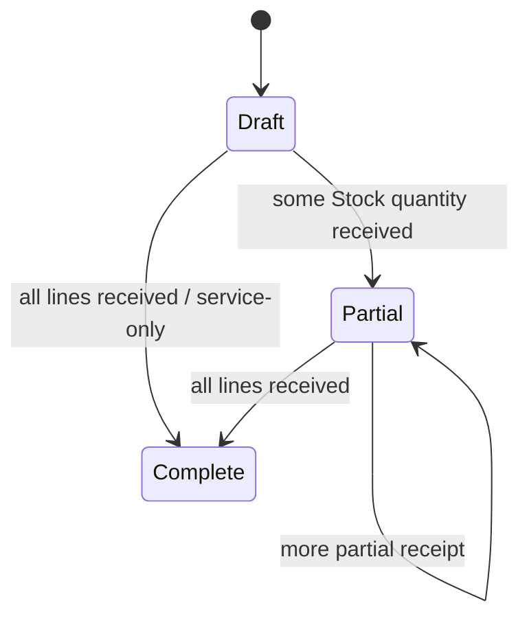

### Handling unit — PARTIAL aggregate
Evidence: D/Aggregates/HandlingUnit.cs#HandlingUnitStatus; I/Persistence/MartenReceiveGoodsOrchestration.cs#ExecuteAsync; A/Services/AdvancedWarehouseStore.cs#SplitHu.
```mermaid
stateDiagram-v2
    [*] --> OPEN: created
    OPEN --> SEALED: sealed event
    SEALED --> PICKED: declared state; no verified transition
    PICKED --> EMPTY: declared state; no verified transition
```

### Reservation — IMPLEMENTED event-sourced lifecycle
Evidence: D/Aggregates/Reservation.cs#ReservationStatus,#Allocate,#StartPicking,#Consume,#Cancel.
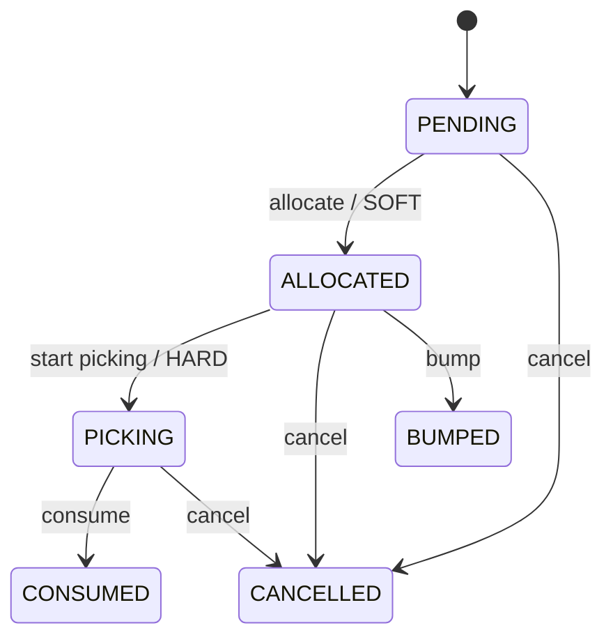

### Transfer — PARTIAL inter-warehouse execution
Evidence: D/Entities/MasterDataEntities.cs#Transfer.Submit,#Approve,#StartExecution,#Complete.
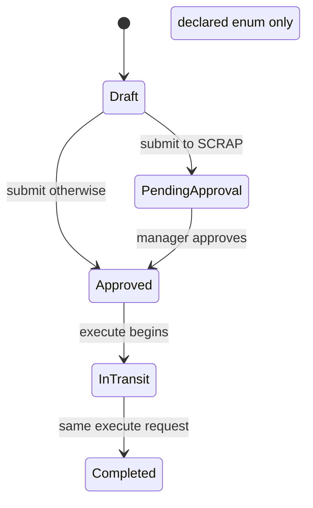

### Sales order — IMPLEMENTED commercial status, PARTIAL shipping stock
Evidence: D/Entities/MasterDataEntities.cs#SalesOrder.Submit,#Approve,#Allocate,#Release,#Pack,#Ship,#ConfirmDelivery,#Invoice,#Cancel.
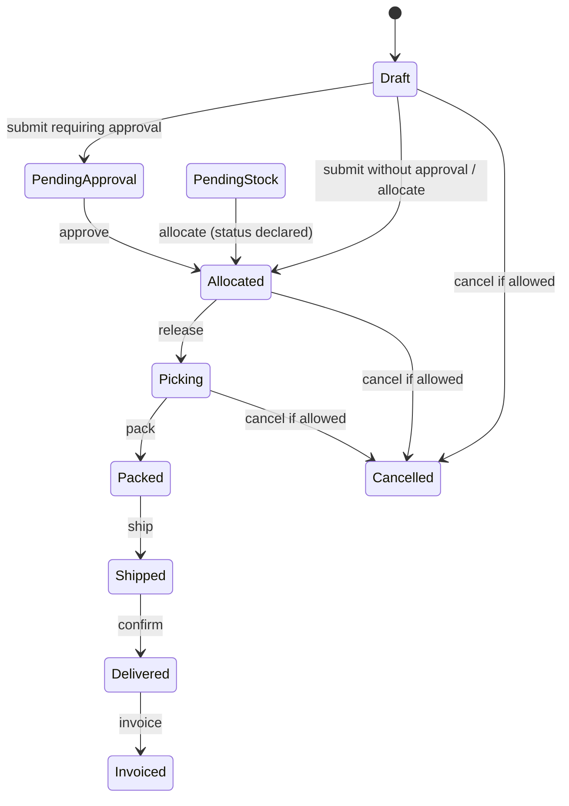

### Outbound order — IMPLEMENTED status, PARTIAL physical shipping
Evidence: D/Entities/MasterDataEntities.cs#OutboundOrder.MarkAllocated,#StartPicking,#CompletePicking,#Pack,#Ship,#ConfirmDelivery,#Cancel.
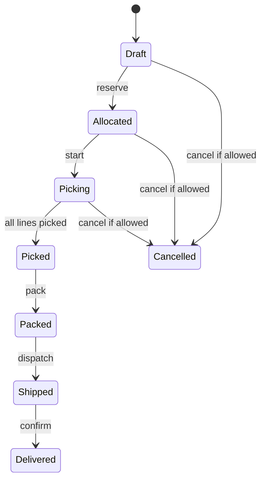

### Pick task — PARTIAL partial quantity
Evidence: D/Entities/MasterDataEntities.cs#PickTask; A/Api/Controllers/PickingController.cs#CreateTaskAsync,#CompleteTaskAsync.
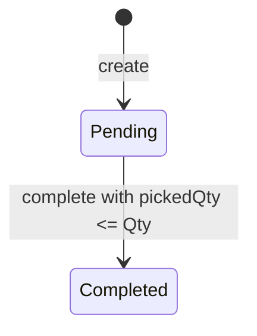

### Cycle count — PARTIAL correction; unused declared states
Evidence: D/Entities/MasterDataEntities.cs#CycleCount.Start,#Complete,#MarkCompleted; A/Services/CycleCountServices.cs#RecordCountCommandHandler.Handle,#ApplyAdjustmentCommandHandler.Handle.
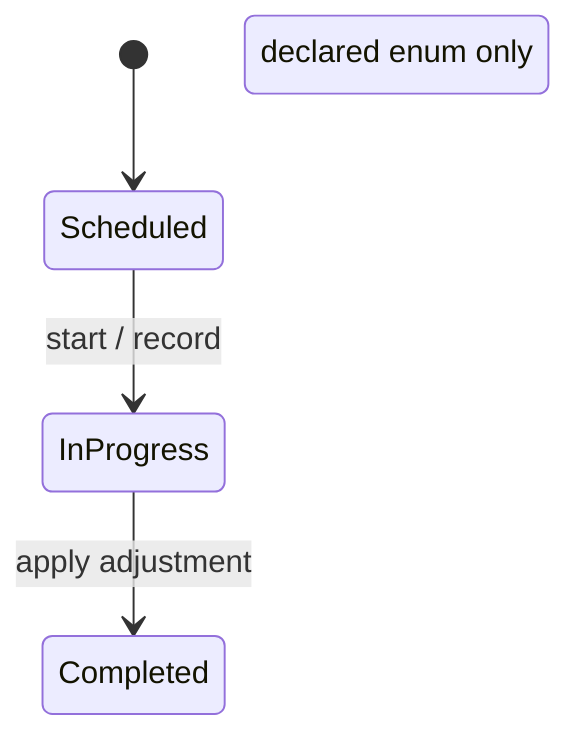

### RMA — UI-ONLY/in-memory
Evidence: A/Services/AdvancedWarehouseStore.cs#CreateRma,#ReceiveRma,#InspectRma.
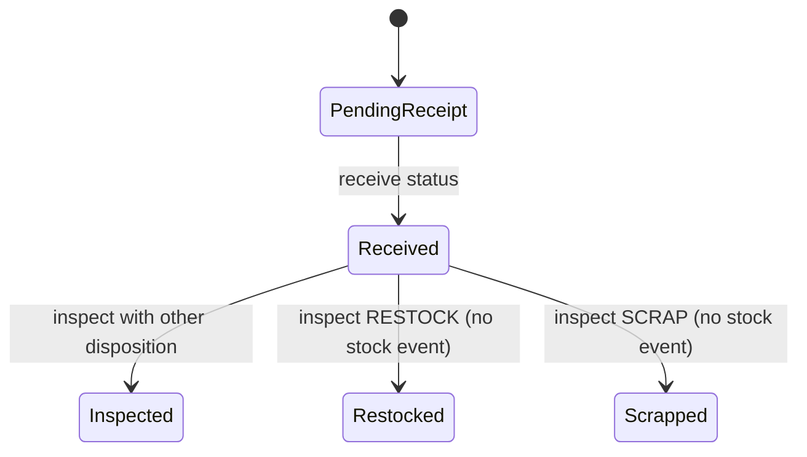

### Agnum export — IMPLEMENTED status/retry, PARTIAL remote acceptance
Evidence: D/Entities/MasterDataEntities.cs#AgnumExportStatus; S/AgnumExportSaga.cs#AgnumExportSaga; A/Services/AgnumExportServices.cs#ExecuteAsync.
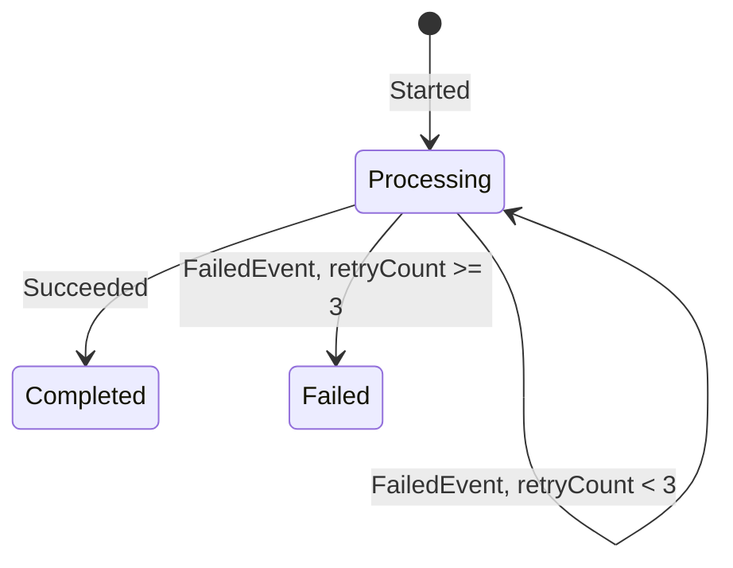


## J. Diagrams

Solid arrows are implemented projected moves; dashed arrows indicate document-only or in-memory transitions. The sequence diagrams show actual call order and distinguish SQL, Marten and event-bus writes. Cross-warehouse transfers and outbound packing must not be depicted as guaranteed balanced fulfillment. Evidence: `A/Api/Controllers/ReceivingController.cs#ReceiveGoodsAsync`, `A/Services/TransferServices.cs#Handle`, `A/Services/OutboundOrderCommandHandlers.cs#PackAsync`, `A/Services/ShipmentCommandHandlers.cs#Handle`.

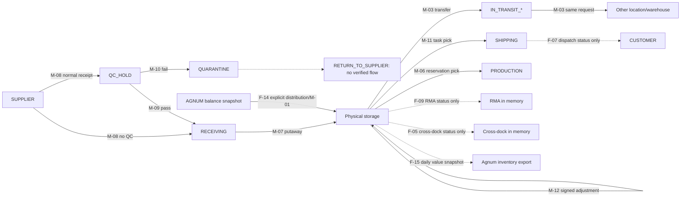

### Receive goods — F-01
```mermaid
sequenceDiagram
    actor Q as QC/manager
    participant UI as Inbound shipment UI
    participant API as ReceivingController
    participant SQL as EF SQL
    participant ES as Marten
    participant V as Valuation
    Q->>UI: Receive qty, price, optional/required lot
    UI->>API: POST shipment/{id}/receive
    API->>SQL: Validate line; upsert Lot; update ReceivedQty/status
    API->>ES: Append GoodsReceivedEvent
    ES-->>UI: AvailableStock projection catches up
    API->>V: Try WAC/landed-cost update
    Note over API,V: Valuation error is logged; physical receipt remains
```

### Transfer — F-04
```mermaid
sequenceDiagram
    actor O as Operator
    participant UI as Transfer UI
    participant API as ExecuteTransferCommandHandler
    participant SQL as EF SQL
    participant ES as StockLedger/Marten
    O->>UI: Create, submit, execute
    UI->>API: POST /transfers/{id}/execute
    API->>SQL: Check lines and availability
    API->>SQL: StartExecution; create IN_TRANSIT_* location
    API->>ES: Append source -> IN_TRANSIT_* StockMovedEvent
    API->>ES: Append IN_TRANSIT_* -> target StockMovedEvent
    API->>SQL: Complete transfer
    Note over ES: Cross-warehouse streams differ; no arrival confirmation
```

### Sell and ship — F-06/F-07
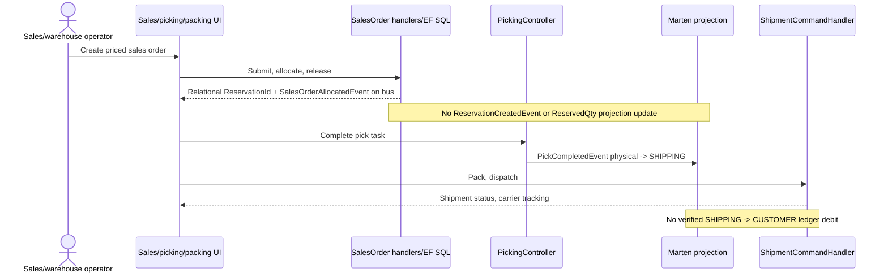


## K. Gaps, mismatches and open questions

The principal gaps are accounting-grade identity (lot/HU), transaction atomicity and the end of outbound stock movement. Several rich UI pages have a backing HTTP endpoint but that endpoint only changes ephemeral state. Documentation that describes a fully closed end-to-end WMS must therefore be read as intent rather than implementation. Evidence: `C/ReadModels/AvailableStockView.cs#ComputeId`, `A/Services/AdvancedWarehouseStore.cs#AdvancedWarehouseStore`, `S/ReceiveGoodsSaga.cs#ReceiveGoodsSaga`.

### Code versus documentation or apparent UI intent

1. `ReceiveGoodsSaga` is an empty placeholder; normal inbound is implemented directly in `ReceivingController`, with EF and Marten writes separated. `S/ReceiveGoodsSaga.cs#ReceiveGoodsSaga`; `A/Api/Controllers/ReceivingController.cs#CreateShipmentAsync,#ReceiveGoodsAsync`.
2. `StockLedger` claims to be the single quantity source, but normal receipt, QC, pick task and adjustment bypass `StockLedger.RecordMovement` and use separate event streams. Projections combine them. `D/Aggregates/StockLedger.cs#RecordMovement`; `P/AvailableStockProjection.cs#AvailableStockGrouper.Group`.
3. `AvailableStockView` has a single lot/expiry field per warehouse/location/SKU, so it cannot correctly represent simultaneous different lots in one bin. Both traceability paths use item-level SQL associations rather than a lot-specific movement chain; a lot can be associated with an unrelated shipment/order of the same item. `C/ReadModels/AvailableStockView.cs#ComputeId`; `P/AvailableStockProjection.cs#Apply(GoodsReceivedEvent)`; `A/Services/LotTraceabilityService.cs#BuildBackwardAsync,#BuildForwardAsync`; `A/Api/Controllers/ReportsController.cs#GetTraceabilityAsync`.
4. Transfer execution emits two moves in one call but appends the second to a **destination warehouse** stream with `IN_TRANSIT_*` as from; the first used the source warehouse stream. This is not an atomic long-lived inter-warehouse transit state and needs reconciliation. `A/Services/TransferServices.cs#ExecuteTransferCommandHandler.Handle`.
5. Task picking moves physical→`SHIPPING`; packing publishes `PICKING_STAGING`→`SHIPPING` without appending to ledger; dispatch changes shipment/order status without a confirmed `SHIPPING`→`CUSTOMER` movement. `A/Api/Controllers/PickingController.cs#CompleteTaskAsync`; `A/Services/OutboundOrderCommandHandlers.cs#PackAsync`; `A/Services/ShipmentCommandHandlers.cs#Handle`.
6. Wave, cross-dock, RMA, advanced HU split/merge and serial tracking are held by singleton in-memory `AdvancedWarehouseStore`; process restart loses them, and they have no ledger move. `A/Program.cs:273`; `A/Services/AdvancedWarehouseStore.cs#AdvancedWarehouseStore`.
7. Cycle-count adjustment publishes its event only to the bus and does not update Marten stock projections. `A/Services/CycleCountServices.cs#ApplyAdjustmentCommandHandler.Handle`; `A/Api/Controllers/AdjustmentsController.cs#CreateAsync`.
8. Sales allocation assigns a relational `ReservationId` and publishes `SalesOrderAllocatedEvent`, but no producer of `ReservationCreatedEvent` or `ReservationCreatedMasterDataEvent` was found in Warehouse. The reservation UI's Start Picking depends on a previously created stream. `A/Services/SalesOrderCommandHandlers.cs#AllocateSalesOrderCommandHandler.Handle`; `A/Api/Controllers/ReservationsController.cs#StartPickingAsync`; `D/Aggregates/Reservation.cs#Apply`.
9. A supplier-return location is seeded but there is no verified return-to-supplier UI/command. RMA “restock/scrap” is a status only. `I/Persistence/Migrations/20260210050442_InitialMasterData.cs#Up`; `A/Services/AdvancedWarehouseStore.cs#InspectRma`.
10. Agnum export is a quantity/value snapshot, not transaction-level financial posting. The reconciliation report is stored in memory. `A/Services/AgnumExportServices.cs#LoadExportRowsAsync`; `A/Services/AgnumReconciliationServices.cs#InMemoryAgnumReconciliationReportStore`.
11. Other modules use separate legacy SQL reads: Sales order-entry color availability and Frontline fabric lookup; Shopfloor references legacy warehouse write-off text but no call from that code to the Warehouse ledger was found. Do not depict them as Warehouse stock moves. `src/Modules/Sales/LKvitai.MES.Modules.Sales.Infrastructure/Sql/SqlLiveOrderEntryCatalog.cs#GetAsync`; `src/Modules/Frontline/LKvitai.MES.Modules.Frontline.Api/Composition/FrontlineFabricPhotos.cs`; `src/Modules/Shopfloor/LKvitai.MES.Modules.Shopfloor.WebUI/Pages/Gamyba.razor.cs`. Scanning and Finance: no direct Warehouse stock mutation found in the inspected module source search.
12. `/locations/{Id:int}` is a static instruction/link page; it neither loads the location nor displays its stock. `W/Pages/WarehouseLocationDetail.razor#@page`.

### Open questions for the product owner

1. Should `QUARANTINE`, `RETURN_TO_SUPPLIER`, `SCRAP` and `PRODUCTION` have explicit release/write-off/return commands, and which role authorizes each?
2. Is lot-isolated balance required, including two lots in the same location and FEFO enforcement at pick time?
3. When should shipping leave MES stock: pick, pack or carrier dispatch? Which location is the canonical staging location?
4. Should cross-warehouse transfer expose a durable in-transit interval and a receiving confirmation?
5. Are Agnum imports authoritative for stock, or only external snapshots? Which, if any, per-movement Agnum document types are required?
6. Should a short-received shipment have a manual close-short action? Should partial pick retain a remainder task?
7. What is the intended atomicity/recovery policy when SQL succeeds but Marten/valuation/distribution persistence fails?
8. Should sales-order allocation create the event-sourced reservation and projected `ReservedQty`, and should expiry release those locks?

## Machine-readable appendix

The JSON repeats the IDs from B, C, E, G and H. It is generated from the same inventory used for the tables; `steps` preserve each flow's step-level status.

```json
{
  "locations": [
    {
      "id": "L-01",
      "code": "RECEIVING",
      "kind": "seeded virtual",
      "role": "normal receipt / QC pass / putaway source",
      "status": "IMPLEMENTED"
    },
    {
      "id": "L-02",
      "code": "QC_HOLD",
      "kind": "seeded virtual",
      "role": "QC required receipt",
      "status": "IMPLEMENTED"
    },
    {
      "id": "L-03",
      "code": "QUARANTINE",
      "kind": "seeded virtual",
      "role": "QC failure",
      "status": "PARTIAL"
    },
    {
      "id": "L-04",
      "code": "PRODUCTION",
      "kind": "seeded virtual",
      "role": "reservation pick destination",
      "status": "PARTIAL"
    },
    {
      "id": "L-05",
      "code": "SHIPPING",
      "kind": "seeded virtual",
      "role": "task pick destination",
      "status": "PARTIAL"
    },
    {
      "id": "L-06",
      "code": "SCRAP",
      "kind": "seeded virtual",
      "role": "transfer approval destination",
      "status": "PARTIAL"
    },
    {
      "id": "L-07",
      "code": "RETURN_TO_SUPPLIER",
      "kind": "seeded virtual",
      "role": "no verified command",
      "status": "PARTIAL"
    },
    {
      "id": "L-08",
      "code": "IN_TRANSIT_{TransferNumber}",
      "kind": "dynamic virtual",
      "role": "transfer intermediate",
      "status": "IMPLEMENTED"
    },
    {
      "id": "L-09",
      "code": "SUPPLIER",
      "kind": "pseudo external",
      "role": "receive command source",
      "status": "BACKEND-ONLY"
    },
    {
      "id": "L-10",
      "code": "AGNUM",
      "kind": "pseudo external",
      "role": "Agnum distribution source",
      "status": "IMPLEMENTED"
    },
    {
      "id": "L-11",
      "code": "CUSTOMER",
      "kind": "pseudo external",
      "role": "report label, no dispatch debit",
      "status": "PARTIAL"
    },
    {
      "id": "L-12",
      "code": "SYSTEM",
      "kind": "pseudo external",
      "role": "HU projection external location",
      "status": "BACKEND-ONLY"
    },
    {
      "id": "L-13",
      "code": "PICKING_STAGING",
      "kind": "code only",
      "role": "pack event source",
      "status": "PARTIAL"
    },
    {
      "id": "L-14",
      "code": "physical configured location",
      "kind": "master data",
      "role": "putaway/transfer/pick",
      "status": "IMPLEMENTED"
    }
  ],
  "movements": [
    {
      "id": "M-01",
      "name": "StockMovedEvent/RECEIPT",
      "status": "IMPLEMENTED"
    },
    {
      "id": "M-02",
      "name": "StockMovedEvent/DISPATCH",
      "status": "PARTIAL"
    },
    {
      "id": "M-03",
      "name": "StockMovedEvent/TRANSFER",
      "status": "PARTIAL"
    },
    {
      "id": "M-04",
      "name": "StockMovedEvent/ADJUSTMENT_IN",
      "status": "BACKEND-ONLY"
    },
    {
      "id": "M-05",
      "name": "StockMovedEvent/ADJUSTMENT_OUT",
      "status": "BACKEND-ONLY"
    },
    {
      "id": "M-06",
      "name": "StockMovedEvent/PICK",
      "status": "PARTIAL"
    },
    {
      "id": "M-07",
      "name": "StockMovedEvent/Putaway",
      "status": "IMPLEMENTED"
    },
    {
      "id": "M-08",
      "name": "GoodsReceivedEvent",
      "status": "PARTIAL"
    },
    {
      "id": "M-09",
      "name": "QCPassedEvent",
      "status": "IMPLEMENTED"
    },
    {
      "id": "M-10",
      "name": "QCFailedEvent",
      "status": "IMPLEMENTED"
    },
    {
      "id": "M-11",
      "name": "PickCompletedEvent",
      "status": "PARTIAL"
    },
    {
      "id": "M-12",
      "name": "StockAdjustedEvent",
      "status": "PARTIAL"
    },
    {
      "id": "M-13",
      "name": "ReservationCreated/ReleasedMasterDataEvent",
      "status": "PARTIAL"
    },
    {
      "id": "M-14",
      "name": "PickingStarted/ReservationConsumed/CancelledEvent",
      "status": "PARTIAL"
    }
  ],
  "flows": [
    {
      "id": "F-01",
      "name": "Normal inbound and partial/over receipt",
      "status": "PARTIAL",
      "steps": [
        {
          "id": "F-01-S01",
          "actor": "QcOrManager",
          "screen": "/inbound/shipments/create",
          "uiLabelKey": "InboundShipments.CreateInbound",
          "api": "POST /api/warehouse/v1/receiving/shipments",
          "command": "CreateShipmentAsync",
          "events": "InboundShipmentCreatedEvent",
          "move": "none",
          "quantityEffect": "0",
          "valueEffect": "landed-cost inputs only",
          "status": "PARTIAL",
          "evidence": "A/Api/Controllers/ReceivingController.cs#CreateShipmentAsync"
        },
        {
          "id": "F-01-S02",
          "actor": "QcOrManager",
          "screen": "/inbound/shipments/{Id:int}",
          "uiLabelKey": "Common.Receive",
          "api": "POST /api/warehouse/v1/receiving/shipments/{id}/receive",
          "command": "ReceiveGoodsAsync",
          "events": "GoodsReceivedEvent",
          "move": "SUPPLIER → QC_HOLD if RequiresQC, else RECEIVING",
          "quantityEffect": "+ReceivedQty",
          "valueEffect": "WAC attempt with unit price and apportioned costs",
          "status": "PARTIAL",
          "evidence": "A/Api/Controllers/ReceivingController.cs#ReceiveGoodsAsync"
        },
        {
          "id": "F-01-S03",
          "actor": "QcOrManager",
          "screen": "/inbound/qc",
          "uiLabelKey": "ReceivingQc.Pass",
          "api": "POST /api/warehouse/v1/qc/pass",
          "command": "ProcessQcAsync",
          "events": "QCPassedEvent",
          "move": "QC_HOLD → RECEIVING",
          "quantityEffect": "-q/+q",
          "valueEffect": "none",
          "status": "IMPLEMENTED",
          "evidence": "A/Api/Controllers/QCController.cs#ProcessQcAsync"
        },
        {
          "id": "F-01-S04",
          "actor": "QcOrManager",
          "screen": "/inbound/qc",
          "uiLabelKey": "ReceivingQc.Fail",
          "api": "POST /api/warehouse/v1/qc/fail",
          "command": "ProcessQcAsync",
          "events": "QCFailedEvent",
          "move": "QC_HOLD → QUARANTINE",
          "quantityEffect": "-q/+q",
          "valueEffect": "none",
          "status": "IMPLEMENTED",
          "evidence": "A/Api/Controllers/QCController.cs#ProcessQcAsync"
        },
        {
          "id": "F-01-S05",
          "actor": "QcOrManager",
          "screen": "/putaway",
          "uiLabelKey": "Putaway.Putaway",
          "api": "POST /api/warehouse/v1/putaway",
          "command": "PutawayAsync",
          "events": "StockMovedEvent/Putaway",
          "move": "RECEIVING → selected location",
          "quantityEffect": "-q/+q",
          "valueEffect": "none",
          "status": "IMPLEMENTED",
          "evidence": "A/Api/Controllers/PutawayController.cs#PutawayAsync"
        }
      ]
    },
    {
      "id": "F-02",
      "name": "Receipt without shipment",
      "status": "PARTIAL",
      "steps": [
        {
          "id": "F-02-S01",
          "actor": "InventoryAccountantOrManager",
          "screen": "/agnum/balances",
          "uiLabelKey": "Agnum.Balances.Distribute",
          "api": "POST /api/warehouse/v1/agnum/balances/{id}/distribute",
          "command": "DistributeAgnumBalanceCommand → ReceiveGoodsCommand",
          "events": "HandlingUnitCreatedEvent, StockMovedEvent, HandlingUnitSealedEvent",
          "move": "AGNUM → chosen location",
          "quantityEffect": "+q",
          "valueEffect": "no WAC update",
          "status": "PARTIAL",
          "evidence": "A/Services/DistributeAgnumBalanceCommandHandler.cs#Handle; I/Persistence/MartenReceiveGoodsOrchestration.cs#ExecuteAsync"
        }
      ]
    },
    {
      "id": "F-03",
      "name": "Supplier return and quarantine release",
      "status": "PLANNED",
      "steps": [
        {
          "id": "F-03-S01",
          "actor": "QcOrManager",
          "screen": "/inbound/qc",
          "uiLabelKey": "ReceivingQc.Fail",
          "api": "POST /api/warehouse/v1/qc/fail",
          "command": "ProcessQcAsync",
          "events": "QCFailedEvent",
          "move": "QC_HOLD → QUARANTINE",
          "quantityEffect": "-q/+q",
          "valueEffect": "none",
          "status": "IMPLEMENTED",
          "evidence": "A/Api/Controllers/QCController.cs#ProcessQcAsync"
        },
        {
          "id": "F-03-S02",
          "actor": "unknown",
          "screen": "none",
          "uiLabelKey": null,
          "api": "none",
          "command": "none",
          "events": "none",
          "move": "QUARANTINE → RETURN_TO_SUPPLIER",
          "quantityEffect": "none implemented",
          "valueEffect": "none",
          "status": "PLANNED",
          "evidence": "I/Persistence/Migrations/20260210050442_InitialMasterData.cs#Up"
        }
      ]
    },
    {
      "id": "F-04",
      "name": "Internal and cross-warehouse transfer",
      "status": "PARTIAL",
      "steps": [
        {
          "id": "F-04-S01",
          "actor": "OperatorOrAbove",
          "screen": "/transfers/create",
          "uiLabelKey": "Transfers.Create.CreateTransfer",
          "api": "POST /api/warehouse/v1/transfers",
          "command": "CreateTransferCommand",
          "events": "TransferCreatedEvent",
          "move": "none",
          "quantityEffect": "0",
          "valueEffect": "none",
          "status": "IMPLEMENTED",
          "evidence": "A/Services/TransferServices.cs#CreateTransferCommandHandler.Handle"
        },
        {
          "id": "F-04-S02",
          "actor": "OperatorOrAbove",
          "screen": "/transfers",
          "uiLabelKey": "Common.Submit",
          "api": "POST /api/warehouse/v1/transfers/{id}/submit",
          "command": "SubmitTransferCommand",
          "events": "EF transfer status only (no event)",
          "move": "none",
          "quantityEffect": "0",
          "valueEffect": "none",
          "status": "IMPLEMENTED",
          "evidence": "A/Services/TransferServices.cs#SubmitTransferCommandHandler.Handle"
        },
        {
          "id": "F-04-S03",
          "actor": "ManagerOrAdmin if SCRAP",
          "screen": "/transfers",
          "uiLabelKey": "Transfers.List.ApproveTransfer",
          "api": "POST /api/warehouse/v1/transfers/{id}/approve",
          "command": "ApproveTransferCommand",
          "events": "TransferApprovedEvent",
          "move": "none",
          "quantityEffect": "0",
          "valueEffect": "none",
          "status": "IMPLEMENTED",
          "evidence": "A/Services/TransferServices.cs#ApproveTransferCommandHandler.Handle"
        },
        {
          "id": "F-04-S04",
          "actor": "OperatorOrAbove",
          "screen": "/transfers/{Id:guid}/execute",
          "uiLabelKey": "Transfers.Execute.ExecuteTransfer",
          "api": "POST /api/warehouse/v1/transfers/{id}/execute",
          "command": "ExecuteTransferCommand",
          "events": "TransferExecutedEvent, 2×StockMovedEvent, TransferCompletedEvent",
          "move": "source → IN_TRANSIT_* → target",
          "quantityEffect": "-q/+q twice",
          "valueEffect": "no revaluation",
          "status": "PARTIAL",
          "evidence": "A/Services/TransferServices.cs#ExecuteTransferCommandHandler.Handle"
        }
      ]
    },
    {
      "id": "F-05",
      "name": "Cross-dock",
      "status": "UI-ONLY",
      "steps": [
        {
          "id": "F-05-S01",
          "actor": "OperatorOrAbove",
          "screen": "/cross-dock",
          "uiLabelKey": "CrossDock.CreateCrossDockMatch",
          "api": "POST /api/warehouse/v1/cross-dock",
          "command": "CreateCrossDock",
          "events": "none",
          "move": "none",
          "quantityEffect": "0",
          "valueEffect": "none",
          "status": "UI-ONLY",
          "evidence": "A/Api/Controllers/AdvancedWarehouseController.cs#CrossDockController; A/Services/AdvancedWarehouseStore.cs#CreateCrossDock"
        },
        {
          "id": "F-05-S02",
          "actor": "OperatorOrAbove",
          "screen": "/cross-dock",
          "uiLabelKey": "Common.Complete",
          "api": "POST /api/warehouse/v1/cross-dock/{id}/status",
          "command": "UpdateCrossDockStatus",
          "events": "none",
          "move": "none",
          "quantityEffect": "0",
          "valueEffect": "none",
          "status": "UI-ONLY",
          "evidence": "A/Services/AdvancedWarehouseStore.cs#UpdateCrossDockStatus"
        }
      ]
    },
    {
      "id": "F-06",
      "name": "Sales allocation and reservation",
      "status": "PARTIAL",
      "steps": [
        {
          "id": "F-06-S01",
          "actor": "SalesAdminOrManager",
          "screen": "/sales/orders/create",
          "uiLabelKey": "SalesOrderCreate.CreateSalesOrder",
          "api": "POST /api/warehouse/v1/sales-orders",
          "command": "CreateSalesOrderCommand",
          "events": "SalesOrderCreatedEvent",
          "move": "none",
          "quantityEffect": "0",
          "valueEffect": "commercial line UnitPrice",
          "status": "IMPLEMENTED",
          "evidence": "A/Services/SalesOrderCommandHandlers.cs#CreateSalesOrderCommandHandler.Handle"
        },
        {
          "id": "F-06-S02",
          "actor": "SalesAdminOrManager",
          "screen": "/sales/orders/{Id:guid}",
          "uiLabelKey": "Common.Submit",
          "api": "POST /api/warehouse/v1/sales-orders/{id}/submit",
          "command": "SubmitSalesOrderCommand",
          "events": "SalesOrderAllocatedEvent when no approval; otherwise EF status only; no Marten reservation",
          "move": "none",
          "quantityEffect": "0",
          "valueEffect": "none",
          "status": "PARTIAL",
          "evidence": "A/Services/SalesOrderCommandHandlers.cs#SubmitSalesOrderCommandHandler.Handle"
        },
        {
          "id": "F-06-S03",
          "actor": "SalesAdminOrManager",
          "screen": "/sales/orders/{Id:guid}",
          "uiLabelKey": "SalesOrderDetail.Allocate",
          "api": "POST /api/warehouse/v1/sales-orders/{id}/allocate",
          "command": "AllocateSalesOrderCommand",
          "events": "SalesOrderAllocatedEvent (bus only)",
          "move": "none",
          "quantityEffect": "0; no ReservedQty increment",
          "valueEffect": "none",
          "status": "PARTIAL",
          "evidence": "A/Services/SalesOrderCommandHandlers.cs#AllocateSalesOrderCommandHandler.Handle; P/AvailableStockProjection.cs#Apply"
        },
        {
          "id": "F-06-S04",
          "actor": "ManagerOrAdmin",
          "screen": "/sales/orders/{Id:guid}",
          "uiLabelKey": "SalesOrderDetail.ReleaseToPicking",
          "api": "POST /api/warehouse/v1/sales-orders/{id}/release",
          "command": "ReleaseSalesOrderCommand",
          "events": "OutboundOrderCreatedEvent",
          "move": "none",
          "quantityEffect": "0",
          "valueEffect": "none",
          "status": "IMPLEMENTED",
          "evidence": "A/Services/SalesOrderCommandHandlers.cs#ReleaseSalesOrderCommandHandler.Handle"
        },
        {
          "id": "F-06-S05",
          "actor": "OperatorOrAbove",
          "screen": "/reservations",
          "uiLabelKey": "Reservations.StartPicking",
          "api": "POST /api/warehouse/v1/reservations/{id}/start-picking",
          "command": "StartPickingCommand",
          "events": "PickingStartedEvent only if a reservation stream already exists",
          "move": "none",
          "quantityEffect": "0; conditional HardLockedQty +q",
          "valueEffect": "none",
          "status": "PARTIAL",
          "evidence": "A/Api/Controllers/ReservationsController.cs#StartPickingAsync; I/Persistence/MartenAllocateReservationOrchestration.cs#AllocateAsync; P/AvailableStockProjection.cs#Apply"
        }
      ]
    },
    {
      "id": "F-07",
      "name": "Single-task pick, pack and dispatch",
      "status": "PARTIAL",
      "steps": [
        {
          "id": "F-07-S01",
          "actor": "OperatorOrAbove",
          "screen": "/picking/tasks",
          "uiLabelKey": "PickingTasks.CreateTask",
          "api": "POST /api/warehouse/v1/picking/tasks",
          "command": "CreateTaskAsync",
          "events": "none",
          "move": "none",
          "quantityEffect": "0",
          "valueEffect": "none",
          "status": "IMPLEMENTED",
          "evidence": "A/Api/Controllers/PickingController.cs#CreateTaskAsync"
        },
        {
          "id": "F-07-S02",
          "actor": "OperatorOrAbove",
          "screen": "/picking/tasks",
          "uiLabelKey": "PickingTasks.CompleteTask",
          "api": "POST /api/warehouse/v1/picking/tasks/{id}/complete",
          "command": "CompleteTaskAsync",
          "events": "PickCompletedEvent",
          "move": "physical → SHIPPING",
          "quantityEffect": "-q/+q",
          "valueEffect": "none",
          "status": "PARTIAL",
          "evidence": "A/Api/Controllers/PickingController.cs#CompleteTaskAsync"
        },
        {
          "id": "F-07-S03",
          "actor": "PackingOperatorOrManager",
          "screen": "/outbound/pack/{OrderId:guid}",
          "uiLabelKey": "PackingStation.Pack",
          "api": "POST /api/warehouse/v1/outbound/orders/{id}/pack",
          "command": "PackOrderCommand",
          "events": "ShipmentPackedEvent, StockMovedEvent published",
          "move": "PICKING_STAGING → SHIPPING claimed",
          "quantityEffect": "unverified ledger effect",
          "valueEffect": "none",
          "status": "PARTIAL",
          "evidence": "A/Services/OutboundOrderCommandHandlers.cs#PackAsync"
        },
        {
          "id": "F-07-S04",
          "actor": "OperatorOrAbove",
          "screen": "/outbound/dispatch",
          "uiLabelKey": "OutboundDispatch.Dispatch",
          "api": "POST /api/warehouse/v1/shipments/{id}/dispatch",
          "command": "DispatchShipmentCommand",
          "events": "ShipmentDispatchedEvent",
          "move": "no ledger destination",
          "quantityEffect": "0 in ledger",
          "valueEffect": "none",
          "status": "PARTIAL",
          "evidence": "A/Services/ShipmentCommandHandlers.cs#Handle"
        }
      ]
    },
    {
      "id": "F-08",
      "name": "Wave pick and labels",
      "status": "UI-ONLY",
      "steps": [
        {
          "id": "F-08-S01",
          "actor": "OperatorOrAbove",
          "screen": "/waves",
          "uiLabelKey": "WavePicking.CreateWave",
          "api": "POST /api/warehouse/v1/waves",
          "command": "CreateWave",
          "events": "none",
          "move": "none",
          "quantityEffect": "0",
          "valueEffect": "none",
          "status": "UI-ONLY",
          "evidence": "A/Api/Controllers/AdvancedWarehouseController.cs#WavesController; A/Services/AdvancedWarehouseStore.cs#CreateWave"
        },
        {
          "id": "F-08-S02",
          "actor": "OperatorOrAbove",
          "screen": "/waves",
          "uiLabelKey": "WavePicking.1Line",
          "api": "POST /api/warehouse/v1/waves/{id}/complete-lines",
          "command": "CompleteWaveLines",
          "events": "none",
          "move": "none",
          "quantityEffect": "0",
          "valueEffect": "none",
          "status": "UI-ONLY",
          "evidence": "A/Services/AdvancedWarehouseStore.cs#CompleteWaveLines"
        }
      ]
    },
    {
      "id": "F-09",
      "name": "RMA return, restock or scrap",
      "status": "UI-ONLY",
      "steps": [
        {
          "id": "F-09-S01",
          "actor": "SalesAdminOrManager",
          "screen": "/rmas",
          "uiLabelKey": "Rmas.CreateRMA",
          "api": "POST /api/warehouse/v1/rmas",
          "command": "CreateRma",
          "events": "none",
          "move": "none",
          "quantityEffect": "0",
          "valueEffect": "none",
          "status": "UI-ONLY",
          "evidence": "A/Services/AdvancedWarehouseStore.cs#CreateRma"
        },
        {
          "id": "F-09-S02",
          "actor": "OperatorOrAbove",
          "screen": "/rmas",
          "uiLabelKey": "Common.Receive",
          "api": "POST /api/warehouse/v1/rmas/{id}/receive",
          "command": "ReceiveRma",
          "events": "none",
          "move": "none",
          "quantityEffect": "0",
          "valueEffect": "none",
          "status": "UI-ONLY",
          "evidence": "A/Services/AdvancedWarehouseStore.cs#ReceiveRma"
        },
        {
          "id": "F-09-S03",
          "actor": "QcOrManager",
          "screen": "/rmas",
          "uiLabelKey": "Rmas.Restock",
          "api": "POST /api/warehouse/v1/rmas/{id}/inspect",
          "command": "InspectRma",
          "events": "none",
          "move": "none",
          "quantityEffect": "0",
          "valueEffect": "none",
          "status": "UI-ONLY",
          "evidence": "A/Services/AdvancedWarehouseStore.cs#InspectRma"
        }
      ]
    },
    {
      "id": "F-10",
      "name": "Stock adjustment, write-off and cycle count",
      "status": "PARTIAL",
      "steps": [
        {
          "id": "F-10-S01",
          "actor": "ManagerOrAdmin",
          "screen": "/stock/adjustments",
          "uiLabelKey": "Common.Create",
          "api": "POST /api/warehouse/v1/adjustments",
          "command": "CreateAdjustmentAsync",
          "events": "StockAdjustedEvent",
          "move": "selected location ±q",
          "quantityEffect": "signed QtyDelta",
          "valueEffect": "no unit cost",
          "status": "IMPLEMENTED",
          "evidence": "W/Pages/StockAdjustments.razor#CreateAsync; A/Api/Controllers/AdjustmentsController.cs#CreateAsync"
        },
        {
          "id": "F-10-S02",
          "actor": "OperatorOrAbove",
          "screen": "/cycle-counts/schedule",
          "uiLabelKey": "Common.Submit",
          "api": "POST /api/warehouse/v1/cycle-counts/schedule",
          "command": "ScheduleCycleCountCommand",
          "events": "CycleCountScheduledEvent",
          "move": "none",
          "quantityEffect": "0",
          "valueEffect": "none",
          "status": "IMPLEMENTED",
          "evidence": "A/Services/CycleCountServices.cs#ScheduleCycleCountCommandHandler.Handle"
        },
        {
          "id": "F-10-S03",
          "actor": "OperatorOrAbove",
          "screen": "/cycle-counts/{Id:guid}/execute",
          "uiLabelKey": "Common.Submit",
          "api": "POST /api/warehouse/v1/cycle-counts/{id}/record-count",
          "command": "RecordCountCommand",
          "events": "CountRecordedEvent",
          "move": "none",
          "quantityEffect": "0",
          "valueEffect": "none",
          "status": "IMPLEMENTED",
          "evidence": "A/Services/CycleCountServices.cs#RecordCountCommandHandler.Handle"
        },
        {
          "id": "F-10-S04",
          "actor": "OperatorOrAbove",
          "screen": "/cycle-counts/{Id:guid}/discrepancies",
          "uiLabelKey": "CycleCounts.Discrepancies.Confirm",
          "api": "POST /api/warehouse/v1/cycle-counts/{id}/apply-adjustment",
          "command": "ApplyAdjustmentCommand",
          "events": "StockAdjustedEvent and CycleCountCompletedEvent published to bus only",
          "move": "no Marten projection move",
          "quantityEffect": "projected delta not applied",
          "valueEffect": "no unit cost",
          "status": "PARTIAL",
          "evidence": "A/Services/CycleCountServices.cs#ApplyAdjustmentCommandHandler.Handle"
        }
      ]
    },
    {
      "id": "F-11",
      "name": "Valuation adjustment and write-down",
      "status": "IMPLEMENTED",
      "steps": [
        {
          "id": "F-11-S01",
          "actor": "InventoryAccountantOrManager",
          "screen": "/valuation/adjust-cost",
          "uiLabelKey": "Common.AdjustCost",
          "api": "POST /api/warehouse/v1/valuation/adjust-cost",
          "command": "AdjustCostCommand",
          "events": "CostAdjusted",
          "move": "none",
          "quantityEffect": "0",
          "valueEffect": "CurrentCost changes",
          "status": "IMPLEMENTED",
          "evidence": "A/Api/Controllers/ValuationController.cs#AdjustCostV2Async"
        },
        {
          "id": "F-11-S02",
          "actor": "InventoryAccountantOrManager",
          "screen": "/valuation/apply-landed-cost",
          "uiLabelKey": "Common.ApplyLandedCost",
          "api": "POST /api/warehouse/v1/valuation/apply-landed-cost",
          "command": "ApplyLandedCostCommand",
          "events": "LandedCostApplied",
          "move": "none",
          "quantityEffect": "0",
          "valueEffect": "CurrentCost changes",
          "status": "IMPLEMENTED",
          "evidence": "A/Api/Controllers/ValuationController.cs#ApplyLandedCostAsync"
        },
        {
          "id": "F-11-S03",
          "actor": "InventoryAccountantOrManager",
          "screen": "/valuation/write-down",
          "uiLabelKey": "Common.WriteDown",
          "api": "POST /api/warehouse/v1/valuation/write-down",
          "command": "WriteDownCommand",
          "events": "WrittenDown",
          "move": "none",
          "quantityEffect": "0",
          "valueEffect": "new valuation value",
          "status": "IMPLEMENTED",
          "evidence": "A/Api/Controllers/ValuationController.cs#WriteDownAsync"
        }
      ]
    },
    {
      "id": "F-12",
      "name": "Production consumption and output",
      "status": "PARTIAL",
      "steps": [
        {
          "id": "F-12-S01",
          "actor": "OperatorOrAbove",
          "screen": "/reservations",
          "uiLabelKey": "Common.Pick",
          "api": "POST /api/warehouse/v1/reservations/{id}/pick",
          "command": "PickStockCommand",
          "events": "StockMovedEvent/PICK, ReservationConsumedEvent",
          "move": "physical → PRODUCTION",
          "quantityEffect": "-q/+q",
          "valueEffect": "none",
          "status": "PARTIAL",
          "evidence": "I/Persistence/MartenPickStockOrchestration.cs#ExecuteAsync; S/PickStockSaga.cs#PickStockSaga"
        },
        {
          "id": "F-12-S02",
          "actor": "unknown",
          "screen": "none",
          "uiLabelKey": null,
          "api": "none",
          "command": "none",
          "events": "none",
          "move": "PRODUCTION → finished stock",
          "quantityEffect": "none implemented",
          "valueEffect": "none",
          "status": "PLANNED",
          "evidence": "src/Modules/Shopfloor/LKvitai.MES.Modules.Shopfloor.WebUI/Pages/Gamyba.razor.cs"
        }
      ]
    },
    {
      "id": "F-13",
      "name": "Admin item import",
      "status": "IMPLEMENTED",
      "steps": [
        {
          "id": "F-13-S01",
          "actor": "Admin",
          "screen": "/admin/import",
          "uiLabelKey": "AdminImport.RunImport",
          "api": "POST /api/warehouse/v1/admin/import/{entityType}?dryRun=…",
          "command": "ImportController.ImportAsync",
          "events": "relational master-data writes, not an inventory event",
          "move": "none",
          "quantityEffect": "0",
          "valueEffect": "catalog purchase/sale prices may change",
          "status": "IMPLEMENTED",
          "evidence": "W/Pages/AdminImport.razor#RunImportAsync; A/Api/Controllers/ImportController.cs#ImportAsync"
        }
      ]
    },
    {
      "id": "F-14",
      "name": "Agnum nomenclature/balance import and distribution",
      "status": "PARTIAL",
      "steps": [
        {
          "id": "F-14-S01",
          "actor": "InventoryAccountantOrManager",
          "screen": "none",
          "uiLabelKey": null,
          "api": "POST /api/warehouse/v1/agnum/import/products?sndId=…&apply=true or recurring job",
          "command": "ImportProductsAsync / AgnumNomenclatureImportService.ApplyAsync; optional AgnumPriceSyncService.SyncAsync",
          "events": "none",
          "move": "none",
          "quantityEffect": "0 physical",
          "valueEffect": "catalog price may change when price sync enabled",
          "status": "BACKEND-ONLY",
          "evidence": "A/Api/Controllers/AgnumImportController.cs#ImportProductsAsync; A/BackgroundJobs/AgnumImportRecurringJob.cs#ExecuteAsync"
        },
        {
          "id": "F-14-S02",
          "actor": "InventoryAccountantOrManager",
          "screen": "none",
          "uiLabelKey": null,
          "api": "POST /api/warehouse/v1/agnum/import/balances?sndId=…",
          "command": "StartImportAsync",
          "events": "none",
          "move": "Agnum virtual balance snapshot",
          "quantityEffect": "0 physical",
          "valueEffect": "external price data separate",
          "status": "BACKEND-ONLY",
          "evidence": "A/Api/Controllers/AgnumImportController.cs#ImportBalancesAsync; I/Agnum/AgnumBalanceImportService.cs#StartImportAsync"
        },
        {
          "id": "F-14-S03",
          "actor": "InventoryAccountantOrManager",
          "screen": "/agnum/balances",
          "uiLabelKey": "Agnum.Balances.Distribute",
          "api": "POST /api/warehouse/v1/agnum/balances/{id}/distribute",
          "command": "DistributeAgnumBalanceCommand",
          "events": "StockMovedEvent/RECEIPT, HU events",
          "move": "AGNUM → chosen location",
          "quantityEffect": "+q",
          "valueEffect": "no guaranteed WAC",
          "status": "PARTIAL",
          "evidence": "A/Services/DistributeAgnumBalanceCommandHandler.cs#Handle"
        }
      ]
    },
    {
      "id": "F-15",
      "name": "Agnum value export and reconciliation",
      "status": "PARTIAL",
      "steps": [
        {
          "id": "F-15-S01",
          "actor": "InventoryAccountantOrManager",
          "screen": "none",
          "uiLabelKey": "Agnum.Configuration.Export",
          "api": "POST /api/warehouse/v1/agnum/export",
          "command": "AgnumExportOrchestrator.ExecuteAsync",
          "events": "AgnumExportStarted/Completed/FailedEvent",
          "move": "none",
          "quantityEffect": "0",
          "valueEffect": "snapshot qty × cost",
          "status": "BACKEND-ONLY",
          "evidence": "A/Services/AgnumExportServices.cs#ExecuteAsync,#LoadExportRowsAsync"
        },
        {
          "id": "F-15-S02",
          "actor": "InventoryAccountantOrManager",
          "screen": "none",
          "uiLabelKey": null,
          "api": "POST /api/warehouse/v1/agnum/reconcile",
          "command": "AgnumReconciliationService.GenerateAsync",
          "events": "none",
          "move": "none",
          "quantityEffect": "0",
          "valueEffect": "compare exported and Agnum balances",
          "status": "BACKEND-ONLY",
          "evidence": "A/Services/AgnumReconciliationServices.cs#GenerateAsync"
        }
      ]
    }
  ],
  "screens": [
    {
      "id": "S-01",
      "route": "/access-denied",
      "file": "Pages/AccessDenied.razor",
      "roles": "AllowAnonymous informational route; no stock API",
      "flows": "reference/read only",
      "status": "IMPLEMENTED"
    },
    {
      "id": "S-02",
      "route": "/admin/warehouses",
      "file": "Pages/Admin/AdminWarehouses.razor",
      "roles": "Admin/manager API policy",
      "flows": "reference/read only",
      "status": "IMPLEMENTED"
    },
    {
      "id": "S-03",
      "route": "/admin/api-keys",
      "file": "Pages/Admin/ApiKeys.razor",
      "roles": "Admin/manager API policy",
      "flows": "reference/read only",
      "status": "IMPLEMENTED"
    },
    {
      "id": "S-04",
      "route": "/admin/approval-rules",
      "file": "Pages/Admin/ApprovalRules.razor",
      "roles": "Admin/manager API policy",
      "flows": "reference/read only",
      "status": "IMPLEMENTED"
    },
    {
      "id": "S-05",
      "route": "/admin/audit-logs",
      "file": "Pages/Admin/AuditLogs.razor",
      "roles": "Admin/manager API policy",
      "flows": "reference/read only",
      "status": "IMPLEMENTED"
    },
    {
      "id": "S-06",
      "route": "/admin/backups",
      "file": "Pages/Admin/Backups.razor",
      "roles": "Admin/manager API policy",
      "flows": "reference/read only",
      "status": "IMPLEMENTED"
    },
    {
      "id": "S-07",
      "route": "/admin/dr-drills",
      "file": "Pages/Admin/DisasterRecoveryDrills.razor",
      "roles": "Admin/manager API policy",
      "flows": "reference/read only",
      "status": "IMPLEMENTED"
    },
    {
      "id": "S-08",
      "route": "/admin/gdpr-erasure",
      "file": "Pages/Admin/GdprErasure.razor",
      "roles": "Admin/manager API policy",
      "flows": "reference/read only",
      "status": "IMPLEMENTED"
    },
    {
      "id": "S-09",
      "route": "/admin/layout-editor",
      "file": "Pages/Admin/LayoutEditor.razor",
      "roles": "Admin/manager API policy",
      "flows": "reference/read only",
      "status": "IMPLEMENTED"
    },
    {
      "id": "S-10",
      "route": "/admin/lots",
      "file": "Pages/Admin/Lots.razor",
      "roles": "Admin/manager API policy",
      "flows": "reference/read only",
      "status": "IMPLEMENTED"
    },
    {
      "id": "S-11",
      "route": "/admin/reason-codes",
      "file": "Pages/Admin/ReasonCodes.razor",
      "roles": "Admin/manager API policy",
      "flows": "reference/read only",
      "status": "IMPLEMENTED"
    },
    {
      "id": "S-12",
      "route": "/admin/retention-policies",
      "file": "Pages/Admin/RetentionPolicies.razor",
      "roles": "Admin/manager API policy",
      "flows": "reference/read only",
      "status": "IMPLEMENTED"
    },
    {
      "id": "S-13",
      "route": "/admin/roles",
      "file": "Pages/Admin/Roles.razor",
      "roles": "Admin/manager API policy",
      "flows": "reference/read only",
      "status": "IMPLEMENTED"
    },
    {
      "id": "S-14",
      "route": "/admin/serial-numbers",
      "file": "Pages/Admin/SerialNumbers.razor",
      "roles": "Admin/manager API policy",
      "flows": "reference/read only",
      "status": "UI-ONLY"
    },
    {
      "id": "S-15",
      "route": "/admin/settings",
      "file": "Pages/Admin/Settings.razor",
      "roles": "Admin/manager API policy",
      "flows": "reference/read only",
      "status": "IMPLEMENTED"
    },
    {
      "id": "S-16",
      "route": "/admin/uom",
      "file": "Pages/Admin/UnitsOfMeasure.razor",
      "roles": "Admin/manager API policy",
      "flows": "reference/read only",
      "status": "IMPLEMENTED"
    },
    {
      "id": "S-17",
      "route": "/admin/categories",
      "file": "Pages/AdminCategories.razor",
      "roles": "Admin/manager API policy",
      "flows": "reference/read only",
      "status": "IMPLEMENTED"
    },
    {
      "id": "S-18",
      "route": "/admin/customers",
      "file": "Pages/AdminCustomers.razor",
      "roles": "Admin/manager API policy",
      "flows": "reference/read only",
      "status": "IMPLEMENTED"
    },
    {
      "id": "S-19",
      "route": "/admin/import",
      "file": "Pages/AdminImport.razor",
      "roles": "Admin/manager API policy",
      "flows": "F-13",
      "status": "IMPLEMENTED"
    },
    {
      "id": "S-20",
      "route": "/admin/items/{Id:int}",
      "file": "Pages/AdminItemDetail.razor",
      "roles": "Admin/manager API policy",
      "flows": "reference/read only",
      "status": "IMPLEMENTED"
    },
    {
      "id": "S-21",
      "route": "/admin/items",
      "file": "Pages/AdminItems.razor",
      "roles": "Admin/manager API policy",
      "flows": "reference/read only",
      "status": "IMPLEMENTED"
    },
    {
      "id": "S-22",
      "route": "/admin/locations",
      "file": "Pages/AdminLocations.razor",
      "roles": "Admin/manager API policy",
      "flows": "reference/read only",
      "status": "IMPLEMENTED"
    },
    {
      "id": "S-23",
      "route": "/admin/price-groups",
      "file": "Pages/AdminPriceGroups.razor",
      "roles": "Admin/manager API policy",
      "flows": "reference/read only",
      "status": "IMPLEMENTED"
    },
    {
      "id": "S-24",
      "route": "/admin/slots",
      "file": "Pages/AdminSlots.razor",
      "roles": "Admin/manager API policy",
      "flows": "reference/read only",
      "status": "IMPLEMENTED"
    },
    {
      "id": "S-25",
      "route": "/admin/supplier-mappings",
      "file": "Pages/AdminSupplierMappings.razor",
      "roles": "Admin/manager API policy",
      "flows": "reference/read only",
      "status": "IMPLEMENTED"
    },
    {
      "id": "S-26",
      "route": "/admin/suppliers",
      "file": "Pages/AdminSuppliers.razor",
      "roles": "Admin/manager API policy",
      "flows": "reference/read only",
      "status": "IMPLEMENTED"
    },
    {
      "id": "S-27",
      "route": "/admin/users",
      "file": "Pages/AdminUsers.razor",
      "roles": "Admin/manager API policy",
      "flows": "reference/read only",
      "status": "IMPLEMENTED"
    },
    {
      "id": "S-28",
      "route": "/agnum/balances",
      "file": "Pages/Agnum/Balances.razor",
      "roles": "InventoryAccountantOrManager API",
      "flows": "F-14/F-15",
      "status": "IMPLEMENTED"
    },
    {
      "id": "S-29",
      "route": "/agnum/config",
      "file": "Pages/Agnum/Configuration.razor",
      "roles": "InventoryAccountantOrManager API",
      "flows": "F-14/F-15",
      "status": "IMPLEMENTED"
    },
    {
      "id": "S-30",
      "route": "/agnum/reconcile",
      "file": "Pages/Agnum/Reconciliation.razor",
      "roles": "InventoryAccountantOrManager API",
      "flows": "F-14/F-15",
      "status": "IMPLEMENTED"
    },
    {
      "id": "S-31",
      "route": "/sales/allocations",
      "file": "Pages/AllocationDashboard.razor",
      "roles": "SalesAdminOrManager API",
      "flows": "F-06",
      "status": "PARTIAL"
    },
    {
      "id": "S-32",
      "route": "/analytics/fulfillment",
      "file": "Pages/AnalyticsFulfillment.razor",
      "roles": "No page gate in App.RouteView; API policy varies",
      "flows": "reference/read only",
      "status": "IMPLEMENTED"
    },
    {
      "id": "S-33",
      "route": "/analytics/quality",
      "file": "Pages/AnalyticsQuality.razor",
      "roles": "No page gate in App.RouteView; API policy varies",
      "flows": "reference/read only",
      "status": "IMPLEMENTED"
    },
    {
      "id": "S-34",
      "route": "/available-stock",
      "file": "Pages/AvailableStock.razor",
      "roles": "No page gate in App.RouteView; API policy varies",
      "flows": "reference/read only",
      "status": "IMPLEMENTED"
    },
    {
      "id": "S-35",
      "route": "/compliance/dashboard",
      "file": "Pages/ComplianceDashboard.razor",
      "roles": "No page gate in App.RouteView; API policy varies",
      "flows": "reference/read only",
      "status": "IMPLEMENTED"
    },
    {
      "id": "S-36",
      "route": "/compliance/lot-trace",
      "file": "Pages/ComplianceLotTrace.razor",
      "roles": "No page gate in App.RouteView; API policy varies",
      "flows": "reference/read only",
      "status": "IMPLEMENTED"
    },
    {
      "id": "S-37",
      "route": "/cross-dock",
      "file": "Pages/CrossDock.razor",
      "roles": "No page gate in App.RouteView; API policy varies",
      "flows": "F-05",
      "status": "UI-ONLY"
    },
    {
      "id": "S-38",
      "route": "/cycle-counts/{Id:guid}/discrepancies",
      "file": "Pages/CycleCounts/Discrepancies.razor",
      "roles": "No page gate in App.RouteView; API policy varies",
      "flows": "F-10",
      "status": "PARTIAL"
    },
    {
      "id": "S-39",
      "route": "/cycle-counts/{Id:guid}/execute",
      "file": "Pages/CycleCounts/Execute.razor",
      "roles": "No page gate in App.RouteView; API policy varies",
      "flows": "F-10",
      "status": "IMPLEMENTED"
    },
    {
      "id": "S-40",
      "route": "/cycle-counts",
      "file": "Pages/CycleCounts/List.razor",
      "roles": "No page gate in App.RouteView; API policy varies",
      "flows": "F-10",
      "status": "IMPLEMENTED"
    },
    {
      "id": "S-41",
      "route": "/cycle-counts/schedule",
      "file": "Pages/CycleCounts/Schedule.razor",
      "roles": "No page gate in App.RouteView; API policy varies",
      "flows": "F-10",
      "status": "IMPLEMENTED"
    },
    {
      "id": "S-42",
      "route": "/dashboard",
      "file": "Pages/Dashboard.razor",
      "roles": "No page gate in App.RouteView; API policy varies",
      "flows": "reference/read only",
      "status": "IMPLEMENTED"
    },
    {
      "id": "S-43",
      "route": "/inbound/shipments/create",
      "file": "Pages/InboundShipmentCreate.razor",
      "roles": "No page gate in App.RouteView; API policy varies",
      "flows": "F-01/F-02/F-03",
      "status": "IMPLEMENTED"
    },
    {
      "id": "S-44",
      "route": "/inbound/shipments/{Id:int}/edit",
      "file": "Pages/InboundShipmentCreate.razor",
      "roles": "No page gate in App.RouteView; API policy varies",
      "flows": "F-01/F-02/F-03",
      "status": "IMPLEMENTED"
    },
    {
      "id": "S-45",
      "route": "/inbound/shipments/{Id:int}",
      "file": "Pages/InboundShipmentDetail.razor",
      "roles": "No page gate in App.RouteView; API policy varies",
      "flows": "F-01/F-02/F-03",
      "status": "PARTIAL"
    },
    {
      "id": "S-46",
      "route": "/inbound/shipments",
      "file": "Pages/InboundShipments.razor",
      "roles": "No page gate in App.RouteView; API policy varies",
      "flows": "F-01/F-02/F-03",
      "status": "IMPLEMENTED"
    },
    {
      "id": "S-47",
      "route": "/",
      "file": "Pages/Index.razor",
      "roles": "No page gate; redirects to /dashboard",
      "flows": "reference/read only",
      "status": "IMPLEMENTED"
    },
    {
      "id": "S-48",
      "route": "/labels",
      "file": "Pages/Labels.razor",
      "roles": "No page gate in App.RouteView; API policy varies",
      "flows": "F-07/F-08",
      "status": "IMPLEMENTED"
    },
    {
      "id": "S-49",
      "route": "/outbound/dispatch",
      "file": "Pages/OutboundDispatch.razor",
      "roles": "No page gate in App.RouteView; API policy varies",
      "flows": "F-07/F-08",
      "status": "PARTIAL"
    },
    {
      "id": "S-50",
      "route": "/outbound/orders/{Id:guid}",
      "file": "Pages/OutboundOrderDetail.razor",
      "roles": "No page gate in App.RouteView; API policy varies",
      "flows": "F-07/F-08",
      "status": "IMPLEMENTED"
    },
    {
      "id": "S-51",
      "route": "/outbound/orders",
      "file": "Pages/OutboundOrders.razor",
      "roles": "No page gate in App.RouteView; API policy varies",
      "flows": "F-07/F-08",
      "status": "IMPLEMENTED"
    },
    {
      "id": "S-52",
      "route": "/outbound/pack/{OrderId:guid}",
      "file": "Pages/PackingStation.razor",
      "roles": "PackingOperatorOrManager API",
      "flows": "F-07/F-08",
      "status": "PARTIAL"
    },
    {
      "id": "S-53",
      "route": "/picking/tasks",
      "file": "Pages/PickingTasks.razor",
      "roles": "No page gate in App.RouteView; API policy varies",
      "flows": "F-07/F-08",
      "status": "IMPLEMENTED"
    },
    {
      "id": "S-54",
      "route": "/projections",
      "file": "Pages/Projections.razor",
      "roles": "No page gate in App.RouteView; API policy varies",
      "flows": "reference/read only",
      "status": "IMPLEMENTED"
    },
    {
      "id": "S-55",
      "route": "/putaway",
      "file": "Pages/Putaway.razor",
      "roles": "QcOrManager API",
      "flows": "F-01/F-02/F-03",
      "status": "IMPLEMENTED"
    },
    {
      "id": "S-56",
      "route": "/inbound/qc",
      "file": "Pages/ReceivingQc.razor",
      "roles": "QcOrManager API",
      "flows": "F-01/F-02/F-03",
      "status": "IMPLEMENTED"
    },
    {
      "id": "S-57",
      "route": "/reports/compliance-audit",
      "file": "Pages/ReportsComplianceAudit.razor",
      "roles": "No page gate in App.RouteView; API policy varies",
      "flows": "reference/read only",
      "status": "IMPLEMENTED"
    },
    {
      "id": "S-58",
      "route": "/reports/dispatch-history",
      "file": "Pages/ReportsDispatchHistory.razor",
      "roles": "No page gate in App.RouteView; API policy varies",
      "flows": "reference/read only",
      "status": "IMPLEMENTED"
    },
    {
      "id": "S-59",
      "route": "/reports/pick-history",
      "file": "Pages/ReportsPickHistory.razor",
      "roles": "No page gate in App.RouteView; API policy varies",
      "flows": "reference/read only",
      "status": "IMPLEMENTED"
    },
    {
      "id": "S-60",
      "route": "/reports/receiving-history",
      "file": "Pages/ReportsReceivingHistory.razor",
      "roles": "No page gate in App.RouteView; API policy varies",
      "flows": "reference/read only",
      "status": "IMPLEMENTED"
    },
    {
      "id": "S-61",
      "route": "/reports/stock-level",
      "file": "Pages/ReportsStockLevel.razor",
      "roles": "No page gate in App.RouteView; API policy varies",
      "flows": "reference/read only",
      "status": "IMPLEMENTED"
    },
    {
      "id": "S-62",
      "route": "/reports/stock-movements",
      "file": "Pages/ReportsStockMovements.razor",
      "roles": "No page gate in App.RouteView; API policy varies",
      "flows": "reference/read only",
      "status": "IMPLEMENTED"
    },
    {
      "id": "S-63",
      "route": "/reports/traceability",
      "file": "Pages/ReportsTraceability.razor",
      "roles": "No page gate in App.RouteView; API policy varies",
      "flows": "reference/read only",
      "status": "IMPLEMENTED"
    },
    {
      "id": "S-64",
      "route": "/reservations",
      "file": "Pages/Reservations.razor",
      "roles": "No page gate in App.RouteView; API policy varies",
      "flows": "F-06",
      "status": "PARTIAL"
    },
    {
      "id": "S-65",
      "route": "/rmas",
      "file": "Pages/Rmas.razor",
      "roles": "No page gate in App.RouteView; API policy varies",
      "flows": "F-09",
      "status": "UI-ONLY"
    },
    {
      "id": "S-66",
      "route": "/sales/orders/create",
      "file": "Pages/SalesOrderCreate.razor",
      "roles": "SalesAdminOrManager API",
      "flows": "F-06/F-07",
      "status": "IMPLEMENTED"
    },
    {
      "id": "S-67",
      "route": "/sales/orders/{Id:guid}",
      "file": "Pages/SalesOrderDetail.razor",
      "roles": "SalesAdminOrManager API",
      "flows": "F-06/F-07",
      "status": "PARTIAL"
    },
    {
      "id": "S-68",
      "route": "/sales/orders",
      "file": "Pages/SalesOrders.razor",
      "roles": "SalesAdminOrManager API",
      "flows": "F-06/F-07",
      "status": "IMPLEMENTED"
    },
    {
      "id": "S-69",
      "route": "/search-by-image",
      "file": "Pages/SearchByImage.razor",
      "roles": "No page gate in App.RouteView; API policy varies",
      "flows": "reference/read only",
      "status": "IMPLEMENTED"
    },
    {
      "id": "S-70",
      "route": "/stock/adjustments",
      "file": "Pages/StockAdjustments.razor",
      "roles": "ManagerOrAdmin API",
      "flows": "F-10",
      "status": "IMPLEMENTED"
    },
    {
      "id": "S-71",
      "route": "/stock/dashboard",
      "file": "Pages/StockDashboard.razor",
      "roles": "No page gate in App.RouteView; API policy varies",
      "flows": "reference/read only",
      "status": "IMPLEMENTED"
    },
    {
      "id": "S-72",
      "route": "/stock/location-balance",
      "file": "Pages/StockLocationBalance.razor",
      "roles": "No page gate in App.RouteView; API policy varies",
      "flows": "reference/read only",
      "status": "IMPLEMENTED"
    },
    {
      "id": "S-73",
      "route": "/transfers/create",
      "file": "Pages/Transfers/Create.razor",
      "roles": "No page gate in App.RouteView; API policy varies",
      "flows": "F-04",
      "status": "IMPLEMENTED"
    },
    {
      "id": "S-74",
      "route": "/transfers/{Id:guid}/execute",
      "file": "Pages/Transfers/Execute.razor",
      "roles": "No page gate in App.RouteView; API policy varies",
      "flows": "F-04",
      "status": "PARTIAL"
    },
    {
      "id": "S-75",
      "route": "/transfers",
      "file": "Pages/Transfers/List.razor",
      "roles": "No page gate in App.RouteView; API policy varies",
      "flows": "F-04",
      "status": "IMPLEMENTED"
    },
    {
      "id": "S-76",
      "route": "/valuation/adjust-cost",
      "file": "Pages/Valuation/AdjustCost.razor",
      "roles": "InventoryAccountantOrManager API",
      "flows": "F-11",
      "status": "IMPLEMENTED"
    },
    {
      "id": "S-77",
      "route": "/valuation/apply-landed-cost",
      "file": "Pages/Valuation/ApplyLandedCost.razor",
      "roles": "InventoryAccountantOrManager API",
      "flows": "F-11",
      "status": "IMPLEMENTED"
    },
    {
      "id": "S-78",
      "route": "/valuation/dashboard",
      "file": "Pages/Valuation/Dashboard.razor",
      "roles": "InventoryAccountantOrManager API",
      "flows": "F-11",
      "status": "IMPLEMENTED"
    },
    {
      "id": "S-79",
      "route": "/valuation/write-down",
      "file": "Pages/Valuation/WriteDown.razor",
      "roles": "InventoryAccountantOrManager API",
      "flows": "F-11",
      "status": "IMPLEMENTED"
    },
    {
      "id": "S-80",
      "route": "/visualization/3d",
      "file": "Pages/Visualization/Warehouse3D.razor",
      "roles": "No page gate in App.RouteView; API policy varies",
      "flows": "reference/read only",
      "status": "IMPLEMENTED"
    },
    {
      "id": "S-81",
      "route": "/visualization/2d",
      "file": "Pages/Visualization/Warehouse3D.razor",
      "roles": "No page gate in App.RouteView; API policy varies",
      "flows": "reference/read only",
      "status": "IMPLEMENTED"
    },
    {
      "id": "S-82",
      "route": "/locations/{Id:int}",
      "file": "Pages/WarehouseLocationDetail.razor",
      "roles": "No page gate; static link to admin locations",
      "flows": "reference/read only",
      "status": "UI-ONLY"
    },
    {
      "id": "S-83",
      "route": "/waves",
      "file": "Pages/WavePicking.razor",
      "roles": "No page gate in App.RouteView; API policy varies",
      "flows": "F-07/F-08",
      "status": "UI-ONLY"
    }
  ],
  "agnumTouchpoints": [
    {
      "id": "G-01",
      "type": "nomenclature and price import",
      "flows": [
        "F-14"
      ],
      "status": "BACKEND-ONLY"
    },
    {
      "id": "G-02",
      "type": "balance snapshot import",
      "flows": [
        "F-14"
      ],
      "status": "BACKEND-ONLY"
    },
    {
      "id": "G-03",
      "type": "physical distribution",
      "flows": [
        "F-14"
      ],
      "status": "PARTIAL"
    },
    {
      "id": "G-04",
      "type": "inventory snapshot export",
      "flows": [
        "F-15"
      ],
      "status": "PARTIAL"
    },
    {
      "id": "G-05",
      "type": "CSV reconciliation",
      "flows": [
        "F-15"
      ],
      "status": "PARTIAL"
    }
  ]
}
```
